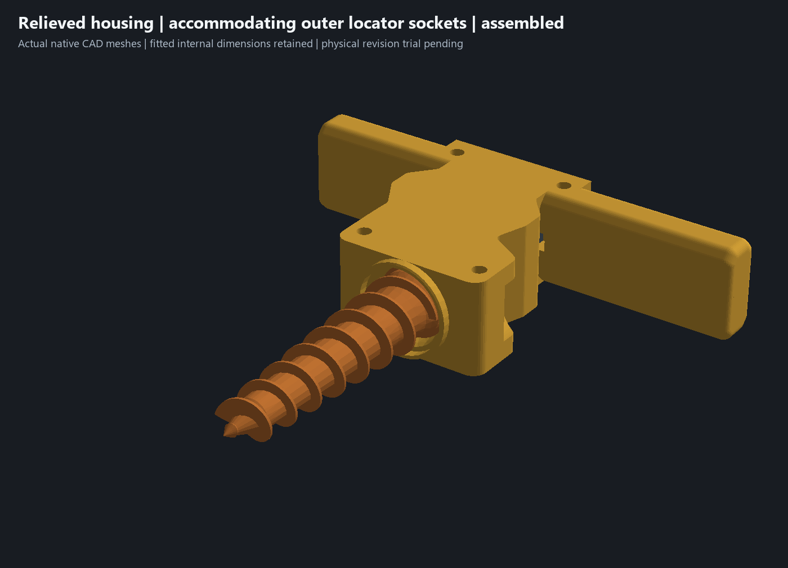
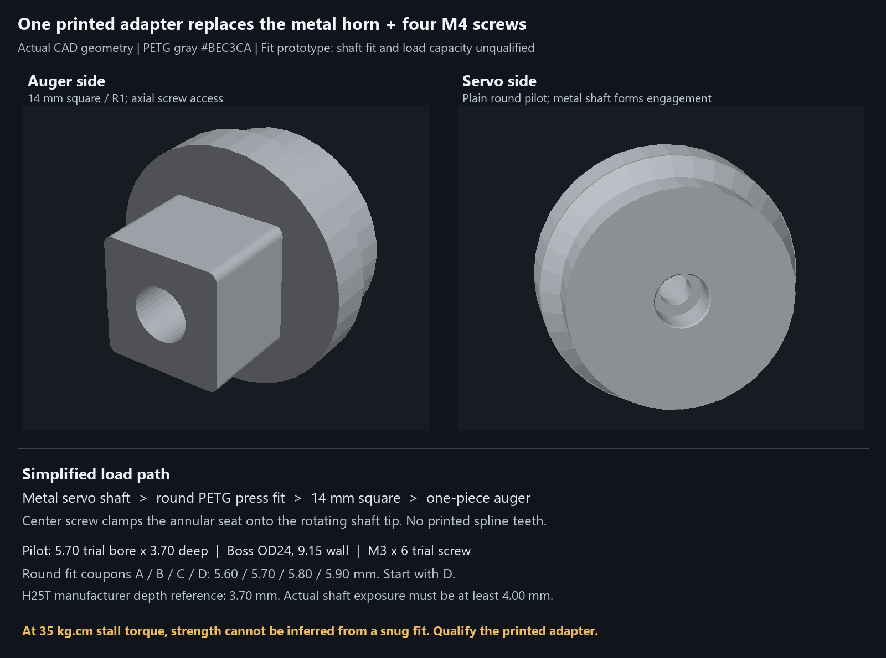
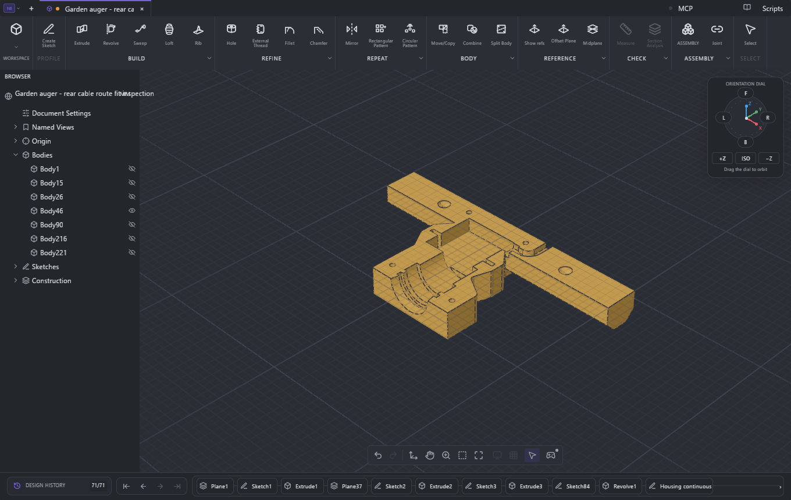
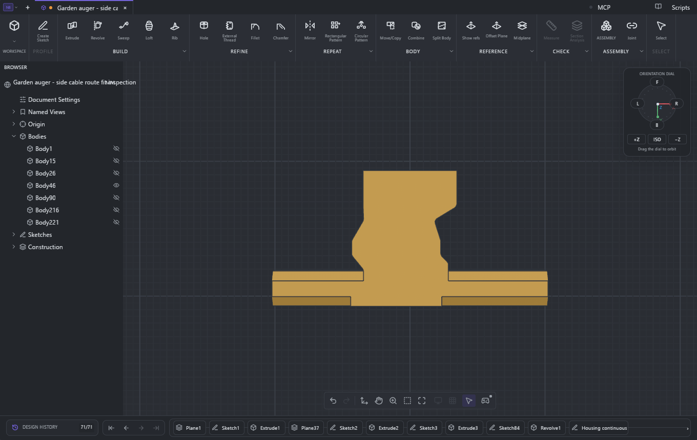
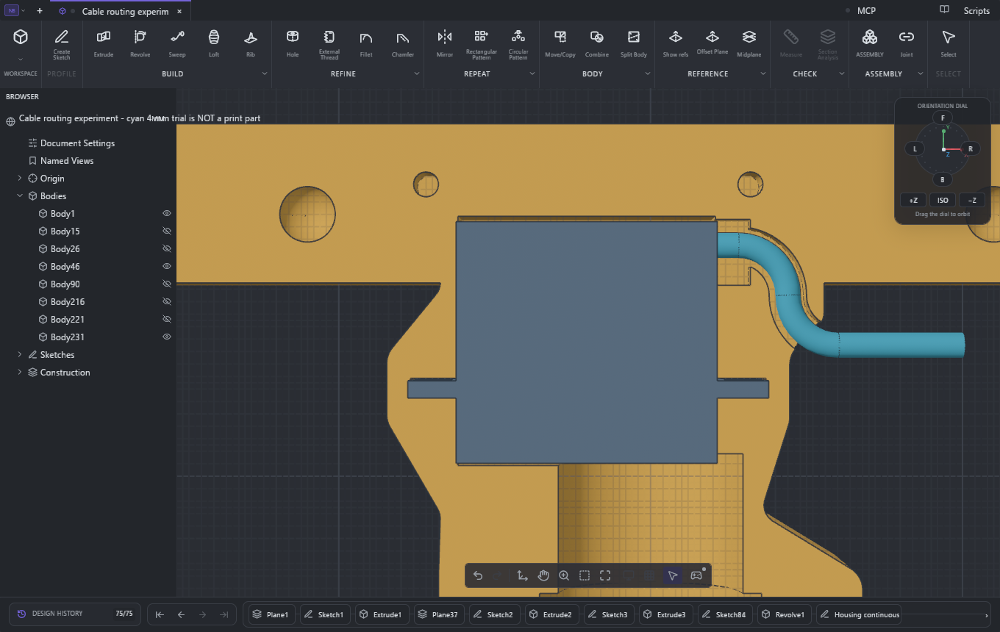
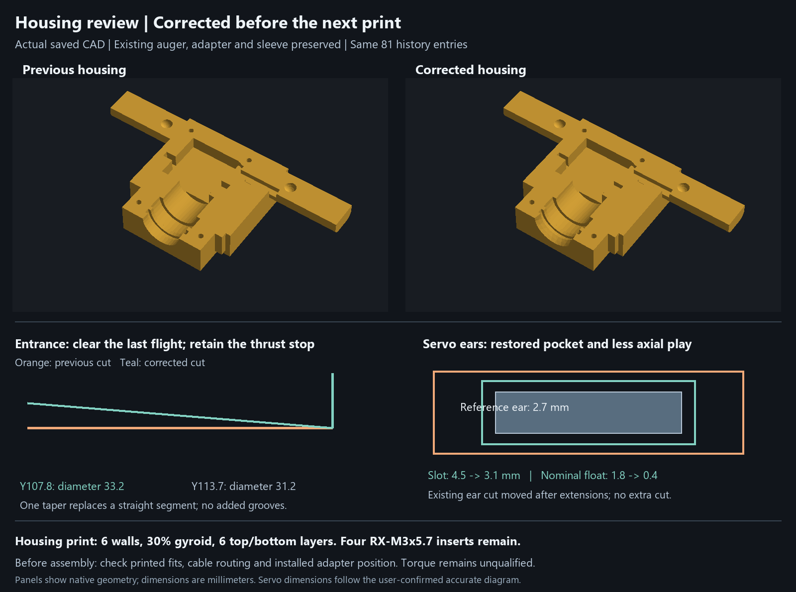
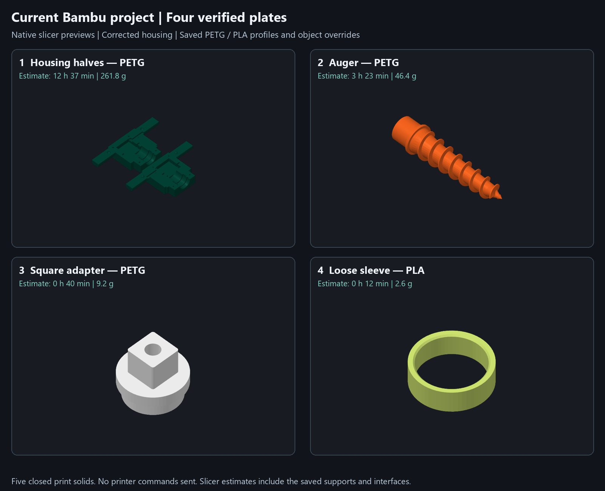

# Garden auger - current two-plate print candidate

**Print the entire current assembly:** [garden-auger-two-plate-assembly.3mf](garden-auger-two-plate-assembly.3mf) contains all five parts on **two plates**. Housing halves share plate 1 by layer; the auger, adapter and bushing print by object on plate 2, with the PLA bushing last and an explicit wait for its saved 55 C bed temperature. Both native slices pass without warnings. Estimate **about 10 hours / 272.0 g**, plus any bed-cooling wait. [Plate layout and all three geometry reviews](docs/two-plate-geometry-review.md) - [package evidence](two-plate-assembly-verification.json) - [geometry evidence](geometry-refinement-review.json) - [individual STLs](print-parts/relieved-assembly/).

The housing has modestly deeper exterior relief and accommodating outer locator sockets; the fitted servo, auger, adapter and bushing dimensions are retained. All three requested geometry areas were reviewed and native checks pass. This remains a printable candidate requiring a printed/screwed trial and dirty testing. No printer command was sent. The [previous four-plate package](garden-auger-current-assembly.3mf) preserves the preceding housing revision.

The following records preserve the earlier iteration history. Use the complete project above for the current full build; historical files named ?latest? are not current geometry.

**Replacement-bushing-only option:** [single-part PLA print project](garden-auger-pla-constraint-fit-bushing-test.3mf), [STL](print-parts/pla-constraint-fit-bushing.stl), [editable assembly](experiments/garden-auger-constraint-bushing-test.limo) and [fit review](docs/constraint-bushing-review.md). The bushing is shorter, centered in the fixed seat and chamfered at both ends. Both housing meshes and the drive parts are unchanged; replace only the bushing. Native assembly, closure, rotation and capture checks pass. Native slicing estimates11 minutes /3.1 g PLA with no supports or prime tower. Physical fit is the next check; no printer command was sent.

**Rounded housing iteration (14 October):** [rounded housing CAD](experiments/garden-auger-rounded-housing-test.limo), [ring tolerance audit and renderings](docs/rounded-housing-review.md), and matching sparse [upper](garden-auger-upper-rounded-housing-sparse-test.3mf) / [lower](garden-auger-lower-rounded-housing-sparse-test.3mf) projects. Smooth grip/front rounds and curved side relief remove more plastic while retaining fitted internals, locating features, common screw stacks and rear cable routing. The original sleeve audit is historical; use the replacement bushing linked above. Use matching rounded halves and verify printed fit.

**Earlier detail revision, physical test pending:** [editable CAD](experiments/garden-auger-clamshell-detail-test.limo), [review report and renderings](docs/clamshell-detail-review.md), and matching sparse [upper](garden-auger-upper-clamshell-detail-sparse-test.3mf) / [lower](garden-auger-lower-clamshell-detail-sparse-test.3mf) test projects. Four alternating handle locators, four identical M3 x18 screw stacks, sculpted exterior shoulders and an external auger-entry deflector preserve the fitted component geometry. Use both new halves together. The physically successful snug-nest pair below remains the fit baseline; the detail revision still needs a printed and screwed trial. No printer command was sent.

**Assembly fit passed on 8 October 2026.** The owner [reports that the fitment tests succeed and all current parts assemble together](source/references/servo-assembly-fit-feedback-20261008.json). This supersedes the earlier lower-half-only report. The original [printed-fit failure #2](https://github.com/jeffglousher/garden-auger-technic/issues/2) is resolved by this physical feedback. The first [dirty trial #3](https://github.com/jeffglousher/garden-auger-technic/issues/3) is still pending; operating performance and loaded strength remain unqualified. The CAD development hold is lifted, reconfirmed by the owner on 14 October 2026; fitted internal dimensions remain locked.

The matching [sparse upper-half project](garden-auger-upper-servo-sparse-test.3mf) comes directly from body 26 of the reviewed snug-nest CAD, with **0.28 mm layers, 0.50 mm lines, two walls, 5% rectilinear infill and three top/bottom layers**. Supports and prime tower are off; Global strength settings apply. Native CAD verifies one pocket-up upper half on its outer bed face, and native Bambu estimates **1 h 15 min /45.9 g of PETG**, with zero support toolpaths or filament changes. [Upper slice evidence](servo-upper-sparse-print-verification.json) records source/package hashes, native placement, mesh identity and preserved files. Those native reports retain their original preparation-time limitations; the later owner feedback above establishes the successful assembly fit.

The [sparse lower-half project](garden-auger-lower-servo-sparse-test.3mf) remains available with the same reviewed nest and process, previously sliced at **1 h 12 min /45.3 g**. The [stronger lower-half copy](garden-auger-lower-servo-snug-test.3mf) estimates **3 h 26 min /109.2 g**. [Lower slice evidence](servo-sparse-print-verification.json) records the CAD metadata-inspector limitation: its typed process interface rejects rectilinear despite successful native Bambu slicing. Both sparse halves inherit the saved PETG and printer profiles without conflicting object strength overrides. The saved slicer spool palette remains distinct from the preserved CAD design colors.

The successful-fit baseline [direct-drive CAD](experiments/garden-auger-servo-snug-test.limo) uses **one gray PETG adapter with a plain round press-fit pilot**, plus one factory-compatible M3 center screw. No fine spline teeth are printed. The metal shaft forms its tooth engagement in the plastic as the adapter seats. The separate horn and four M4 screws are omitted. The 14 mm square drive, 28 mm auger hub, loose teal PLA sleeve and clamshell-only retention remain.

[Current design decisions](docs/design-decisions.md) record the drawing references, caliper readings and selected construction. **Successful-fit baseline: [snug-nest CAD](experiments/garden-auger-servo-snug-test.limo), with the matching sparse halves linked above and a [stronger-profile lower-half project](garden-auger-lower-servo-snug-test.3mf).** Both housing halves in this CAD use 3.00 mm axial ear slots, 56.40 mm outer-ear capture span and 20.40 mm capture width. These target 0.30 mm total axial and 0.40 mm total lateral/capture movement around the drawing's 2.70/56.00/20.00 mm hardware dimensions. The enlarged rear bay remains at Y194.0: 28.35 mm behind the rear ear stop, leaving 1.35 mm for the measured 27 mm rear length. The revised nest reused the existing pocket cuts; no retaining hardware or geometry features were added. The auger, adapter and PLA sleeve meshes, materials and colors remain unchanged.

The [native review evidence](servo-snug-review.json) records independent measured-case/solid-ear probes, clear and blocked translation controls, angular samples, nine coupled assembly samples, 24 auger motion samples, retained native face measurements, six native sections and a valid one-half print placement. It also records native inspection and slicing of the packaged Bambu project. The follow-up corrected OPC relationship namespace spelling so the native Bambu loader accepts the file; geometry, transforms and settings were byte-identical through that repair. **Combined physical assembly fit now passes per owner.** Use matching revised halves; an old upper half retains the older clearance. Case width, ear span/thickness and shaft-relative offsets remain drawing references, not new caliper readings. The successful assembly does not confirm torque performance, actual shaft engagement or usable screw thread depth.

The production housing failed physical fit and is not the corrected test. Its files still have a 26.00 mm rear ear-stop-to-wall distance, insufficient for the measured 27 mm rear length. The owner's saved `garden-auger-lower-fit-test.3mf` template was preserved in `fb259e4`; it is historical geometry, not the corrected print candidate. Do not select by modification time or a “latest” filename. The [feedback audit](servo-fit-feedback-20261007.json) preserves the investigation before measurements arrived. `py scripts/verify_release.py` checks historical production-file integrity, not physical fit; preserve the owner's saved Bambu edits even when their hashes differ.

The owner's [caliper readings](source/references/servo-caliper-readings.json) establish **27 mm ear underside to rear case and 38 mm case plan length**. The conservative 41.3 mm case bay has 3.3 mm excess plan space, but the tighter ear stops locate the servo independently of that void. Shrinking the bay to 38 mm at an invented shaft offset would risk another fit failure. The earlier [rear-extension-only CAD](experiments/garden-auger-servo-27mm-test.limo) remains a snug-nest builder input, and the [failure regression](servo-27mm-test-verification.json) preserves useful evidence. The redundant [rear-extension print](https://github.com/jeffglousher/garden-auger-technic/blob/9f4f70ff763428d7d02fba0fde2486eeed1f74af/garden-auger-lower-servo-27mm-test.3mf) was removed from the checkout; it is recoverable from that pinned commit. The owner's saved Bambu template remains untouched.

**Next gate: [first dirty trial and detail feedback](docs/servo-fit-review.md#physical-feedback-and-next-trial).** Record operating behavior, drive retention, cable routing and part condition under actual use in [issue #3](https://github.com/jeffglousher/garden-auger-technic/issues/3). Actual shaft engagement and usable screw thread depth remain unconfirmed. The sparse profiles remain dimensional fit-test settings; the assembly result does not establish loaded strength or production readiness.

## Earlier production design and verification — historical

The following renders, print estimates and validation records describe the older production geometry. Use the snug-nest files above for the current servo fit test. The reviewed nest builder is `scripts/review_snug_servo_nest.py`; the matching upper package is prepared with `uv run --no-project --python 3.14 --with numpy --with trimesh --with manifold3d python scripts/prepare_sparse_servo_upper_test.py`. That script preserves the saved CAD and lower-half projects and slices locally without sending printer commands.

The [direct CAD tool review](docs/cad-tool-validation.md) records the live Limo CAD results and limitations. Open [garden-auger-fit-inspection.limo](garden-auger-fit-inspection.limo) for the native schema-10 inspection copy with three associative measurement sheets and an open mating-surface view. Its geometry matches the canonical print source; drawing and presentation metadata are added only to that inspection copy. The native tool confirms nominal dimensions and exact assembled clearance, while automatic GD&T stack validation, absent hardware details and physical print fit remain outside its checks.

The current exterior has a **continuous flat bed face**, with tangent blends around the servo ears. The suspended thin-floor relief and its sketch are removed. The servo floor is **10.20 mm**, the bearing floor retains **2.80 mm** nominal stock, and the selected ear-side walls measure **3.80 mm**. Overall housing depth remains **41.20 mm**, below the earlier 48 mm blank. The fixed drive axis prevents a 2.80 mm servo floor from sharing the bearing bed plane. Handles now reach the bed with **11.50 mm lands and 45-degree shoulders**, and their rear edge aligns with the body. Their assembled depth is 41.20 mm. [Native Sheet 3](renders/cad-thin-wall-dimensions.svg) measures selected current planes; the tool has no automatic global minimum-wall or GD&T checker.

The [lower-half test project](garden-auger-lower-fit-test.3mf) prints flat, pocket upward. Native Bambu estimates **3 h 26 min /109.4 g** at the saved 0.24 mm settings; both halves together use **6 h 54 min /220.0 g**. Both housing objects generate **zero support toolpaths**, including beneath the handles, and consume only PETG. Automatic supports remain enabled globally for the other parts. The lower half also generates zero supports in a separate automatic-support probe of the same geometry. The upper screw-recess roofs retain short bridges, so their printed quality needs checking on the test article. Slicer success does not certify bridging. [Native housing print evidence](housing-print-verification.json) and [CAD revision evidence](thin-housing-verification.json) retain these limits.

The rejected 2.80 mm suspended floor used 101.4 g for the lower half, including 5.61 g PLA support interface. The printable floor and thicker grips use about 8.0 g more total material; the current time and material estimates are shown above. This revision prioritizes removing support material and cleanup.

## Cable outlet and routing experiment

The servo lead now exits **completely through the rear face toward the controls**, along +Y. One tangent R8 trial turn joins the case-side boot bay to a straight rear passage centered at X28. It crosses the actual native rear face at Y206.5, offset from the mounting screw at X16/Y196.8. The previous side swoop and its exterior bulge are removed. No extra hardware or production features are added; the housing remains at 71 active entries.

The [native routing checks](cable-route-verification.json) use continuous analytic `solid_sweep` cable envelopes and exact retained-solid interference. Ø4 mm has **1.00 mm minimum housing clearance**, Ø5 mm also fits, and Ø6.2 mm is rejected. Six placement-offset trials, five lower drop-in samples and five upper closure samples pass. The planar tooling checks a fully external tail against the actual native rear-face datum; the internal passage intentionally crosses rear stock. The channel is 6 ×8 mm with an **8 mm trial centerline bend radius**.

Open the [separate native CAD experiment](experiments/cable-routing-trial.limo) to see the cyan virtual Ø4 cable. It is **not a print part**. Run `uv run --no-project --python 3.14 --with shapely==2.1.2 python scripts/check_cable_route.py --inspection-project "<absolute repository path>/experiments/cable-routing-trial.limo"` to regenerate it. The [experiment notes](docs/cable-routing-experiment.md) distinguish native 3D checks from the new Shapely/GEOS planar tooling and record remaining limits.

The old straight channel stopped inside a handle, and a later pad join partly refilled its boot bay. The failed native control remains in the report; the existing cable cut now runs after all joins. Boot dimensions, bundle size, exact seam entry and acceptable bend radius are not dimensioned in the servo drawing. The trial allowances need a physical fit check. The channel provides clearance; it does not clamp the cable or qualify strain relief, fatigue or tug resistance. The JR connector remains outside during clamshell assembly.

## Housing corrected after the physical fit test

The earlier preprint review found **last-flight interference at the permitted 0.50 mm shaft offset**, after radial checks had omitted the flight body. The consistency audit subsequently found that its 33.2 mm entrance was checked at ±0.30 mm nominal axial travel while the tolerance notes allowed ±0.50 mm. A conservative native CAD envelope left **0.149 mm**, below the existing 0.20 mm review target. The existing shared revolve now has **one entrance taper, diameter 33.6 at Y107.8 to diameter 31.2 at Y113.7**. The collar opening and both thrust stops stay unchanged. The [component review](preprint-review.json) separates nominal poses, native tolerance-envelope samples, full coupled assembly poses and a separately derived screening bound.

The physical fit test exposed a **2.70 mm ear-datum error in both the reference servo and housing**: the diagram's **24.70 mm** starts at the ear underside, but the model used the opposite face. A real servo seated in the old pockets extended **1.20 mm beyond the rear cavity**. The corrected ear pockets are **Y162.6–165.7**, 3.10 mm around the 2.70 mm ear, with 0.40 mm nominal total play. The **41.30 by 20.80 mm case pocket** clears the larger **40.50 by 20.00 mm** catalog envelope with 0.40 mm on each side. Case cavity Y151.7–191.7 leaves **1.50 mm nominal rear room** at the corrected seat. Reference mounting centers are corrected from 52 to **49 mm**. See the [full fit correction report](docs/servo-fit-review.md) and [independent drawing-envelope regression](servo-fit-verification.json).

Both collar stop planes remain at Y113.7 /117.3, giving **0.60 mm nominal auger end float**. Sleeve stops remain at Y120.3 /131.2, giving **0.50 mm nominal sleeve end float**. The rear journal/adapter chamber remains diameter 29.6, with its endpoint extended 0.60 mm to **Y153.6** for the full installed-position stack. The **6 mm wide ×8 mm high open cable channel** follows one tangent R8 trial turn to the rear face toward the controls; keep the JR connector outside. Its boot envelope is not dimensioned in the supplied drawing. Locating features, M3 screw seats and **four ruthex RX-M3x5.7 insert pilots, diameter 4.00 by 6.70 deep**, remain.

Only the two housing STLs changed in the earlier fit correction. **The auger, adapter, sleeve and four fit-coupon STLs remained byte-identical** to the preceding release at `6816a19`. That historical housing still failed physical fit; the later snug-nest revision at the top of this README now assembles successfully per owner. Removing the floor-relief sketch and cut left **71 active entries**, down from 73 in the rejected thin-floor release. The historical saved housing objects use **six walls, 30% gyroid infill and six top/bottom layers**. The auger profile uses **six walls, 40% gyroid and six top/bottom layers** for future prints; saved settings do not alter a previously started print. Materials, colors, the adapter's six-wall/100% infill and saved global PETG/PLA support settings are retained. Only the two housing objects disable support generation.

The [nesting verification](housing-nesting-verification.json) and [adapter clearance check](adapter-housing-verification.json) reference the current saved CAD. The historical geometry-preserving comparison at `50f789b` remains in [housing-simplification-verification.json](housing-simplification-verification.json); subsequent cavity revisions intentionally change the housing geometry.

## Research and design choice

[Firsthand builders](https://www.reddit.com/r/3Dprinting/comments/pm04eb) report using a slightly undersized round hole instead of printing miniature spline teeth; another [PETG/FDM discussion](https://www.reddit.com/r/robotics/comments/sh8ooa) recommends the same approach. These are maker reports, not a 35 kg·cm qualification. A [primary Botball study](https://ecer.pria.at/archive/ecer-2026/papers/Replacing_Botball_Kit_Parts_with_3D_Prints.pdf) reports that a PLA horn could not reproduce the fine shaft engagement and failed to transmit torque. Its material and servo differ from ours.

For the requested one-part PETG approach, use a **calibrated round pilot, tooth engagement formed by the metal shaft, and the center retaining screw**. This avoids estimating or printing another manufacturer's 25T profile. Friction and tooth indentation work together; the screw supplies axial retention. The former metal-horn fallback is recoverable from Git history. The printed approach has not been qualified at this servo's stall torque.

[INJORA](https://www.injora.com/products/injora-injs035-360-35kg-waterproof-digital-servo-360-steering-winch-wheel-for-rc) specifies a Ø5.9 /25T output, 35 kg·cm stall at 6 V, and an M3 spool screw. Its dimensions image shows overall 41.5 mm and case 37.5 mm, implying a nominal 4.0 mm tip-to-case-face difference. It does not separately dimension exposed spline length, stationary nose geometry, usable thread depth or factory center-screw length. The user confirms the supplied dimensioned diagram is accurate; it is the dimensional authority for the housing and the shown shaft/case stack. The internal shaft thread depth is not shown.

## Press-fit pilot and positive seating

The revised pilot is **Ø5.70 ×3.70 deep**, with a 0.15 mm entry chamfer and **3.55 mm straight portion**. Depth follows [Hitec's H25T horn/spline technical data](https://shop.multiplex-rc.de/userdata/files/HITEC%20SERVO%20ACTUATOR%20HORN%20%26%20SPLINE%20TECHNICAL%20DATA%20SHEET_v3_0_1_26C.pdf), printed page 75, which specifies 3.7 mm horn depth for its standard nominal Ø6 /25T family. This is a manufacturer family reference, not a universal tolerance standard or a published INJORA axial dimension. It replaces the former 1.70 mm shallow pilot.

Ø5.70 remains a trial diameter for the INJORA Ø5.9 shaft. The updated [PETG fit coupons](garden-auger-press-fit.3mf) match the **3.70 mm depth, Ø24 boss and 2.60 mm seating web**: **A=5.60, B=5.70, C=5.80, D=5.90 mm**. Start with D, the largest bore, and select the fit that seats snugly without splitting, rocking or excessive force. Inspect the metal teeth's impression. Do not pull an over-tight pilot on with the center screw. Set `PILOT_DIAMETER` in `scripts/direct_drive_parameters.py` to the physically selected size before the final adapter print.

**The rotating shaft tip seats positively on the annular bore floor** around the center passage at Y148.70. The deeper boss ends at Y152.40; the nominal case face is Y152.70, giving **0.30 mm nominal case-face clearance**. The user's confirmed diagram gives **4.00 mm nominal tip-to-case-face distance**. With a 3.70 +/-0.10 mm printed socket, that leaves **at least 0.20 mm case-face clearance**. The drawing controls the nominal hardware stack; inspect the printed socket and confirm seating during assembly. The omitted old 2 mm nose was an unsupported reference detail.

The adapter has a **Ø24 boss**, enlarged from Ø16, with a broad 2 mm axial/radial taper into the Ø28 ×5 flange. Plastic wall is **9.15 mm radially along the straight bore**, 9.00 mm at the entry chamfer (8.90 mm minimum under the stated ±0.10 diameter limits). The annular seat-to-screw-seat web stays **2.60 mm**; **Ø4.00 ×0.30 underhead relief** clears the screw neck. The rear chassis chamber stays Ø29.6. The current servo fit correction preserves the adapter, auger and sleeve; use both corrected housing halves described above.

The [adapter-to-housing recheck](adapter-housing-verification.json) uses the saved native assembly, including both housing halves. The Ø29.6 chamber leaves **2.80 mm nominal radial boss clearance**, **0.80 mm nominal radial flange clearance**, and **1.20 mm nominal clearance behind the adapter**. With ±0.10 mm critical printed dimensions, ±0.50 mm installed axial allowance and at most 0.50 mm radial axis offset, the conditional minima are **2.20, 0.20 and 0.50 mm**, respectively. These housing gaps do not certify relative square alignment. The nominal servo stack follows the confirmed diagram; inspect printed seating during assembly.

## Center screw verification

Use an **M3 ×6 full-thread center screw as the nominal trial**, length measured under the head. The [M3 screw envelope](https://in.misumi-ec.com/vona2/detail/110310861029/?HissuCode=E-BOX-GSCB3-10) has a Ø5.5 ×3.0 head and 2.5 mm hex. Inspect factory thread/pitch compatibility and the actual dimensions; do not assume the supplied INJORA screw is 6 mm long.

- Screw head access: **Ø6.40**, giving 0.45 mm nominal radial head room, at least 0.40 mm with the ±0.10 printed diameter allowance.
- Screw passage: **Ø3.40**, giving 0.20 mm nominal radial shaft room, at least 0.15 mm with that printed allowance.
- Underhead-seat to shaft-tip seat: **2.60 mm nominal; required measured range 2.40–2.80 mm**.
- A 6.00 mm screw inserts **3.40 mm nominally**. With an inspected 5.90–6.10 mm screw and the seat limits above, insertion is **3.10–3.70 mm**.
- Require the actual shaft's safe usable axial hole depth to be **at least 4.00 mm from its tip face**. That gives 0.60 mm nominal bottom room, **at least 0.30 mm** at the stated extremes. This is an incoming inspection requirement, not a published INJORA dimension. Check full-thread engagement separately; entry chamfers and screw tip lead are not full threads.

The actual adapter mesh has an open axial passage and a measured 2.60 mm annular-seat stack. A temporary native CAD M3×6 envelope, including a conservative neck transition, has **zero overlap with all printed parts**. The temporary screw is not saved as an extra assembly/print body. The servo reference omits its internal threaded cavity, so this check cannot prove the real thread bottom. **CAD printed-part clearance is confirmed; physical screw bottoming and thread engagement remain conditional on inspection.**

[Native CAD screw section and conditional stack](renders/direct-drive-screw-check.png).

After seating, inspect the auger-facing adapter flange **27.40 ±0.50 mm behind the actual front chassis thrust-stop face**, with its drive axis within 0.50 mm radial of the assembled journal axis. The conservative axial budget includes 0.20 mm ear-face gap, 0.10 mm ear-stop extrema, 0.10 mm adapter seat-to-flange extrema and 0.10 mm transfer to the printed front thrust face. Nominal world Y coordinates are model locations, not a physical inspection datum. The square must align with the adapter over its engagement length; common housing-axis offset is a separate quantity. The square engagement/bottom-gap limits below require these installed limits and the critical printed sizes.

## Current files and materials

**Historical complete slicer project: [garden-auger-bambu-latest.3mf](garden-auger-bambu-latest.3mf).** Its housing geometry failed fit; the current assembly uses the reviewed snug-nest geometry linked at the top of this README. This earlier project places five direct-drive solids on four named plates: PETG housing halves, PETG auger, PETG adapter, and PLA sleeve. Each plate contains one printed-part filament; the saved PLA support-interface setting can add PLA to the PETG plates. The saved purge tower remains enabled; its position on the housing plate moves to X180/Y142 to clear the parts. The shared housing plate prints by layer to avoid the sequential-print gantry collision warning. Housing halves rest on their outside faces, the auger lies horizontally, and the adapter and sleeve stand upright. All five parts sit at Z0 within their assigned beds, with clearance between the housing halves.

The latest native Bambu project preserves the saved X2D 0.4 mm printer, saved 0.24 mm Standard process, automatic tree supports with PLA interfaces, and Bambu PETG Basic / PLA Glow profiles. The housing halves have explicit **six-wall, 30% gyroid infill and six top/bottom-layer overrides**. The future auger profile uses **six walls, 40% gyroid and six top/bottom layers**. The adapter has an explicit **six-wall, 100% infill override** for the enlarged boss and seating web. Saved spool colors remain dark green #034638, orange #FF671F, white #FFFFFF, and light green #DCF478. The CAD/export palette below remains the design reference. [Bambu layout verification](bambu-latest-verification.json) checks five closed connected solids against the canonical geometry, confirms all parts lie on their assigned beds, and records the latest file hash. The saved project contains no G-code. [Native slice verification](bambu-slice-verification.json) confirms all four plates generate G-code locally with no model outside the bed. The stronger housing plate estimates **6 h 54 min /220.0 g**; these are slicer estimates. Neither dimensions nor infill establish a measured stall-torque rating.

Current adapter geometry: [native CAD revision views](renders/cad-depth/adapter-revision.png), [square end](renders/cad-depth/adapter-front.png), [servo end](renders/cad-depth/adapter-rear.png), [axial half-section](renders/cad-depth/adapter-section.jpg), and [capture provenance](renders/cad-depth/provenance.json). The [dimensioned mating ends](renders/direct-drive-adapter.png) and [3.70 mm socket/screw stack](renders/direct-drive-screw-check.png) are rendered from native geometry. The current [housing comparison](renders/clamshell-nested.png) shows the simpler collar and sleeve seats. The current assembled square keeps 10.00 mm nominal engagement, 2.00 mm peg-tip clearance and 1.60 mm hub-to-flange clearance.

[Five-part 3MF](garden-auger-direct-drive.3mf), [single-adapter 3MF](garden-auger-direct-adapter.3mf), [press-fit coupon CAD](garden-auger-press-fit.nbcad), [individual STLs](print-parts/direct-drive), [all parts](renders/direct-drive-all-parts.png), [exploded assembly](renders/direct-drive-exploded.png), and [dimension/verification report](direct-drive-verification.json).

The [assembly GIF](renders/cad-assembly-animation.gif) shows the five printed parts and servo coming together using actual native CAD viewport captures. The separate [native assembly review](experiments/garden-auger-assembly-review.limo) contains saved exploded, open-housing and assembled views; [interior still](renders/cad-assembly-open.png), [exploded still](renders/cad-assembly-exploded.png) and [closed still](renders/cad-assembly-assembled.png) are also available. Display offsets illustrate component relationships; this is not a joint-driven motion or collision validation. GIF encoding occurs outside CAD. [Presentation verification](assembly-presentation-verification.json) checks native poses at every frame and confirms the mechanical model, materials, authored placements and production source files remain unchanged.

The [experiment issue index](experiments/upstream-issue-index.json) links the CAD feature requests, observed bugs and local slicer-settings preservation issue. These are filed as deferred work: keep evidence committed and pushed, use issues rather than experiment PRs, and wait for owner-confirmed Bevy finalization before implementation. See [current decision records](docs/design-decisions.md) for the gate and upstream links.

Materials/colors are explicit: chassis PETG yellow #E5AE3C, auger PETG orange #D57E37, adapter PETG gray #BEC3CA, sleeve PLA teal #37AAA1. Native checks cover nominal assembly, both ±0.30 mm travel limits, common 45°/90° rotation and chassis-blocked overtravel at ±0.31 mm. Print parts must be closed and connected and fit the 256 mm bed. Actual press fit, torque, stall behavior and PETG creep remain unqualified.

The [cleanup record](release-cleanup.json) preserves earlier purges and the 8 October 2026 cleanup: the superseded rear-extension print and abandoned metal-horn STEP/PDF are removed, with exact hashes and recovery at `9f4f70f`. The current snug-nest CAD, both sparse halves, stronger lower copy, caliper/drawing references, original auger sources and native failure evidence remain. Historical CAD and slicer files that still support builders, inspection evidence or saved user settings also remain. Rebuilding the historical direct-drive pipeline does not generate the reviewed snug-nest candidate.

Regenerate only when changing the design; cleanup does not require a new print. Run in order: `scripts/build_direct_drive.py`, `scripts/direct_drive_coupons.py`, `scripts/check_direct_screw.py`, `scripts/desktop_export.py --reader "<schema-7 desktop executable>"`, `scripts/pack_direct_drive.py`, `scripts/check_adapter_housing.py`, then `scripts/record_nesting_release.py`, `scripts/check_preprint.py`, `scripts/check_servo_fit.py` and `scripts/check_thin_housing.py`. The last check constructs an independent solid probe directly from the drawing and reproduces the previous failure before checking the correction. The desktop check requires an explicit reader and runs in an isolated headless process. Mesh checks require numpy/trimesh; packaging also requires manifold3d. On this machine use `uv run --no-project --python 3.14 --with numpy --with trimesh --with manifold3d python <script>`.

Render with `scripts/render_direct_drive.py`, `scripts/render_screw_check.py`, `scripts/render_nested_housing.py` and `scripts/render_preprint.py` (Pillow). Build the historical complete slicer file with `scripts/prepare_bambu_latest.py`, run `scripts/check_bambu_slice.py` to slice all plates locally and refresh native previews, run `scripts/prepare_lower_fit_test.py` and `scripts/check_housing_print.py` for its historical one-half test and automatic-support probe, then use preparation's `--verify-only` to record the final hash. No printer commands are sent. `scripts/servo_dimensions.py` records the drawing datums; `scripts/design_parameters.py` contains common dimensions and the conservative square stack; `scripts/direct_drive_parameters.py` contains the pilot and screw inspection limits. These historical rebuilds preserve saved printer, filament and process profiles. The [servo diagram and Hitec reference](source/references/provenance.json) are preserved locally. Original auger construction sources and needed supplier evidence remain under `source/`; the abandoned metal-horn files are recoverable from Git history.

## Mating dimensions and acceptance limits

All dimensions are millimeters. These are required acceptance limits, not measured printer capability or native GD&T certification. Critical printed diameters and axial extrema require ±0.10 mm acceptance; the collar/sleeve length and capture-span controls below also apply. Basic square surfaces use a 0.10 mm total profile zone, including size, form and location. The quoted flat gap assumes aligned mating datums and does not include arbitrary relative offset or tilt. Inspect functional face extrema and the installed flange from the actual thrust face. Installed axial allowance is ±0.50 mm and common radial axis offset is at most 0.50 mm.

- Collar 3.00 ±0.10 in a 3.60 ±0.10 capture span: **0.40–0.80 mm total end float**. Both chassis faces retain the integral collar.
- PLA sleeve 10.40 ±0.10 long in a 10.90 ±0.10 seat: **0.30–0.70 mm total end float**. The sleeve remains loose.
- Square peg 14 BASIC /R1 BASIC, 11.6 long; socket 14.4 BASIC /R1.2 BASIC, 12 deep. Square flat clearance is **at least 0.10 mm per side** under the stated profile controls.
- Square engagement: **8.80–11.20 mm**. Peg-tip clearance is **at least 0.80 mm** and hub-to-flange gap is **at least 0.50 mm** under the printed and installed acceptance limits. The conservative stack derives ±0.50 mm auger motion extrema, ±0.60 mm socket-face location allowance and ±0.60 mm peg-tip location allowance. These are separately derived bounds.
- Ø28 journal, sleeve bore Ø28.6 /OD34, sleeve pocket Ø35.6: **at least 0.90 mm combined radial float**. The rear Ø29.6 journal/adapter chamber preserves **at least 0.20 mm radial room at the permitted axis offset**.

The collar-root fillets and square socket radii stay in the auger. Finish mating surfaces as needed and check free rotation, positive end float, installed flange position and alignment before a loaded trial.

## Heat-set inserts and chassis screws

Use **four brass ruthex RX-M3x5.7 inserts**, Ø4.6 ×5.7, M3 thread. Lower housing pilots are **Ø4.00 ×6.70 deep**. Inspect printed hole size and a depth of at least the actual insert length +1 mm; install flush with the split face. Checked surrounding wall is **at least 3.07 mm after dimensional allowance**. The cable cut runs after the rear pad joins so they cannot refill its boot bay. The nearest rear insert retains 3.07 mm sampled wall after the stated allowance.

Upper screw passages are Ø3.4 with Ø6.2 head recesses. Use **two M3 ×12 front** and **two M3 ×18 rear ISO4762 screws**. Nominal insert engagement is 4.0 /5.3 mm. All passages and insert mouths are checked open. The adapter uses its separate factory-compatible M3 center screw as described above.

[ruthex datasheet](https://www.igo3d.com/mediafiles/Sonstiges/Ruthex/ruthex_Datenblatt_RX-Serie.pdf), [specified insert](https://www.ruthex.de/products/ruthex-gewindeeinsatz-m3-100-stuck-rx-m3x5-7-messing-gewindebuchsen).

## Printing and assembly

The complete Bambu project has four plates grouped by model filament, the saved purge tower enabled, and housing halves printed by layer with six walls, 30% gyroid and six top/bottom layers. The latest saved 0.24 mm process enables automatic tree supports with PLA interfaces at zero top Z gap; the horizontal auger needs support under its flights and underside. The adapter has six walls and 100% infill. STL files do not store materials or colors.

1. Print and measure the PETG pilot coupons. Select the snug fit that seats without splitting, rocking or excessive force; update the final adapter pilot if needed.
2. Install the four heat-set inserts in the lower housing and let it cool.
3. Seat the adapter directly on the servo shaft. Inspect shaft-tip contact, stationary clearance and screw depth; install the compatible center screw before mating the auger.
4. Slide the full PLA sleeve over the auger journal from its drive end. Engage the square adapter first, then nest the servo, sleeve and integral collar in the lower housing. Let the auger and sleeve follow the servo drive axis; do not independently force the auger onto the housing centerline. Confirm the square slides axially without binding.
5. Lay the cable in the curved split-seam channel and out through the rear face toward the controls, keeping the connector outside. Check the actual boot, bundle fit and comfortable bend before closing; do not crush the cable.
6. Close the upper housing with the two front and two rear M3 screws. Confirm free rotation, collar/sleeve end float and installed drive-axis alignment.

The clamshell retains the auger and loose sleeve. No retaining clip, ring lock, separate horn or four M4 horn screws are required.

## Abe's Home Assistant controls

The deployed [ESP32-S3 configuration](controls/esphome/lonelybinary.yaml) includes
the [learning-bench package](controls/esphome/common/lonelybinary-learning-bench.yaml).
The [Abe dashboard export](controls/home-assistant/abe.json) is a Home Assistant
storage-dashboard configuration for `lovelace-abe`; save it through the Lovelace
WebSocket API or dashboard editor rather than editing `.storage` files.

PCA9685 **CH0** follows the potentiometer, **CH1** is a system-controlled position
servo, and **CH2** is the continuous-rotation auger. **CH3** remains available for
a second continuous motor. The auger has Reverse, Stop, Forward and speed controls.
The direction buttons request -50% and +50%; 0% stops. Nonzero continuous commands
keep PWM attached. Boot, disabling servo commands, releasing all outputs, and
loss of all API connections clear the continuous commands. Enabling commands does
not restart them. The existing position servos retain their timed release behavior.

Keep `wifi_ssid`, `wifi_password`, `lonelybinary_api_key` and
`lonelybinary_fallback_password` in the local, ignored `secrets.yaml`. The exported
configuration references those secrets; no live credentials are included here.
The controller uses GPIO8/GPIO9 for I2C and address 0x40. Its servo V+ supply is
separate from the 3.3 V logic supply and shares ground; USB logic power alone is
insufficient for the servos. Power off before moving or reseating cables.

Validation on 9 October 2026: ESPHome 2026.9.1 compiled and uploaded this package;
all dashboard entities were available, and live button commands reached CH2.
Controller-register readback showed approximately 2001 microseconds at +50%,
1000 microseconds at -50%, and PWM off at Stop, with a nominal 50 Hz frequency.
The `Auger output status` diagnostic reports controller-register settings, not
measured terminal voltage, servo speed or physical rotation. The owner identified
and repaired a loose shared servo-power wire after reporting that no servos moved.
This check does not qualify loaded auger performance or mechanical strength.
