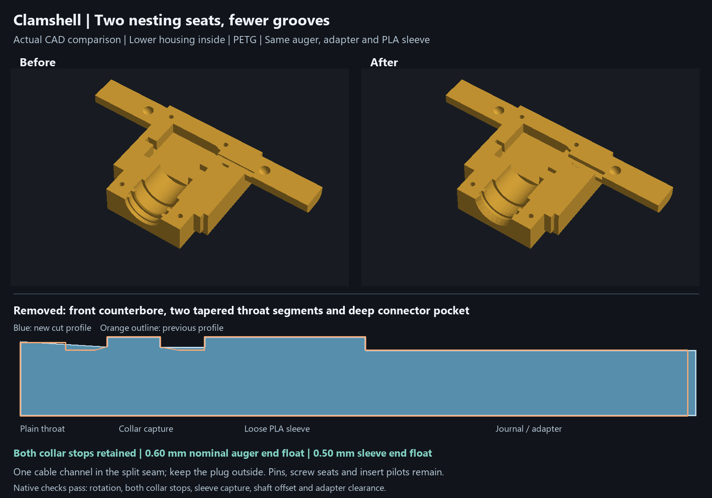

# Garden auger — current direct-drive print release

The current [direct-drive CAD](garden-auger-direct-drive.nbcad) uses **one gray PETG adapter with a plain round press-fit pilot**, plus one factory-compatible M3 center screw. No fine spline teeth are printed. The metal shaft forms its tooth engagement in the plastic as the adapter seats. The separate horn and four M4 screws are omitted. The 14 mm square drive, 28 mm auger hub, loose teal PLA sleeve and clamshell-only retention remain.

## Simplified clamshell and nesting seats

The current direct-drive housing removes the **separate front-entry counterbore, two tapered throat transitions, and oversized internal connector pocket**. A single shared revolve creates plain cylindrical throats and the **two required enlarged seats**: one captures the integral auger collar between both chassis stops; the other seats the loose full PLA sleeve. The housing does not need to reproduce the auger's collar-root fillets. The unchanged auger retains those strength features.

Both collar stop planes remain at Y113.7 /117.3, giving **0.60 mm nominal auger end float**. The sleeve stops remain at Y120.3 /131.2, giving **0.50 mm nominal sleeve end float**. The rear journal/adapter chamber remains Ø29.6. Servo case/ear pockets, clamshell locating features, M3 screw seats and heat-set insert pilots remain. One **8 mm high open cable channel** replaces the tall connector bay; lay the cable in the split seam and leave the JR connector outside. Its short case-side boot allowance is a design envelope, not a supplier-dimensioned or physically verified fit.

The [nesting verification](housing-nesting-verification.json) ties the saved CAD to native checks for rotation, both collar stops, sleeve retention and ±0.50 mm shaft offset. The [adapter clearance check](adapter-housing-verification.json) passes with the new housing. **Only the two housing STLs change**; auger, adapter, sleeve and fit-coupon STLs remain byte-identical. Earlier housings remain compatible with those parts. Use the updated housing files for the simpler cavities; actual printing progress is unknown. The current complete Bambu project contains both updated halves with the saved materials, colors and process settings.

Housing history now uses **47 entries instead of the original 81**, with **25 solid operations instead of 41**. The complete direct-drive history has **81 active entries instead of 115**. Three overlapping housing blanks become one stepped-footprint extrusion, one revolve serves both halves, and one wire cut serves both halves. Repeated cuts, filled-back cuts, duplicate planes and unused sketches are removed.

The preceding history-only refactor at commit `50f789b` reduced the housing to 49 entries /26 solid operations without changing its finished geometry. Its [exact boolean comparison](housing-simplification-verification.json) remains pinned to that revision. The current nesting revision intentionally changes the housing cavities. `scripts/build_direct_drive.py` applies and verifies both stages; `scripts/render_nested_housing.py` renders the saved current CAD against the pinned preceding revision. [Current render provenance](renders/clamshell-nested-provenance.json).

## Research and design choice

[Firsthand builders](https://www.reddit.com/r/3Dprinting/comments/pm04eb) report using a slightly undersized round hole instead of printing miniature spline teeth; another [PETG/FDM discussion](https://www.reddit.com/r/robotics/comments/sh8ooa) recommends the same approach. These are maker reports, not a 35 kg·cm qualification. A [primary Botball study](https://ecer.pria.at/archive/ecer-2026/papers/Replacing_Botball_Kit_Parts_with_3D_Prints.pdf) reports that a PLA horn could not reproduce the fine shaft engagement and failed to transmit torque. Its material and servo differ from ours.

For the requested one-part PETG approach, use a **calibrated round pilot, tooth engagement formed by the metal shaft, and the center retaining screw**. This avoids estimating or printing another manufacturer's 25T profile. Friction and tooth indentation work together; the screw supplies axial retention. The former metal-horn fallback is recoverable from Git history. The printed approach has not been qualified at this servo's stall torque.

[INJORA](https://www.injora.com/products/injora-injs035-360-35kg-waterproof-digital-servo-360-steering-winch-wheel-for-rc) specifies a Ø5.9 /25T output, 35 kg·cm stall at 6 V, and an M3 spool screw. Its dimensions image shows overall 41.5 mm and case 37.5 mm, implying a nominal 4.0 mm tip-to-case-face difference. It does not separately dimension exposed spline length, stationary nose geometry, usable thread depth or factory center-screw length. The local servo is therefore a reference, not a complete supplier shaft drawing.

## Press-fit pilot and positive seating

The revised pilot is **Ø5.70 ×3.70 deep**, with a 0.15 mm entry chamfer and **3.55 mm straight portion**. Depth follows [Hitec's H25T horn/spline technical data](https://shop.multiplex-rc.de/userdata/files/HITEC%20SERVO%20ACTUATOR%20HORN%20%26%20SPLINE%20TECHNICAL%20DATA%20SHEET_v3_0_1_26C.pdf), printed page 75, which specifies 3.7 mm horn depth for its standard nominal Ø6 /25T family. This is a manufacturer family reference, not a universal tolerance standard or a published INJORA axial dimension. It replaces the former 1.70 mm shallow pilot.

Ø5.70 remains a trial diameter for the INJORA Ø5.9 shaft. The updated [PETG fit coupons](garden-auger-press-fit.3mf) match the **3.70 mm depth, Ø24 boss and 2.60 mm seating web**: **A=5.60, B=5.70, C=5.80, D=5.90 mm**. Start with D, the largest bore, and select the fit that seats snugly without splitting, rocking or excessive force. Inspect the metal teeth's impression. Do not pull an over-tight pilot on with the center screw. Set `PILOT_DIAMETER` in `scripts/direct_drive_parameters.py` to the physically selected size before the final adapter print.

**The rotating shaft tip seats positively on the annular bore floor** around the center passage at Y148.70. The deeper boss ends at Y152.40; the nominal case face is Y152.70, giving **0.30 mm nominal case-face clearance**. The old reference's unmeasured 2 mm stationary nose has been omitted from the active case reference; removing that unsupported model detail does not prove physical clearance. Require **at least 4.00 mm actual exposure from the shaft tip to the nearest stationary nose/case surface**, measured around the entire Ø24 boss footprint. This accommodates a 3.70 ±0.10 mm socket and at least 0.20 mm stationary clearance. The actual shaft/nose must pass this check before use; INJORA does not publish that axial interface.

The adapter has a **Ø24 boss**, enlarged from Ø16, with a broad 2 mm axial/radial taper into the Ø28 ×5 flange. Plastic wall is **9.15 mm radially along the straight bore**, 9.00 mm at the entry chamfer (8.90 mm minimum under the stated ±0.10 diameter limits). The annular seat-to-screw-seat web stays **2.60 mm**; **Ø4.00 ×0.30 underhead relief** clears the screw neck. The rear chassis chamber stays Ø29.6. The adapter-depth revision changed only the adapter; an earlier printed auger, sleeve and housing remain compatible. The subsequent nesting revision above updates the housing cavities for simplicity, without changing the adapter, auger or sleeve.

The [adapter-to-housing recheck](adapter-housing-verification.json) uses the saved native assembly, including both housing halves. The existing Ø29.6 chamber leaves **2.80 mm nominal radial boss clearance**, **0.80 mm nominal radial flange clearance**, and **0.60 mm nominal clearance behind the adapter**. With ±0.10 mm critical printed dimensions, ±0.15 mm installed axial position and at most 0.50 mm radial axis offset, the conditional minima are **2.20, 0.20 and 0.25 mm**, respectively. The housing does not need resizing for this adapter revision. This describes file compatibility; the user's progress printing individual parts is unknown. Actual servo shaft/nose clearance remains a separate physical inspection.

## Center screw verification

Use an **M3 ×6 full-thread center screw as the nominal trial**, length measured under the head. The [M3 screw envelope](https://in.misumi-ec.com/vona2/detail/110310861029/?HissuCode=E-BOX-GSCB3-10) has a Ø5.5 ×3.0 head and 2.5 mm hex. Inspect factory thread/pitch compatibility and the actual dimensions; do not assume the supplied INJORA screw is 6 mm long.

- Screw head access: **Ø6.40**, giving 0.45 mm nominal radial head room, at least 0.40 mm with the ±0.10 printed diameter allowance.
- Screw passage: **Ø3.40**, giving 0.20 mm nominal radial shaft room, at least 0.15 mm with that printed allowance.
- Underhead-seat to shaft-tip seat: **2.60 mm nominal; required measured range 2.40–2.80 mm**.
- A 6.00 mm screw inserts **3.40 mm nominally**. With an inspected 5.90–6.10 mm screw and the seat limits above, insertion is **3.10–3.70 mm**.
- Require the actual shaft's safe usable axial hole depth to be **at least 4.00 mm from its tip face**. That gives 0.60 mm nominal bottom room, **at least 0.30 mm** at the stated extremes. This is an incoming inspection requirement, not a published INJORA dimension. Check full-thread engagement separately; entry chamfers and screw tip lead are not full threads.

The actual adapter mesh has an open axial passage and a measured 2.60 mm annular-seat stack. A temporary native CAD M3×6 envelope, including a conservative neck transition, has **zero overlap with all printed parts**. The temporary screw is not saved as an extra assembly/print body. The servo reference omits its internal threaded cavity, so this check cannot prove the real thread bottom. **CAD printed-part clearance is confirmed; physical screw bottoming and thread engagement remain conditional on inspection.**

[Native CAD screw section and conditional stack](renders/direct-drive-screw-check.png).

After seating, the auger-facing adapter flange must lie **27.40 ±0.15 mm behind the front chassis thrust-stop face**, and its drive axis must be within 0.50 mm radial of the assembled journal axis. The square engagement/bottom-gap limits below are conditional on these installed limits and the critical printed sizes. The existing insert and chassis-screw dimensions remain unchanged.

## Current files and materials

**Open [garden-auger-bambu-latest.3mf](garden-auger-bambu-latest.3mf) in Bambu Studio for the latest complete slicer project.** All five current direct-drive solids are placed on four named plates: PETG housing halves, PETG auger, PETG adapter, and PLA sleeve. Each plate contains one printed-part filament; the current PLA support-interface setting can add PLA to the PETG plates. The saved purge tower is disabled. The shared housing plate prints by layer to avoid the sequential-print gantry collision warning. Housing halves rest on their outside faces, the auger lies horizontally, and the adapter and sleeve stand upright. All five parts sit at Z0 within their assigned beds, with clearance between the housing halves.

The latest native Bambu project preserves the saved X2D 0.4 mm printer, latest 0.20 mm High Quality process, automatic tree supports with PLA interfaces, and Bambu PETG Basic / PLA Glow profiles. The adapter has an explicit **six-wall, 100% infill override** for the enlarged boss and seating web. Saved spool colors remain dark green #034638, orange #FF671F, white #FFFFFF, and light green #DCF478. The CAD/export palette below remains the design reference. [Bambu layout verification](bambu-latest-verification.json) checks five closed connected solids against the canonical geometry, confirms all parts lie on their assigned beds, and records the latest file hash. The saved project contains no G-code; neither dimensions nor infill establish a measured stall-torque rating.

Current adapter geometry: [native CAD revision views](renders/cad-depth/adapter-revision.png), [square end](renders/cad-depth/adapter-front.png), [servo end](renders/cad-depth/adapter-rear.png), [axial half-section](renders/cad-depth/adapter-section.jpg), and [capture provenance](renders/cad-depth/provenance.json). The [dimensioned mating ends](renders/direct-drive-adapter.png) and [3.70 mm socket/screw stack](renders/direct-drive-screw-check.png) are rendered from native geometry. The current [housing comparison](renders/clamshell-nested.png) shows the simpler collar and sleeve seats. The current assembled square keeps 10.00 mm nominal engagement, 2.00 mm peg-tip clearance and 1.60 mm hub-to-flange clearance.

[Five-part 3MF](garden-auger-direct-drive.3mf), [single-adapter 3MF](garden-auger-direct-adapter.3mf), [press-fit coupon CAD](garden-auger-press-fit.nbcad), [individual STLs](print-parts/direct-drive), [all parts](renders/direct-drive-all-parts.png), [exploded assembly](renders/direct-drive-exploded.png), and [dimension/verification report](direct-drive-verification.json).

Materials/colors are explicit: chassis PETG yellow #E5AE3C, auger PETG orange #D57E37, adapter PETG gray #BEC3CA, sleeve PLA teal #37AAA1. Native checks cover nominal assembly, both ±0.30 mm travel limits, common 45°/90° rotation and chassis-blocked overtravel at ±0.31 mm. Print parts must be closed and connected and fit the 256 mm bed. Actual press fit, torque, stall behavior and PETG creep remain unqualified.

Superseded print projects, old STLs, historical galleries, fallback drawings and archive copies have been removed from the current checkout. The [cleanup record](release-cleanup.json) lists the removed files and the preceding commit `04abed1` from which they can be recovered. Keep [garden-auger-bambu-latest.3mf](garden-auger-bambu-latest.3mf) as the complete printer-specific project; the portable direct-drive export, single-adapter export and current fit coupons serve distinct current uses. Construction sources remain under `source/` because the current builder uses them.

Regenerate in order: `scripts/build_direct_drive.py`, `scripts/direct_drive_coupons.py`, `scripts/check_direct_screw.py` (trimesh), `scripts/desktop_export.py --direct`, `scripts/pack_direct_drive.py` (trimesh/manifold3d), `scripts/check_adapter_housing.py`, then `scripts/record_nesting_release.py`. Render with `scripts/render_direct_drive.py`, `scripts/render_screw_check.py` and `scripts/render_nested_housing.py` (Pillow). Build the complete slicer file with `scripts/prepare_bambu_latest.py`, save it in Bambu Studio, then run that script with `--verify-only` to verify the native save and record its hash. `scripts/direct_drive_parameters.py` contains the current pilot and screw inspection limits. Restore the current Bambu project from Git if it is missing; the rebuild preserves its existing printer, filament and process profiles.

## Mating dimensions and acceptance limits

All dimensions are millimeters. These are required acceptance limits, not measured printer capability. Critical printed diameters and axial extrema require ±0.10 mm acceptance. Basic square surfaces use a 0.10 mm total profile zone, including size, form and location; do not count those contributions again. Inspect functional face extrema so form is included in the axial stack. Installed adapter flange position is ±0.15 mm and radial axis offset is at most 0.50 mm.

- Collar 3.00 ±0.10 in a 3.60 ±0.10 capture span: **0.40–0.80 mm total end float**. Both chassis faces retain the integral collar.
- PLA sleeve 10.40 ±0.10 long in a 10.90 ±0.10 seat: **0.30–0.70 mm total end float**. The sleeve remains loose.
- Square peg 14 BASIC /R1 BASIC, 11.6 long; socket 14.4 BASIC /R1.2 BASIC, 12 deep. Square flat clearance is **at least 0.10 mm per side** under the stated profile controls.
- Square engagement: **9.35–10.85 mm**. Peg-tip clearance is **at least 1.05 mm** and hub-to-flange gap is **at least 0.75 mm** under the printed and installed acceptance limits.
- Ø28 journal, sleeve bore Ø28.6 /OD34, sleeve pocket Ø35.6: **at least 0.90 mm combined radial float**. The rear Ø29.6 journal/adapter chamber preserves **at least 0.20 mm radial room at the permitted axis offset**.

The collar-root fillets and square socket radii stay in the auger. Finish mating surfaces as needed and check free rotation, positive end float, installed flange position and alignment before a loaded trial.

## Heat-set inserts and chassis screws

Use **four brass ruthex RX-M3x5.7 inserts**, Ø4.6 ×5.7, M3 thread. Lower housing pilots are **Ø4.00 ×6.70 deep**. Inspect printed hole size and a depth of at least the actual insert length +1 mm; install flush with the split face. Checked surrounding wall is **at least 4.45 mm after dimensional allowance**. Rear pads sit behind the cable channel.

Upper screw passages are Ø3.4 with Ø6.2 head recesses. Use **two M3 ×12 front** and **two M3 ×18 rear ISO4762 screws**. Nominal insert engagement is 4.0 /5.3 mm. All passages and insert mouths are checked open. The adapter uses its separate factory-compatible M3 center screw as described above.

[ruthex datasheet](https://www.igo3d.com/mediafiles/Sonstiges/Ruthex/ruthex_Datenblatt_RX-Serie.pdf), [specified insert](https://www.ruthex.de/products/ruthex-gewindeeinsatz-m3-100-stuck-rx-m3x5-7-messing-gewindebuchsen).

## Printing and assembly

The complete Bambu project has four plates grouped by model filament, the purge tower disabled, and housing halves printed by layer. The latest saved 0.20 mm process enables automatic tree supports with PLA interfaces at zero top Z gap; the horizontal auger needs support under its flights and underside. The adapter has six walls and 100% infill. STL files do not store materials or colors.

1. Print and measure the PETG pilot coupons. Select the snug fit that seats without splitting, rocking or excessive force; update the final adapter pilot if needed.
2. Install the four heat-set inserts in the lower housing and let it cool.
3. Seat the adapter directly on the servo shaft. Inspect shaft-tip contact, stationary clearance and screw depth; install the compatible center screw before mating the auger.
4. Slide the full PLA sleeve over the auger journal from its drive end. Engage the square adapter and nest the servo, sleeve and integral collar in the lower housing.
5. Lay the cable in the open split-seam channel, keeping the connector outside. Physically check the cable boot allowance.
6. Close the upper housing with the two front and two rear M3 screws. Confirm free rotation, collar/sleeve end float and installed drive-axis alignment.

The clamshell retains the auger and loose sleeve. No retaining clip, ring lock, separate horn or four M4 horn screws are required.
