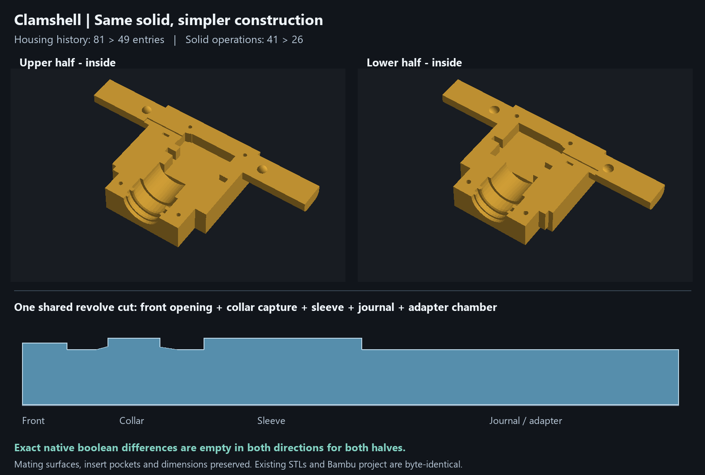
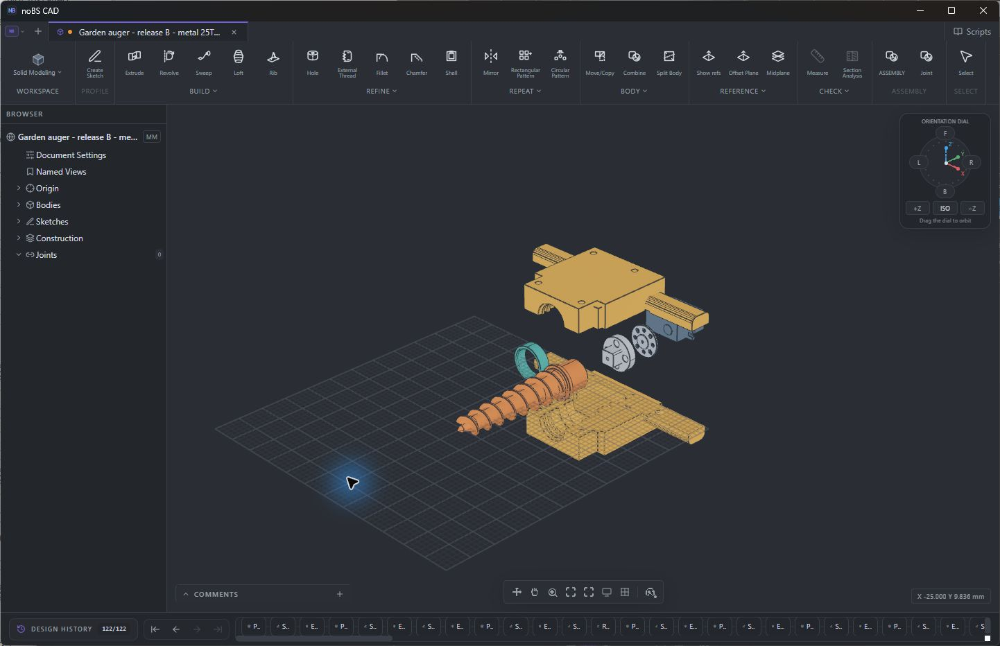
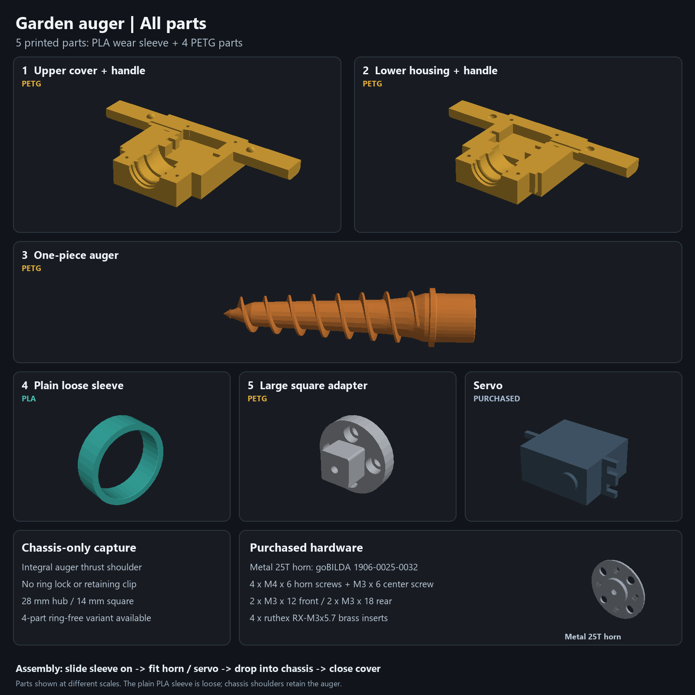

# Garden auger — round press-fit prototype and release B fallback

The current [direct-drive CAD](garden-auger-direct-drive.nbcad) uses **one gray PETG adapter with a plain round press-fit pilot**, plus one factory-compatible M3 center screw. No fine spline teeth are printed. The metal shaft forms its tooth engagement in the plastic as the adapter seats. The separate horn and four M4 screws are omitted. The 14 mm square drive, 28 mm auger hub, loose teal PLA sleeve and clamshell-only retention remain.


## Simplified clamshell construction

The current direct-drive housing uses **49 history entries instead of 81** (40% fewer), with **26 solid operations instead of 41**. The entire assembly history drops from 115 to 83 entries. Three overlapping rectangular housing extrusions become one stepped footprint extrusion. The front openings join the existing collar, sleeve, journal and adapter chamber in **one shared revolve cut**. One symmetric wire-exit cut serves both halves. Repeated cuts, cuts subsequently filled back in, duplicate reference planes and unused sketches are removed. The remaining mirrored extensions preserve the existing housing and alignment surfaces.



The [native geometry comparison](housing-simplification-verification.json) checks the new solid minus the committed old solid, and the old solid minus the new solid, for **both halves**. All four analytic boolean residuals are empty at CAD kernel precision. Other body meshes, assembly placements and material appearances are identical. Insert pockets, servo mounting surfaces, clamshell locators and the deeper adapter clearances therefore retain their existing geometry. No housing reprint is required because of this history cleanup; actual printing progress is unknown.

The existing STLs and complete Bambu project are **byte-identical** to the previous release and remain compatible with the simplified CAD. `scripts/build_direct_drive.py` now applies and verifies this simplification during regeneration. To repeat the committed-baseline check, run `scripts/check_housing_simplification.py`; render the rebuilt halves and actual axial sketch with `scripts/render_housing_simplification.py`. [Render provenance](renders/clamshell-simplified-provenance.json) identifies the current CAD file.

## Research and design choice

[Firsthand builders](https://www.reddit.com/r/3Dprinting/comments/pm04eb) report using a slightly undersized round hole instead of printing miniature spline teeth; another [PETG/FDM discussion](https://www.reddit.com/r/robotics/comments/sh8ooa) recommends the same approach. These are maker reports, not a 35 kg·cm qualification. A [primary Botball study](https://ecer.pria.at/archive/ecer-2026/papers/Replacing_Botball_Kit_Parts_with_3D_Prints.pdf) reports that a PLA horn could not reproduce the fine shaft engagement and failed to transmit torque. Its material and servo differ from ours.

For the requested one-part PETG approach, use a **calibrated round pilot, tooth engagement formed by the metal shaft, and the center retaining screw**. This avoids estimating or printing another manufacturer's 25T profile. Friction and tooth indentation work together; the screw supplies axial retention. The metal-horn release B remains the stronger-supported fallback for high loads. Neither printed approach has been qualified at this servo's stall torque.

[INJORA](https://www.injora.com/products/injora-injs035-360-35kg-waterproof-digital-servo-360-steering-winch-wheel-for-rc) specifies a Ø5.9 /25T output, 35 kg·cm stall at 6 V, and an M3 spool screw. Its dimensions image shows overall 41.5 mm and case 37.5 mm, implying a nominal 4.0 mm tip-to-case-face difference. It does not separately dimension exposed spline length, stationary nose geometry, usable thread depth or factory center-screw length. The local servo is therefore a reference, not a complete supplier shaft drawing.

## Press-fit pilot and positive seating

The revised pilot is **Ø5.70 ×3.70 deep**, with a 0.15 mm entry chamfer and **3.55 mm straight portion**. Depth follows [Hitec's H25T horn/spline technical data](https://shop.multiplex-rc.de/userdata/files/HITEC%20SERVO%20ACTUATOR%20HORN%20%26%20SPLINE%20TECHNICAL%20DATA%20SHEET_v3_0_1_26C.pdf), printed page 75, which specifies 3.7 mm horn depth for its standard nominal Ø6 /25T family. This is a manufacturer family reference, not a universal tolerance standard or a published INJORA axial dimension. It replaces the former 1.70 mm shallow pilot.

Ø5.70 remains a trial diameter for the INJORA Ø5.9 shaft. The updated [PETG fit coupons](garden-auger-press-fit.3mf) match the **3.70 mm depth, Ø24 boss and 2.60 mm seating web**: **A=5.60, B=5.70, C=5.80, D=5.90 mm**. Start with D, the largest bore, and select the fit that seats snugly without splitting, rocking or excessive force. Inspect the metal teeth's impression. Do not pull an over-tight pilot on with the center screw. Set `PILOT_DIAMETER` in `scripts/direct_drive_parameters.py` to the physically selected size before the final adapter print.

**The rotating shaft tip seats positively on the annular bore floor** around the center passage at Y148.70. The deeper boss ends at Y152.40; the nominal case face is Y152.70, giving **0.30 mm nominal case-face clearance**. The old reference's unmeasured 2 mm stationary nose has been omitted from the active case reference; removing that unsupported model detail does not prove physical clearance. Require **at least 4.00 mm actual exposure from the shaft tip to the nearest stationary nose/case surface**, measured around the entire Ø24 boss footprint. This accommodates a 3.70 ±0.10 mm socket and at least 0.20 mm stationary clearance. The actual shaft/nose must pass this check before use; INJORA does not publish that axial interface.

The adapter has a **Ø24 boss**, enlarged from Ø16, with a broad 2 mm axial/radial taper into the Ø28 ×5 flange. Plastic wall is **9.15 mm radially along the straight bore**, 9.00 mm at the entry chamfer (8.90 mm minimum under the stated ±0.10 diameter limits). The annular seat-to-screw-seat web stays **2.60 mm**; **Ø4.00 ×0.30 underhead relief** clears the screw neck. The rear chassis chamber stays Ø29.6. Square-drive geometry and location, housing halves, auger, and sleeve are unchanged; **only the adapter needs replacement** if the other four parts are already printed.

The [adapter-to-housing recheck](adapter-housing-verification.json) uses the saved native assembly, including both housing halves. The existing Ø29.6 chamber leaves **2.80 mm nominal radial boss clearance**, **0.80 mm nominal radial flange clearance**, and **0.60 mm nominal clearance behind the adapter**. With ±0.10 mm critical printed dimensions, ±0.15 mm installed axial position and at most 0.50 mm radial axis offset, the conditional minima are **2.20, 0.20 and 0.25 mm**, respectively. The housing does not need resizing for this adapter revision. This describes file compatibility; the user's progress printing individual parts is unknown. Actual servo shaft/nose clearance remains a separate physical inspection.

## Center screw verification

Use an **M3 ×6 full-thread center screw as the nominal trial**, length measured under the head. The [M3 screw envelope](https://in.misumi-ec.com/vona2/detail/110310861029/?HissuCode=E-BOX-GSCB3-10) has a Ø5.5 ×3.0 head and 2.5 mm hex. Inspect factory thread/pitch compatibility and the actual dimensions; do not assume the supplied INJORA screw is 6 mm long.

- Screw head access: **Ø6.40**, giving 0.45 mm nominal radial head room, at least 0.40 mm with the ±0.10 printed diameter allowance.
- Screw passage: **Ø3.40**, giving 0.20 mm nominal radial shaft room, at least 0.15 mm with that printed allowance.
- Underhead-seat to shaft-tip seat: **2.60 mm nominal; required measured range 2.40–2.80 mm**.
- A 6.00 mm screw inserts **3.40 mm nominally**. With an inspected 5.90–6.10 mm screw and the seat limits above, insertion is **3.10–3.70 mm**.
- Require the actual shaft's safe usable axial hole depth to be **at least 4.00 mm from its tip face**. That gives 0.60 mm nominal bottom room, **at least 0.30 mm** at the stated extremes. This is an incoming inspection requirement, not a published INJORA dimension. Check full-thread engagement separately; entry chamfers and screw tip lead are not full threads.

The actual adapter mesh has an open axial passage and a measured 2.60 mm annular-seat stack. A temporary native CAD M3×6 envelope, including a conservative neck transition, has **zero overlap with all printed parts**. The temporary screw is not saved as an extra assembly/print body. The servo reference omits its internal threaded cavity, so this check cannot prove the real thread bottom. **CAD printed-part clearance is confirmed; physical screw bottoming and thread engagement remain conditional on inspection.**

[Native CAD screw section and conditional stack](renders/direct-drive-screw-check.png).

After seating, the auger-facing adapter flange must lie **27.40 ±0.15 mm behind the front chassis thrust-stop face**, and its drive axis must be within 0.50 mm radial of the assembled journal axis. The square engagement/bottom-gap limits in the fallback section are conditional on these installed limits and the critical printed sizes. The existing insert and chassis-screw dimensions remain unchanged.

## Current files and materials

**Open [garden-auger-bambu-latest.3mf](garden-auger-bambu-latest.3mf) in Bambu Studio for the latest complete slicer project.** All five current direct-drive solids are placed on four named plates: PETG housing halves, PETG auger, PETG adapter, and PLA sleeve. Every plate uses one filament, so no purge tower is needed. The shared housing plate prints by layer to avoid the sequential-print gantry collision warning. This corrects the upper housing being outside the plates in the saved review copy. The [saved review copy](garden-auger-bambu-review.3mf) is retained unchanged.

The latest native Bambu project preserves the saved X2D 0.4 mm printer, user's 0.08 mm process, supports, and Bambu PETG Basic / PLA Glow profiles. The adapter has an explicit **six-wall, 100% infill override** for the enlarged boss and seating web. Saved spool colors remain dark green #034638, orange #FF671F, white #FFFFFF, and light green #DCF478. The CAD/export palette below remains the design reference. [Bambu layout verification](bambu-latest-verification.json) checks five closed connected solids against the canonical geometry, confirms all parts lie on their assigned beds, and records the latest file hash. The project is unsliced; neither dimensions nor infill establish a measured stall-torque rating.

Current adapter geometry: [native CAD revision views](renders/cad-depth/adapter-revision.png), [square end](renders/cad-depth/adapter-front.png), [servo end](renders/cad-depth/adapter-rear.png), [axial half-section](renders/cad-depth/adapter-section.jpg), and [capture provenance](renders/cad-depth/provenance.json). The [dimensioned mating ends](renders/direct-drive-adapter.png) and [3.70 mm socket/screw stack](renders/direct-drive-screw-check.png) are rendered from native geometry. The earlier [desktop mating gallery](renders/cad-mating/01-square-drive.png) records the superseded shallow adapter; it is retained as historical documentation, not the current servo interface. The [journal/sleeve](renders/cad-mating/03-bearing-and-capture.png) and [clamshell/insert surfaces](renders/cad-mating/04-clamshell-and-inserts.png) are unchanged. The current assembled square keeps 10.00 mm nominal engagement, 2.00 mm peg-tip clearance and 1.60 mm hub-to-flange clearance.

[Five-part 3MF](garden-auger-direct-drive.3mf), [single-adapter 3MF](garden-auger-direct-adapter.3mf), [press-fit coupon CAD](garden-auger-press-fit.nbcad), [individual STLs](print-parts/direct-drive), [all parts](renders/direct-drive-all-parts.png), [exploded assembly](renders/direct-drive-exploded.png), and [dimension/verification report](direct-drive-verification.json).

Materials/colors are explicit: chassis PETG yellow #E5AE3C, auger PETG orange #D57E37, adapter PETG gray #BEC3CA, sleeve PLA teal #37AAA1. Native checks cover nominal assembly, both ±0.30 mm travel limits, common 45°/90° rotation and chassis-blocked overtravel at ±0.31 mm. Print parts must be closed and connected and fit the 256 mm bed. Actual press fit, torque, stall behavior and PETG creep remain unqualified.

The superseded printed-spline adapter, coupons, renders and documentation are preserved in the SHA256-verified [printed-spline archive](archive/direct-drive-printed-spline.zip). The active direct-drive CAD has no printed spline geometry or release B horn drawings. `README.md`, dimension audits, drawing-generation notes and both CAD variants were checked together; the old shaft gap and insufficiently defined screw clamp seat are corrected in this prototype.

Regenerate in order: `scripts/build_direct_drive.py`, `scripts/direct_drive_coupons.py`, `scripts/check_direct_screw.py` (trimesh), `scripts/desktop_export.py --direct`, `scripts/pack_direct_drive.py` (trimesh/manifold3d), then `scripts/render_direct_drive.py` and `scripts/render_screw_check.py` (Pillow). `scripts/direct_drive_parameters.py` contains the current pilot and screw inspection limits. Release B below is the separate metal-horn fallback; its drawings do not describe this connection.

## Release B — metal-horn fallback

Ready for a **fit-check print and bench qualification**. CAD, drawings, both bearing variants and print packages have been rebuilt and checked. Physical spline fit, printer capability, loaded strength and wear have not been tested.

The PETG auger has a Ø28 journal, a rounded square socket and an integral Ø34 collar. **Both collar faces are retained by the chassis clamshell.** The full PLA sleeve slides over the journal from the drive end and remains loose. No clip, ring lock or separate retention hardware is used.





## Servo and metal horn

Use the **INJORA INJS035-360, 35KG continuous-rotation servo** and **goBILDA 1906-0025-0032 metal 25T horn**. The standard H25T connection is selected from the published 5.9 mm /25T servo specification and horn family; confirm its fit on the actual INJORA shaft at first assembly. The original unmeasured nylon-horn mount and printed round spline placeholder have been removed.

The [manufacturer STEP](source/horn-1906-0025-0032/1906-0025-0032.STEP) defines the nominal horn boss, seating face and four threaded M4 mounting holes. Vendor manufacturing tolerances were not provided; the drawing uses incoming inspection requirements instead of claiming supplier tolerances.

- PETG adapter: Ø34 ×7 flange, 14 BASIC square /R1 BASIC corners, 11.6 mm peg length. Four Ø4.6 holes with Ø7.4 ×4.4 counterbores accept **four M4 ×6 ISO4762 screws**, clear of the peg.
- Horn pocket: Ø14.5 ×2.3 deep for the nominal Ø13.98 ×2.0 metal boss. The Ø6.4 center-head relief clears the **M3 ×6 center screw**.
- M4 engagement: 3.4 mm nominal, at least 3.1 mm under the stated tolerances; minimum head recess 0.3 mm.
- Verify **at least 4.0 mm usable M3 thread depth** and **2.6 ±0.2 mm from the screw's under-head seating face to the shaft tip** before installing the specified center screw. The 3.1–3.7 mm engagement range leaves at least 0.3 mm at the thread bottom. If either inspection fails, use a factory-compatible screw. Confirm the spline seats without force and provides at least 2 mm engagement.
- Installed horn face: **34.40 ±0.15 mm behind the front chassis thrust stop**. Installed drive-axis offset from the assembled journal axis: **≤0.50 mm radial**. Inspect these assembly requirements, which include purchased-part variation.

Primary sources: [INJORA servo](https://www.injora.com/products/injora-injs035-360-35kg-waterproof-digital-servo-360-steering-winch-wheel-for-rc), [goBILDA horn](https://www.gobilda.com/1906-series-lightweight-servo-hub-25-tooth-spline-32mm-diameter//), [original STEP download](https://www.gobilda.com/content/step_files/1906-0025-0032.zip).

## Dimensions and GD&T

The [four-page controlled drawing](output/pdf/garden-auger-release-B.pdf) defines datum frames, basic square geometry, surface-profile controls, mounting-hole position, face flatness and thrust-face perpendicularity. Native CAD contains four drawing sheets and manufacturing notes. All dimensions are millimeters.

Critical printed dimensions require ±0.10 mm acceptance. Basic square surfaces use a **0.10 mm total profile zone**, including size, form and location; those contributions are not counted again. Functional axial dimensions are inspected at their surface extrema, so face form stays inside the size envelope. The stack uses arithmetic worst cases, including ±0.15 mm installed horn-face variation:

- Collar 3.00 ±0.10 in a 3.60 ±0.10 capture span: **0.40–0.80 mm total end float**.
- Square engagement: **9.35–10.85 mm**.
- Tip-to-socket-bottom gap: **≥1.05 mm**.
- Hub-to-adapter-flange gap: **≥0.75 mm**.
- Ø28 journal in Ø29.6 seat: **≥0.70 mm radial clearance**, leaving **0.20 mm** at the permitted 0.50 mm axis offset.
- Sleeve Ø34 /bore Ø28.6 ×10.4 long in Ø35.6 cavity: **≥0.90 mm combined radial float**.
- Square flat clearance: **≥0.10 mm per side**. Socket 14.4 BASIC /R1.2 BASIC, 12 deep. Hub corner wall: 4.31 mm nominal, 3.81 mm at the outer mouth chamfer.

Torque transfers through rounded leading corners after clearance is taken up. Nominal geometric backlash is about 3.89° total; exact checks show clearance at 1.8° relative rotation and contact at 2.2°.

These are **required acceptance limits, not measured FDM capability or rated load capacity**. Print and measure the fit coupon in the intended materials/settings, finish mating surfaces if needed, and check free rotation, positive end float and the installed horn-face/axis limits before a loaded trial. PLA/PETG wear or friction benefit remains untested.

## Materials and heat-set inserts

Native CAD and 3MF assignments are explicit:

- Chassis halves: **PETG, yellow #E5AE3C**.
- One-piece auger: **PETG, orange #D57E37**.
- Square adapter: **PETG, gray #BEC3CA**.
- Loose sleeve: **PLA, teal #37AAA1**.
- Purchased servo: blue gray #4B6277; purchased anodized aluminum horn: #AEB8C4. Both are excluded from print packages.

Use **four brass ruthex RX-M3x5.7 inserts**, Ø4.6 ×5.7, M3 thread. Lower chassis pilots are **Ø4.00 ×6.70 deep**. Inspect actual printed hole size and a depth of at least the actual insert length +1 mm; install flush with the split face. Checked surrounding wall is **at least 4.45 mm after dimensional allowance**, above the 1.6 mm minimum. Rear pads sit behind the wire channel.

Upper screw clearance is Ø3.4, with Ø6.2 head recesses. Use **two M3 ×12 front** and **two M3 ×18 rear ISO4762 screws**. Nominal insert engagement is 4.0 /5.3 mm respectively. All four screw passages and insert mouths are checked open. Fastener cuts follow structural joins.

[ruthex datasheet](https://www.igo3d.com/mediafiles/Sonstiges/Ruthex/ruthex_Datenblatt_RX-Serie.pdf), [exact insert](https://www.ruthex.de/products/ruthex-gewindeeinsatz-m3-100-stuck-rx-m3x5-7-messing-gewindebuchsen).

## Print and assembly

3MF contains geometry, bed placement, material names and colors. Choose actual printer, filament and support profiles in the slicer. Separate PETG and PLA plates allow single-material printing with no purge tower. STL does not store material or color.

Chassis halves rest on their outside faces; adapter and sleeve are upright. The auger lies horizontally to keep its shaft along the layer planes; support is needed under the flight and unsupported underside. Use substantial perimeters, qualify the coupon, and preserve the collar fillets and socket radii.

1. Install inserts in the lower chassis; allow it to cool.
2. Mount the metal horn and appropriate center screw on the servo. Inspect spline engagement, thread depth and seating.
3. Bolt the adapter to the metal horn with four M4 ×6 screws. Access the counterbores from the auger side before mating the square.
4. Slide the PLA sleeve onto the journal, engage the square and place the assembly in the lower chassis.
5. Close the clamshell using the four M3 screws. Check rotation, end float and installed face/axis limits. The integral collar alone provides retention.

The direct-bearing variant omits the sleeve. It uses the same Ø29.6 journal clearance, collar stops, auger and adapter.

## Deliverables and checks

- [Editable CAD](garden-auger-drive.nbcad), [five-part 3MF](garden-auger-slice.3mf), [PETG plate](garden-auger-petg.3mf), [PLA sleeve plate](garden-auger-pla-bushing.3mf).
- [Fit-check CAD](garden-auger-fit-check.nbcad), [fit-check 3MF](garden-auger-fit-check.3mf), [no-ring CAD](garden-auger-no-ring.nbcad), [no-ring 3MF](garden-auger-no-ring.3mf), [individual STL files](print-parts).
- [GD&T drawing PDF](output/pdf/garden-auger-release-B.pdf), [dimension audit](dimension-audit.json), [checks and artifact hashes](captured-verification.json).

Exact native checks cover both thrust limits, common 45/90° rotation, chassis-blocked overtravel, ±0.50 mm isolated journal offsets, sleeve installation and relative square contact. Print meshes are closed and connected, do not overlap on a 256 mm bed and sit at Z0. The editable auger component contains its core and original imported flight as two overlapping construction bodies; the packer produces one connected printed solid and checks that the flight remains.

Active history has 122 features and no suppressed leftovers. Desktop-compatible CAD is checked against the newer engine for identical mesh vertices/triangles, preserved materials and drawing sheets. The construction seed retains newer editable region data. Retired designs and builders are in SHA256-verified [archives](archive).

Regenerate with the installed native stdio engine:

```powershell
uv run --no-project python scripts/build_model.py
uv run --no-project python scripts/check_captured.py
uv run --no-project --python 3.12 --with trimesh python scripts/audit_dimensions.py
uv run --no-project --python 3.12 --with reportlab --with pymupdf python scripts/release_drawings.py
Copy-Item .build/drawing-project.nbcad garden-auger-drive.nbcad
uv run --no-project --python 3.12 --with trimesh --with manifold3d python scripts/pack_captured.py
uv run --no-project --with pillow python scripts/render_captured.py
uv run --no-project --with pillow python scripts/render_mating.py
```

`scripts/desktop_export.py` additionally verifies/exports through the isolated desktop recorded in `.build/cad-launch.json`. Run it before final packing to keep CAD hashes current. `scripts/cad_review.py` displays temporary inspection poses without saving them.
