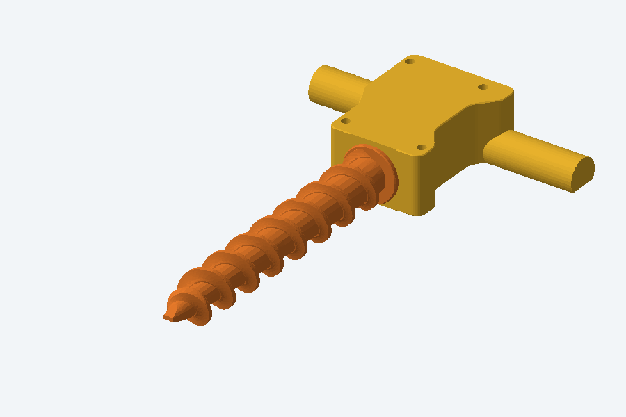
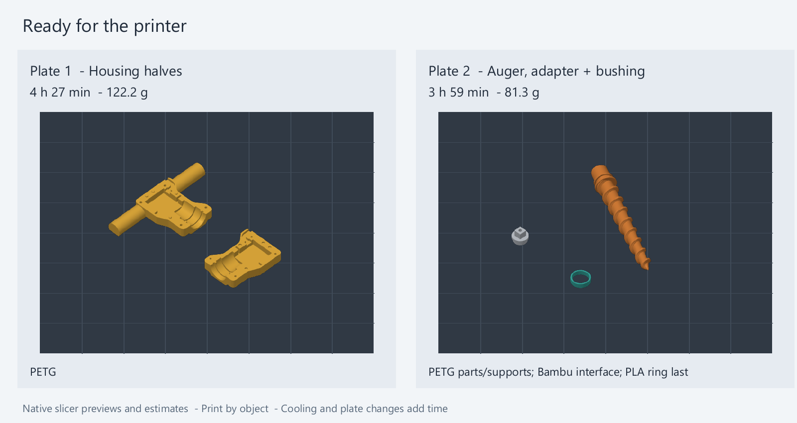
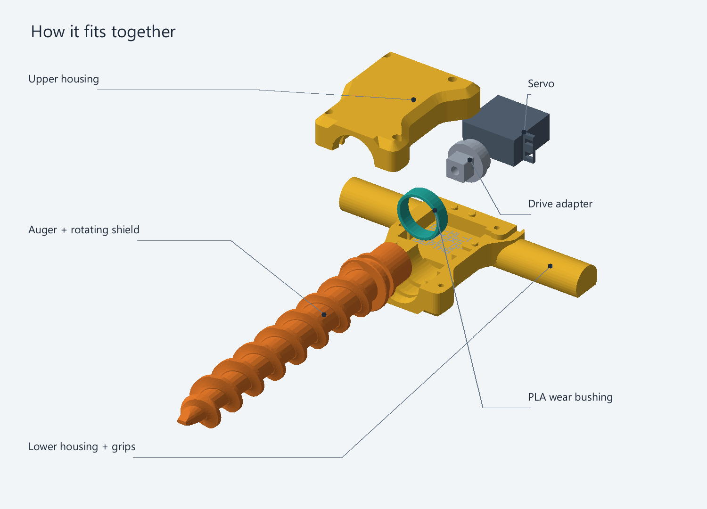
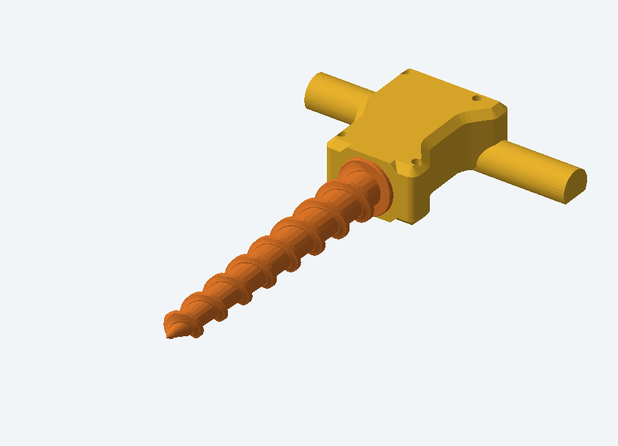
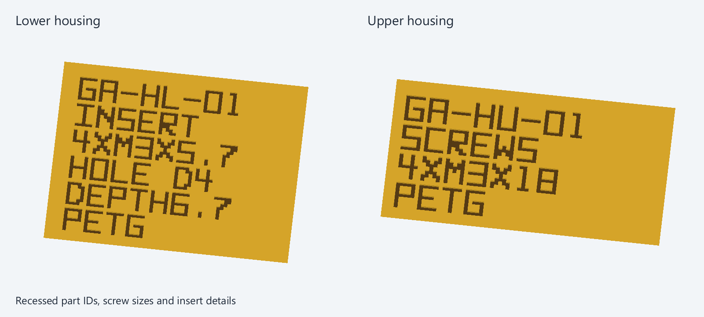

# Garden auger

A printable garden auger driven by a continuous-rotation servo. The two-piece housing holds the servo and drive, with rounded grips and a replaceable wear bushing.

[Print in Bambu Studio](print/garden-auger.3mf) · [Open in Limo CAD](garden-auger.limo) · [Assembly guide](docs/assembly.md)

## What you'll print

- **Housing.** Two halves with flat print bases, four screw joints and flush part and hardware labels inside.
- **Auger.** A 240 mm screw with a backed chisel tip, thick flights and a rotating dirt shield. Shallow flats help support the shaft and drive journal during printing.
- **Drive.** A square adapter connects the servo to the auger. A round PLA bushing guides the journal.

## Print files

The two-plate projects print both housing halves together. The second plate holds the auger, adapter and bushing. Use PETG for the housing, auger, adapter and support body. The bushing uses PLA Basic, and the support contact layers use Bambu Support for PLA/PETG.

- [Two plates with contrasting PETG lettering](print/garden-auger.3mf)
- [Two plates with same-color textured lettering](print/garden-auger-single-color.3mf)
- [Auger-only plate](print/auger-only.3mf) for reprinting the screw when you already have the other parts
- [Individual STLs](print/parts/)

## Inside the housing

Watch it come apart with the drive turning

## How we made it

We modeled the assembly in [Limo CAD](https://github.com/limo-cad/Limo-CAD), exported the parts and prepared the plates in Bambu Studio. The print projects use three walls and gyroid infill, with extra infill around the fasteners and along the drive.

[Editable flight](cad/auger-flight.limo) · [Design and print workflow](docs/workflow.md)
