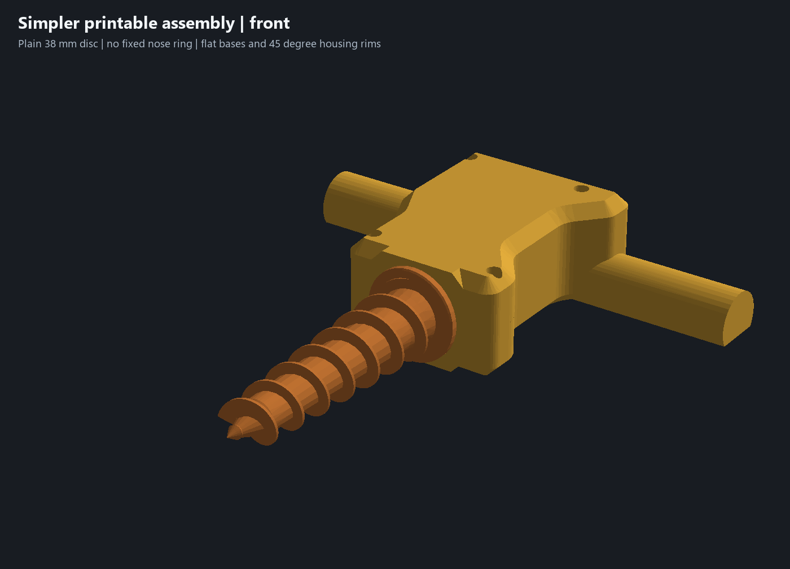

# Garden auger

A printable housing for a continuous-rotation servo, with an auger for digging in the dirt. Print the parts, add the servo, and hook it up to power and controls.

## The parts

- A two-piece housing that holds the servo and drive assembly, secured with four screws.
- Rounded handles with flat bases for printing.
- A square drive adapter and replaceable wear bushing.
- A rotating dirt shield at the housing opening.
- Recessed part labels and hardware details inside the housing.
- Reinforcement around the screw holes and drive adapter.

The housing, auger and adapter use PETG. The bushing uses PLA.

## How we made it

We designed and refined the assembly in **[Limo CAD](https://github.com/limo-cad/Limo-CAD)**, exported the parts, then prepared the print plates and local reinforcement for Bambu Studio. The CAD model and print settings are included so you can adapt the design to your own setup.

## Make your own

- [Editable Limo CAD model](garden-auger.limo)
- [Bambu Studio print project](print/garden-auger.3mf)
- [Individual STL files](print/parts/)

[Assembly notes](docs/assembly.md) · [Design and print workflow](docs/workflow.md)
