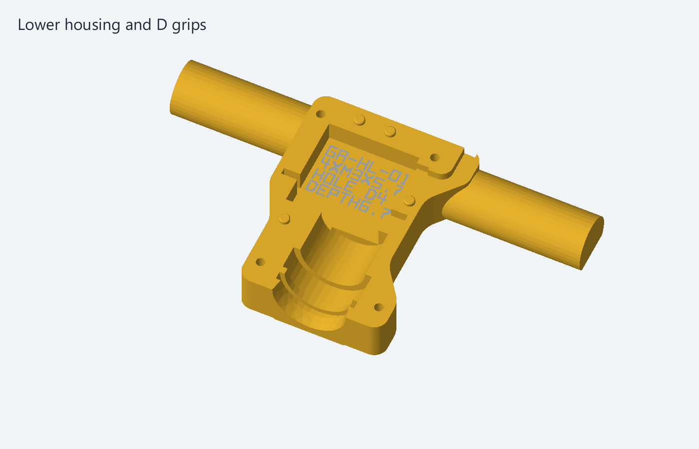
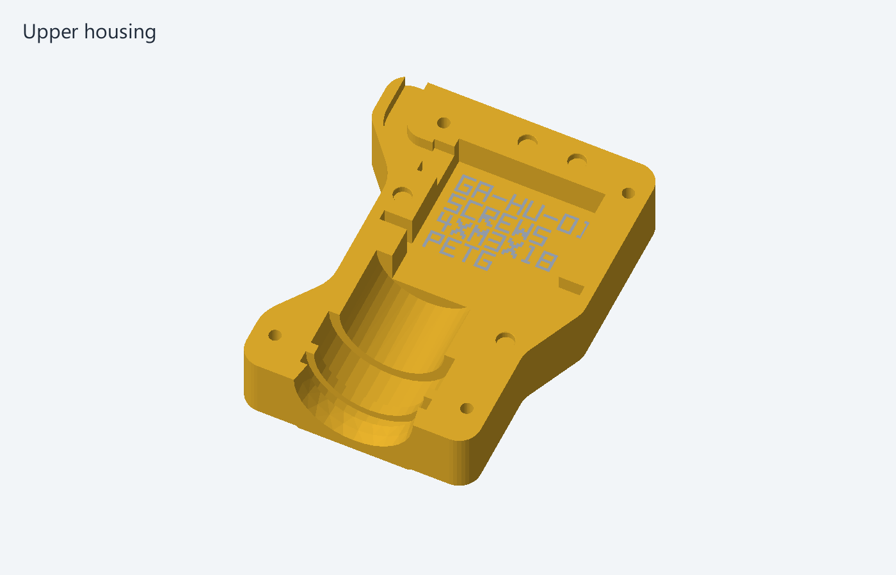
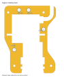
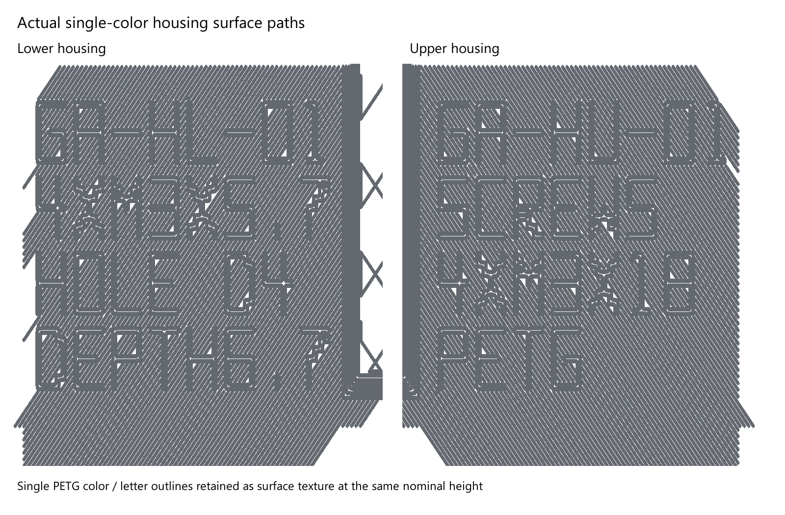
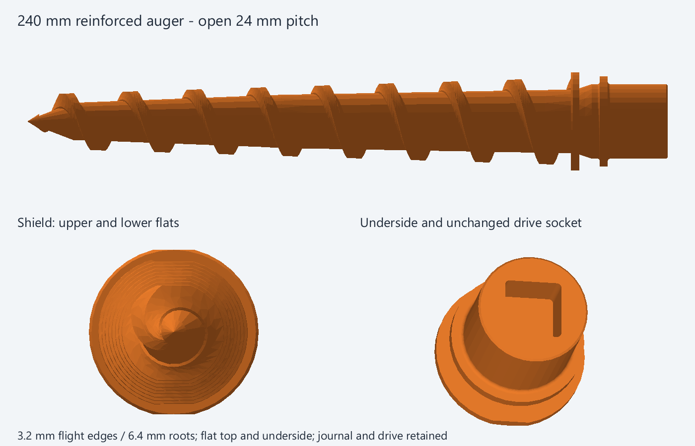
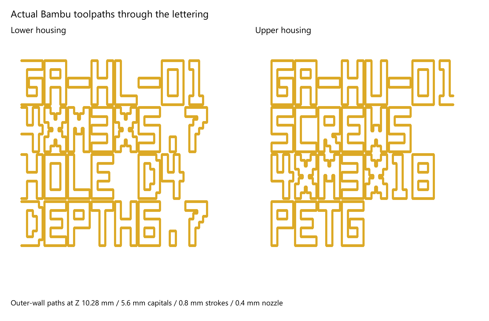
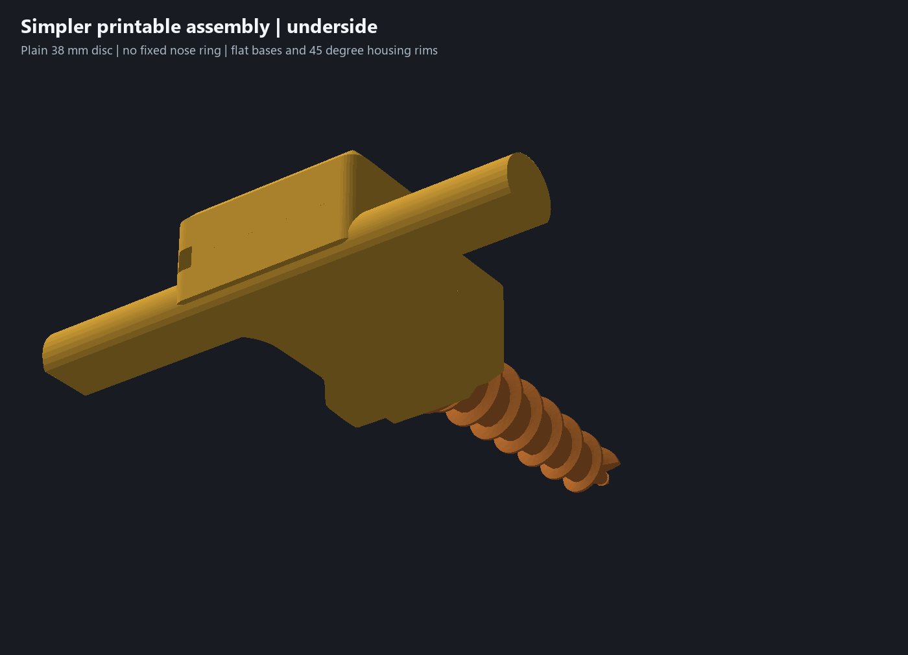

# Assembly

The five printed parts are the upper housing, lower housing with both grips, auger with rotating shield, servo adapter and PLA bushing. Open `garden-auger.limo` for the complete assembly and named feature history. The purchased servo is a reference envelope, not a printable part.

## Hardware and fit

- Four M3 x18 housing screws and four ruthex RX-M3x5.7 heat-set inserts. Nominal insert pilot holes: diameter4.0 mm, depth6.7 mm.
- Both housing halves use matching 0.6 mm, 45° exterior chamfers. The Ø6.2 mm upper screw-head recesses have closed rims with at least 1.6 mm of nominal material at the exterior face. The screws and lower inserts use the original centers.
- Existing compatible servo center screw for the owner-proven adapter connection.
- Diameter4.70 mm locating pins in diameter5.00 mm sockets: 0.30 mm diametral clearance, or 0.15 mm per side. This is the owner's selected three-notch coupon fit. The pins project 1.8 mm into 2.2 mm deep sockets, leaving 0.4 mm bottom clearance. Nominal material between each socket mouth and the inner cavity is at least 3.0 mm; the smallest exterior edge margin is about 2.7 mm in native mesh sections.
- Diameter28 mm journal; bushing ID28.6 /OD34 /length9.8 mm, captured in the diameter35.6 mm housing seat.
- 14 mm rounded-square adapter drive and 14.4 mm mating socket.

The existing 28.6 mm bore bushing fits the revised journal at nominal dimensions. The journal has a shallow flat on the top and bottom and keeps its 28 mm diameter across the round sides. Use the [auger-only plate](../print/auger-only.3mf) to keep a ring and adapter you already have.

Both housings, the auger and the adapter use PETG. Filament 4 is **Bambu PLA Basic**, used only for the ring. The auger's support bodies use orange PETG (filament 2); their contact layers use **Bambu Support for PLA/PETG** (filament 5). That dedicated interface filament is separate from the ring's PLA. The project assigns it to the auxiliary nozzle; map the saved materials to the loaded spools before printing.

The owner measured 27 mm from rear case face to rear-facing mounting-ear underside, and 38 mm main case length excluding ears. Other servo dimensions remain drawing references; no missing shaft-relative measurement is inferred. The successful servo-to-adapter connection was confirmed complete on 5 November 2026.

The first zero-clearance print was too tight. The owner selected the three-notch 4.70 mm pin after printing the fit coupons. That local fit is accepted; full housing closure still needs checking. Locator centres and upper sockets match revision 194ccec, so the new lower half is intended to mate with that upper half. Earlier locator layouts remain incompatible.

Install the heat-set inserts before closing the housing. Assemble the proven servo adapter with its compatible center screw, engage the square drive, place the bushing around the auger journal and seat the mechanism in the lower half. Route the cable through the rear exit with its connector outside. Fit the matching upper half and close the four screw joints. The clamshell provides capture without extra servo mounting hardware or clips.

Flush part IDs GA-HL-01 and GA-HU-01 identify the housing halves. Recessed lettering did not read well on the physical print. The new housing has solid, flat pocket floors, with the same 5.6 mm capitals and 0.8 mm strokes assigned gray PETG through 0.72 mm deep color masks. Yellow surrounds the letters at the same surface height. Both colors use PETG; the teal PLA remains the separate bushing. Hardware details stay clear of the mating rim, and both exterior bed faces remain continuous.

The saved 3MF includes the color assignments; STLs contain solid geometry without lettering. In Bambu Studio, the two named **flush PETG lettering** regions select filament3. The [single-color print project](../print/garden-auger-single-color.3mf) uses filament1 and a concentric surface pattern within the letters. This keeps their outlines in the sliced paths at the same nominal surface height. It replaces the plain same-color mask that Bambu merged away. Texture gives less contrast than a second PETG color; physical readability remains a print check.

The auger is 240 mm overall. The short chisel pilot has a 6.8 mm wide, 2.8 mm thick contact face. Two bevels back it with a widening shoulder that merges into the core and first flight. The flight then opens to 31 mm over its 14 mm entry ramp and grows gently to 34 mm. Pitch is 24 mm. The flight edge thickens from 2.0 to 3.2 mm along the entry, with a 6.4 mm root.

The auger prints lengthwise, underside down. Shallow flats run along the flight edges and tapered core underneath. Paired 0.6 mm flats through the journal and drive end give the support a flat landing about 8 mm wide. The shield supplies direct bed contact. Use Snug supports with the dedicated Bambu interface at zero nominal top gap and interface spacing. Check adhesion and support removal on the print.

All parts keep three perimeter walls and use 20% gyroid bulk infill. Ten contained regions use solid infill: eight housing screw anchors, one continuous adapter region from the square drive peg to the servo hub, and one connected auger region from the socket through the journal and shoulder into the loaded shaft. The auger region tapers away over one 24 mm flight pitch. Its opening follows the rounded-square socket, placing infill behind the loaded flats; the low-radius shaft center keeps ordinary gyroid. These change infill only and stay at least 0.4 mm inside the part surfaces.

Earth augers use the pilot to center the hole, cutting edges to break the soil and the flight to lift it. Commercial units treat the pilot and cutting teeth as separate wear parts. This printed chisel is a candidate for ordinary garden soil. For abrasive soil, a replaceable steel pilot is the next design to evaluate. A matched trial should record time to depth, stalls, soil removed and loss of tip length after the same number of holes. A wider face may require more starting pressure in packed soil. [Digga auger guide](https://diggaeurope.com/about-augers/) · [Auger Torque operator manual](https://www.augertorque.com.au/wp-content/uploads/2023/05/99-95200001-REV-09-4-EARTH-DRILL-OPERATORS-MANUAL-ENGLISH.pdf)

The rotating shield is 38 mm wide and 3 mm thick, with upper and lower flats reducing its height to 36.8 mm. Its minimum radius is 18.4 mm, with 0.6 mm nominal coverage beyond the 17.8 mm housing opening. The rear gap is 1.6 mm. The rounded-square socket is 14.4 mm wide and 12 mm deep. Check soil exclusion, support removal and durability in the physical trial.

The load path is illustrated in the [reinforcement section from the earlier flight revision](images/torque-paths.svg).

Check the revised print for full seam closure, free auger rotation, cable routing, label readability, hand comfort and fastener retention. Existing open project issues track those physical checks.
