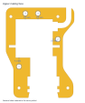
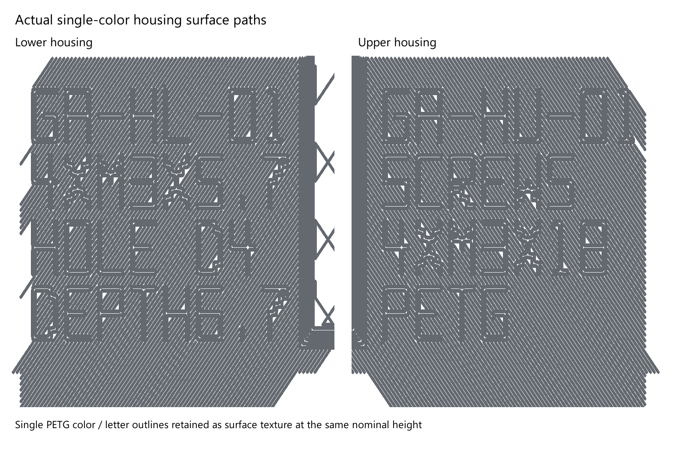

# Assembly

The five printed parts are the upper housing, lower housing with both grips, auger with rotating shield, servo adapter and PLA bushing. Open `garden-auger.limo` for the complete assembly and named feature history. The purchased servo is a reference envelope, not a printable part.

## Hardware and fit

- Four M3 x18 housing screws and four ruthex RX-M3x5.7 heat-set inserts. Nominal insert pilot holes: diameter4.0 mm, depth6.7 mm.
- Existing compatible servo center screw for the owner-proven adapter connection.
- Diameter4.70 mm locating pins in diameter5.00 mm sockets: 0.30 mm diametral clearance, or 0.15 mm per side. This is the owner's selected three-notch coupon fit. The pins project 1.8 mm into 2.2 mm deep sockets, leaving 0.4 mm bottom clearance. Nominal material between each socket mouth and the inner cavity is at least 3.0 mm; the smallest exterior edge margin is about 2.7 mm in native mesh sections.
- Diameter28 mm journal; bushing ID28.6 /OD34 /length9.8 mm, captured in the diameter35.6 mm housing seat.
- 14 mm rounded-square adapter drive and 14.4 mm mating socket.

The owner measured 27 mm from rear case face to rear-facing mounting-ear underside, and 38 mm main case length excluding ears. Other servo dimensions remain drawing references; no missing shaft-relative measurement is inferred. The successful servo-to-adapter connection was confirmed complete on 5 November 2026.

The first zero-clearance print was too tight. The owner selected the three-notch 4.70 mm pin after printing the fit coupons. That local fit is accepted; full housing closure still needs checking. Locator centres and upper sockets match revision 194ccec, so the new lower half is intended to mate with that upper half. Earlier locator layouts remain incompatible.

Install the heat-set inserts before closing the housing. Assemble the proven servo adapter with its compatible center screw, engage the square drive, place the bushing around the auger journal and seat the mechanism in the lower half. Route the cable through the rear exit with its connector outside. Fit the matching upper half and close the four screw joints. The clamshell provides capture without extra servo mounting hardware or clips.

Flush part IDs GA-HL-01 and GA-HU-01 identify the housing halves. Recessed lettering did not read well on the physical print. The new housing has solid, flat pocket floors, with the same 5.6 mm capitals and 0.8 mm strokes assigned gray PETG through 0.72 mm deep color masks. Yellow surrounds the letters at the same surface height. Both colors use PETG; the teal PLA remains the separate bushing. Hardware details stay clear of the mating rim, and both exterior bed faces remain continuous.

The saved 3MF includes the color assignments; STLs contain solid geometry without lettering. In Bambu Studio, the two named **flush PETG lettering** regions select filament3. The [single-color print project](../print/garden-auger-single-color.3mf) uses filament1 and a concentric surface pattern within the letters. This keeps their outlines in the sliced paths at the same nominal surface height. It replaces the plain same-color mask that Bambu merged away. Texture gives less contrast than a second PETG color; physical readability remains a print check.

The simple diameter38 x3 mm rotating shield has a 1.6 mm nominal rear gap; it is a noncontact dirt deflector whose soil performance remains to be tested.

Check the revised print for full seam closure, free auger rotation, cable routing, label readability, hand comfort and fastener retention. Existing open project issues track those physical checks.
