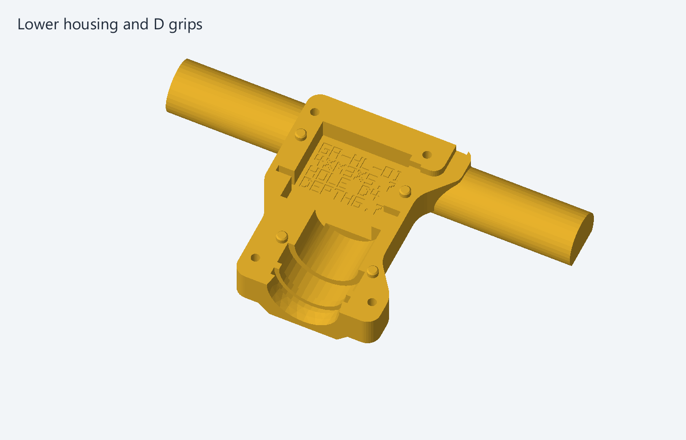
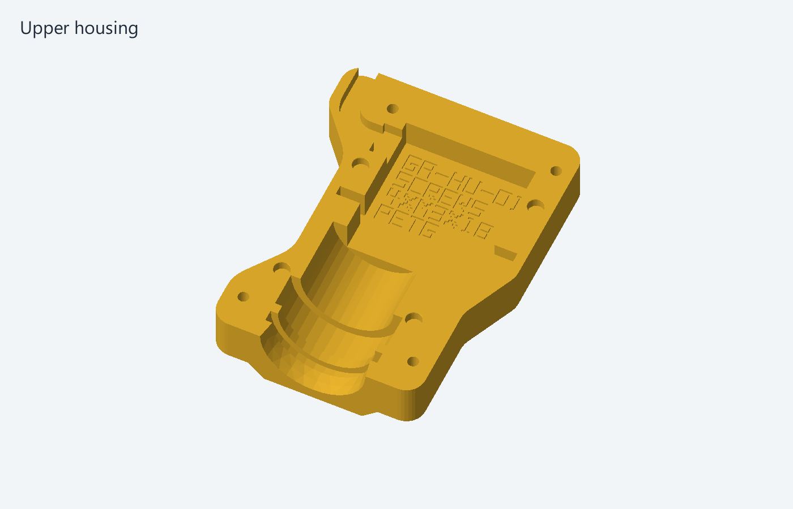
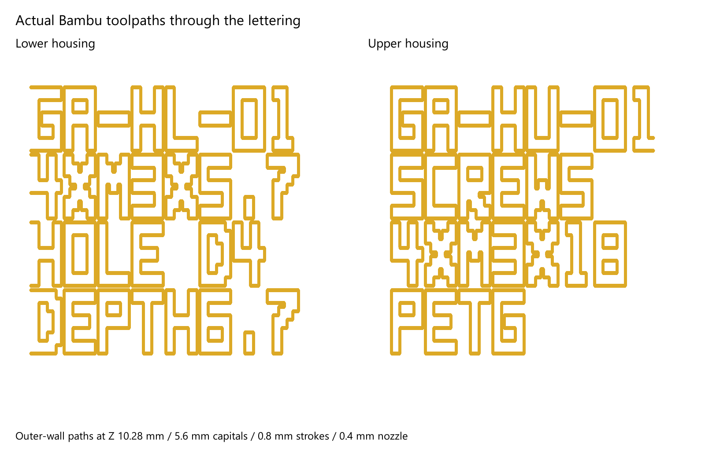
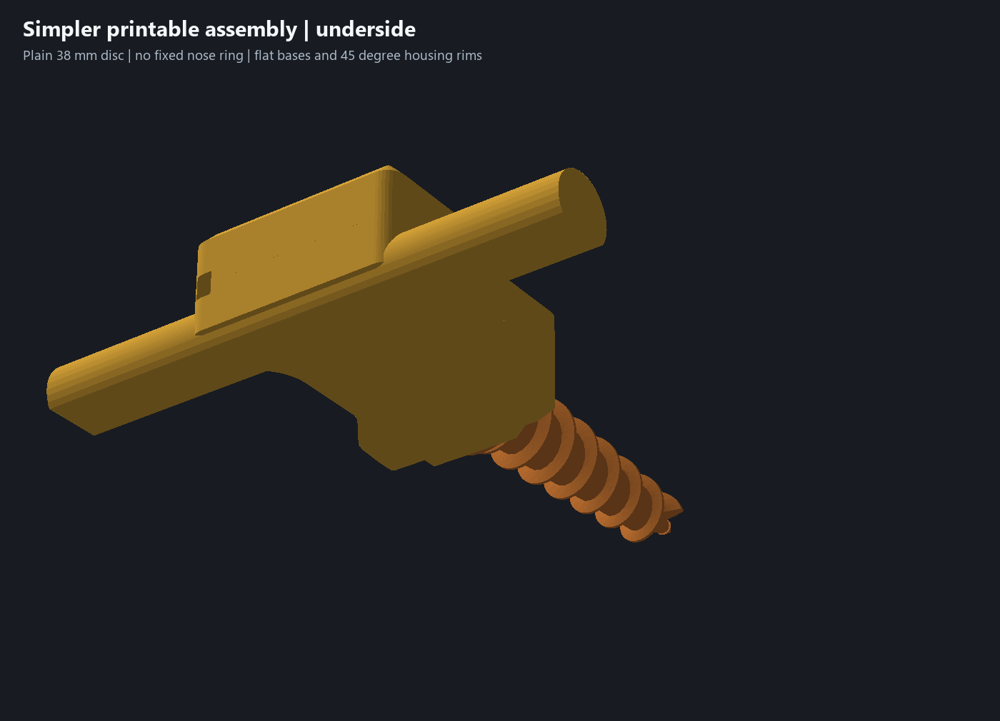

# Assembly

The five printed parts are the upper housing, lower housing with both grips, auger with rotating shield, servo adapter and PLA bushing. Open `garden-auger.limo` for the complete assembly and named feature history. The purchased servo is a reference envelope, not a printable part.

## Hardware and fit

- Four M3 x18 housing screws and four ruthex RX-M3x5.7 heat-set inserts. Nominal insert pilot holes: diameter4.0 mm, depth6.7 mm.
- Existing compatible servo center screw for the owner-proven adapter connection.
- Matched diameter5 mm housing pins/sockets; 2.8 mm pin projection. Selected socket side stock is at least 2.6 mm.
- Diameter28 mm journal; bushing ID28.6 /OD34 /length9.8 mm, captured in the diameter35.6 mm housing seat.
- 14 mm rounded-square adapter drive and 14.4 mm mating socket.

The owner measured 27 mm from rear case face to rear-facing mounting-ear underside, and 38 mm main case length excluding ears. Other servo dimensions remain drawing references; no missing shaft-relative measurement is inferred. The successful servo-to-adapter connection was confirmed complete on 5 November 2026.

Install the heat-set inserts before closing the housing. Assemble the proven servo adapter with its compatible center screw, engage the square drive, place the bushing around the auger journal and seat the mechanism in the lower half. Route the cable through the rear exit with its connector outside. Fit the matching upper half and close the four screw joints. The clamshell provides capture without extra servo mounting hardware or clips.

Recessed part IDs GA-HL-01 and GA-HU-01 identify the housing halves. The lettering has 5.6 mm capitals, 0.8 mm strokes and a 0.72 mm recess for the 0.4 mm nozzle. Hardware details sit inside the servo pocket, clear of the flat mating rim. Both exterior bed faces are continuous. The simple diameter38 x3 mm rotating shield has a 1.6 mm nominal rear gap; it is a noncontact dirt deflector whose soil performance remains to be tested.

Check the revised print for full seam closure, free auger rotation, cable routing, label readability, hand comfort and fastener retention. Existing open project issues track those physical checks.
