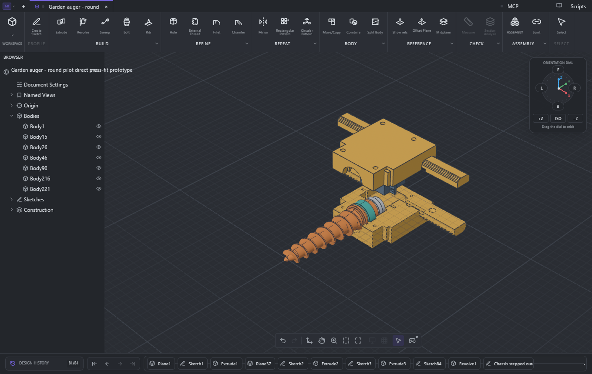

# Direct CAD tool validation

The corrected assembly is open in a newly launched **Limo CAD Bevy desktop**. This review used the product's MCP tools directly, attached to that live document. The [raw native results](../cad-tool-validation.json) preserve its session identity, feature statuses, exact interference results, print warnings, hole-summary warnings and drawing references.

Open [garden-auger-fit-inspection.limo](../garden-auger-fit-inspection.limo) for the current native inspection document, with **two associative drawing sheets** and a saved view showing the mating surfaces. It uses the current schema 10. The canonical schema-7 [print source](../garden-auger-direct-drive.nbcad) and all print exports remain unchanged. The native scene's mesh arrays match before and after adding the inspection sheets. The raised cover and servo are presentation offsets; mechanical placements are preserved.

## What the CAD tool confirmed

Native project-open recomputed **81 features** with no failed feature status. The scene contains seven native bodies belonging to six components: five printed parts, including the two-body auger, and the purchased servo reference. All seven have appearances.

`assembly_interference_check` returned **exact: true** and **zero overlap volume in all 15 reported pairs** at the assembled mechanical poses. It measured **0.20 mm** nearest servo-to-housing clearance in each half, **0.30 mm** servo-case-to-adapter clearance, **0.80 mm** adapter-to-housing clearance and **0.20 mm** square-mate clearance. The housing seam touches at zero gap without volumetric interference. A 2 mm reporting threshold exposes near pairs; it is not a universal required fit gap.

The native drawing tools resolve retained topology references, then generate measured dimension text. No dimension value was entered as a label. [Sheet 1](../renders/cad-fit-dimensions.svg) measures **40.50 mm case plan length, 37.50 mm case height, 20.00 mm case width, 2.70 mm ear thickness, 24.70 mm ear underside-to-rear, 56.00 mm ear span, 41.30 mm pocket plan length, 40.00 mm cavity axial span and 3.10 mm ear pocket**. It also measures the lower half's **10.40 mm** pocket depth to the split face. The matching slot corners are **49.00 mm** apart; both reference slots have equal width, so their center separation is the same.

[Sheet 2](../renders/cad-fit-clearances.svg) measures **20.80 mm full clamshell pocket width**, **1.50 mm nominal rear case clearance** and **0.20 mm nominal front ear clearance** directly between the relevant bodies.

## Limits and warnings retained

- **GD&T:** the available CAD interface has no automatic tolerance-stack validator. The previously reported tolerance bounds are separately derived inspection requirements. They are not a native CAD-certified GD&T result. These new sheets validate nominal geometry.
- **Motion:** the saved assembly has no joints or motion studies. This direct check is at its assembled poses; it does not provide a native swept-motion result. The earlier sampled checks are separate evidence.
- **Print preflight:** `ok: true` confirms timeline/appearance readiness, while its separate layout report warns about off-bed bodies and possible bounding-box overlap in the assembled pose. Its conservative mesh-bound warnings are distinct from the exact assembly interference result. The printer project has its own four-plate verification; the assembled CAD position is not a print layout.
- **Hole summary:** the tool reports 22 inferred holes with unknown depths and eight overlap warnings. Its adapter projection identifies open **R1 corner arcs**, while its summary counts those as four Ø2 holes. The inferred counterbore classification also includes outer cylindrical faces. This summary cannot certify bore depth or distinguish every bore from a fillet or outer surface. The raw warnings are preserved, rather than hidden or called a clean pass.
- **Absent hardware details:** the purchased envelope omits shaft teeth/the output-shaft solid, its internal threaded cavity and the cable boot. The tool cannot validate press-fit engagement, actual screw bottoming or boot fit for geometry that is absent. Physical print fit and loaded strength also remain outside this nominal CAD check.

The confirmed result is **a successfully recomputed nominal assembly with no reported volumetric collisions and native dimensions matching the corrected mating geometry**. No broader certification is claimed.
