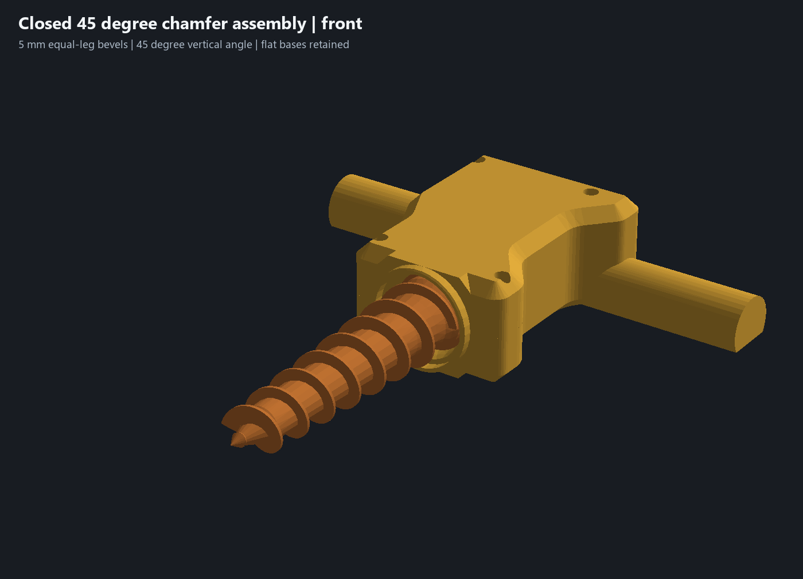
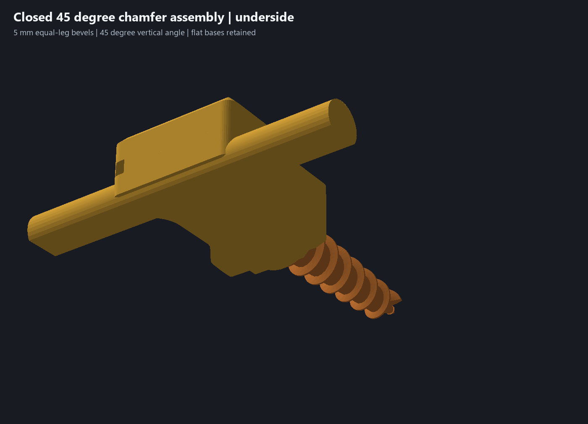

# Housing with controlled vertical bevels — 29 October 2026

The owner requested chamfers in place of the broad outer-face fillets, with a consistent vertical angle. Both halves print pocket-up on their outside faces, so both assembled outer-face rims are print undersides. This revision uses **5 mm equal-leg chamfers at 45° to the bed** on both housing halves. The angle and leg size are design choices; they are not new hardware measurements.

## Underside correction

A quarter-round approaches a shallow tangent near its bed contact. The chamfer controls that local section with a straight 45° slope. The existing blended plan-view outline and its corner radii remain: the requested control is in vertical section. The continuous frame has no cosmetic seam recesses.

Checking the first chamfer candidate found that the preceding circular bearing jacket still had a shallow underside start. Its external XZ envelope is now an octagon with flat top/bottom lands **31.2 mm wide**, 5 mm equal-leg side shoulders and outer X/Z extrema ±20.6 mm. It spans the same Y107.9–113.9 station and is joined before the original bearing cuts. The frontmost jacket face is vertical; its side shoulders are 45°. The fixed bearing seat and sampled 2.8 mm cover remain. The functional circular entry/deflector remains around the auger.

The complete lower D grips retain their R12 hand-contact profile, 24 mm width, 18.6 mm height, 20.04 mm bed land and 187 mm overall span. Their circle centers are 6.6 mm above the bed; the underside tangent starts at **56.63° to the bed** and steepens toward the widest section. That underside already exceeds the chosen 45° slope. The optional [comfort sample](../print-parts/grip-comfort-sample.stl) is unchanged.

Housing volume is **223.78 cm³**, down **3.22 cm³ /1.42%** from the preceding rounded envelope, including the flat nose correction. Flat bed contact increases by **156 mm² per half**, to approximately **4,835 mm² upper /7,548 mm² lower**. Each exposed grip retains approximately 1,102 mm². These are solid geometry/contact measurements; native slicing supplies filament estimates.

## Validation

[Geometry review](../chamfer-envelope-geometry-review.json), [wall/angle review](../chamfer-envelope-wall-review.json), [functional checks](../chamfer-envelope-validation.json) and [print evidence](../chamfer-envelope-print-verification.json) bind the final CAD and installed engine hashes.

The native wall review checks **44 planar/conical bevel faces at 45°**, including the conical bands around rounded plan corners and the flat nose shoulders. This controls the specified exterior bevels; it does not assert that all functional curved surfaces or bridge roofs have that angle. Selected longitudinal roof/cover samples retain at least 2.8 mm. Ear-tip side stock remains 3.1 mm each; selected cable-route side stock remains at least 2.97 mm. The local counterbore land is approximately 2.2 mm at the checked station just above its seat. All four screw/insert stacks and driver approaches remain.

The functional checks retain the six fitted-section probes, 20 clear/blocked case-locator controls, five closure positions, four driver approaches, four bushing-capture controls, 24 auger rotation/end-float samples, nine coupled assembly poses and continuous Ø4/Ø5 cable sweeps with a blocked Ø6.2 control. The servo, auger, adapter and bushing meshes and all appearances remain unchanged. The servo nest stays 3.00 mm axial /56.40 mm ear capture /20.40 mm across the seam; rear stop-to-wall distance stays 28.35 mm. Only the owner's 27 mm rear-case and 38 mm case-length readings are caliper authority. Missing shaft-relative measurements are not inferred.

These are sampled native geometry and slicing checks. Physical comfort, clamped strength, fit, wear, actual shaft engagement, usable threads and dirty performance remain pending in [physical acceptance #5](https://github.com/jeffglousher/garden-auger-technic/issues/5) and [dirty trial #3](https://github.com/jeffglousher/garden-auger-technic/issues/3).

## Complete print

Use [garden-auger-chamfer-envelope-assembly.3mf](../garden-auger-chamfer-envelope-assembly.3mf), [matching editable CAD](../experiments/garden-auger-chamfer-envelope.limo) and [five individual STLs](../print-parts/chamfer-envelope-assembly/). **Use both matching revised housing halves.**

Native slicing passes without warnings, estimating **8 h 35 min /226.3 g** total, plus any bed-cooling wait. Plate 1 holds both housing pieces, separated by 62.4 mm in X. Plate 2 completes the PETG auger, PETG adapter and PLA bushing in that order, with 126.0 mm rear-to-front separation and a wait for the saved 55 C bed temperature before the bushing. Both plates use print by object. Keep the supplied order and Textured PEI profile when reslicing; the actual thermal transition has not been tested on the printer.

Saved strength/support overrides, printer/process/filament profiles and CAD colors remain: yellow PETG housing, orange PETG auger, gray PETG adapter and teal PLA bushing. Supports remain enabled as saved; this is not a claim that the whole assembly prints without supports. The editable project has no embedded G-code. No printer command was sent. The user's sparse-upper edit and the [preceding rounded package](../garden-auger-rounded-envelope-assembly.3mf) are preserved.

Reproduce using the existing numpy/trimesh/manifold3d/pillow Python environment, with `--chamfer-envelope` on each command: `scripts/build_outer_envelope.py`, `scripts/check_outer_walls.py`, `scripts/check_d_grips.py`, then `scripts/package_refined_assembly.py`. Reuse the installed isolated CAD and native Bambu slicer. The project-owned `chamfer-envelope` evidence subdirectory on D has a 90 MiB ceiling; retain compressed native proof and source/scene witnesses while current or needed to reproduce. Remove standalone G-code only after byte verification against its retained archive and settlement.
