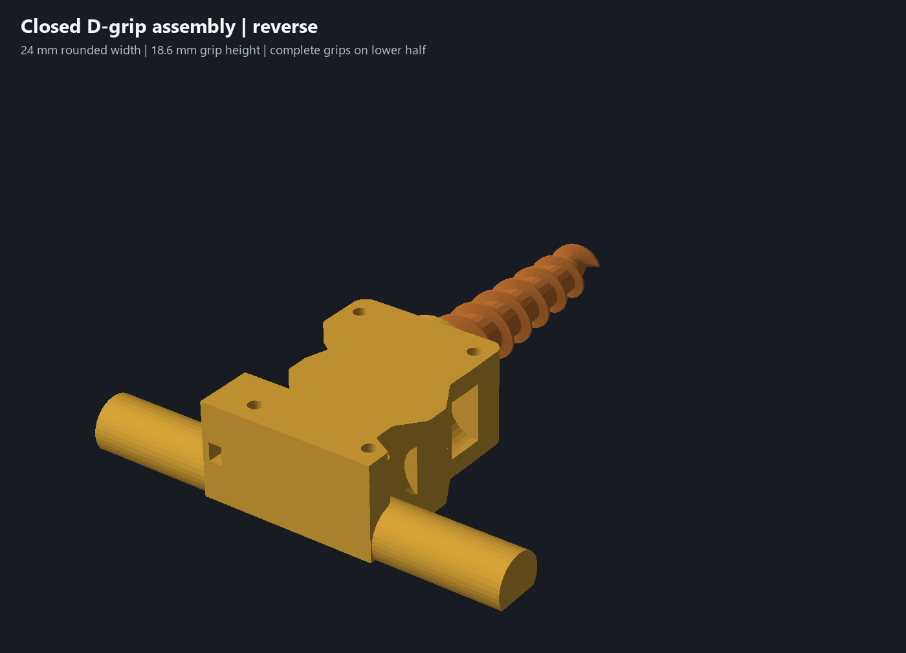
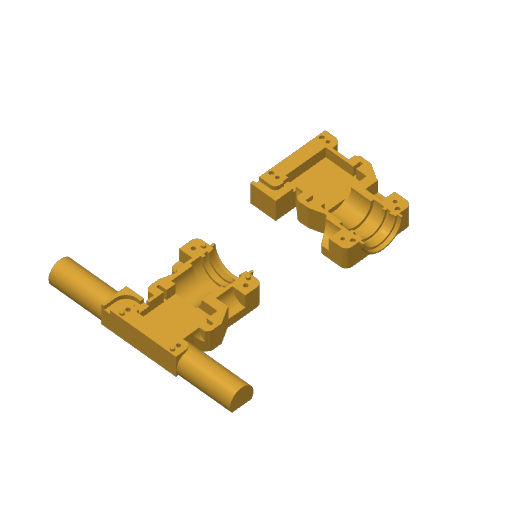
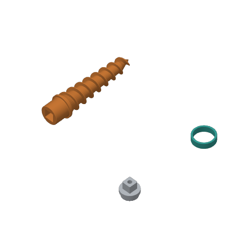

# Lower, rounder D grips — 18 October 2026

**Superseded exterior:** the owner subsequently rejected the seam scallops. The [continuous-frame revision](solid-frame-review.md) removes them while retaining these D grips and the functional dimensions. Files below preserve the preceding iteration.

Use [the complete five-part project](../garden-auger-child-d-grip-assembly.3mf) and [matching editable CAD](../experiments/garden-auger-child-d-grips.limo). This supersedes the previous relieved housing and its two-plate layout. Both revised housing pieces are required together.

The rounded contours on the sides remain exterior relief. The servo, bearing, adapter and bushing cavities retain their functional dimensions. The closed reverse view shows the rear cable outlet and the smaller handles; the [underside view](../renders/d-grip/closed-underside.png) shows their continuous flat bases.

## Grip shape and ownership

The previous paired handles assembled to 41.2 mm in height across a 200 mm span. The new grips have a **24 mm rounded width, 18.6 mm height and 20.04 mm flat bed land**. Each side provides **55 mm of clear grip length** outside the central case. Their ends are X−98 and X+89, giving **187 mm overall span**; the unequal coordinates balance the lengths around the asymmetric case.

Both complete grips are joined to the **lower housing**. The upper is now a central mechanism cover. This puts the entire D section on one print base, avoids a grip seam and allows the handles to stay lower than the 41.2 mm central housing. The D profile is a radius-12 circular arc clipped at the original lower bed plane, Z−20.6. It reaches Z−2.0 at the top. Each exposed grip contributes approximately **1,102 mm²** of flat bed contact; the full lower and upper bed faces provide approximately 8,688 and 6,282 mm² respectively. These are native mesh contact areas, not adhesion or strength measurements.

Four locating pins move from the old handles into the central case, all on the lower: **Ø4.0 pins / Ø4.3 sockets**, 2.8 mm projection and 3.2 mm socket depth. Centers are (−23,112), (23,112), (−36,203), (16,203). The four existing M3×18 screw positions, head seats and insert pilots remain. A local rear cable cheek replaces the roof formerly supplied by the upper handle; the existing channel is recut after the joins.

The **24 mm size is an engineering starting point for the requested child grip**, not a fit guarantee from age alone. A [study of children aged 6–11](https://journals.sagepub.com/doi/10.1177/0018720812465770) found hand-rung coupling depends on diameter, with the largest tested rung reducing breakaway strength. That overhead-grasp study does not establish an optimal powered-tool handle diameter or torque limit. Check the [optional 55 mm comfort sample](../print-parts/grip-comfort-sample.stl) in the intended hand before committing to a full housing print. It is cut from the actual native grip mesh, sits on its flat face and is excluded from the five-part project. It checks comfort only.

The long grip surfaces are round. The planar D end faces retain their perimeter edges: optional R1.2 and R0.8 end-round trials were rejected by the installed CAD export's topology checks and were reverted. Their exact failures are retained in the geometry report. No failed fillets or mesh repair substitutes enter the delivered CAD.

## Dimensions and geometry validation

[Geometry evidence](../d-grip-geometry-review.json) and [functional checks](../d-grip-validation.json) bind the final CAD hash and installed engine hash. Both housing exports are closed, connected solids. The auger, adapter, bushing and servo reference meshes and all appearances match the preceding CAD.

- Servo ear slots remain 3.00 mm, capture span 56.40 mm and capture width 20.40 mm. Rear stop-to-wall remains 28.35 mm. The owner's 27 mm rear-case and 38 mm case-length readings remain the only caliper authority; other hardware datums remain drawing references.
- Bushing bore Ø28.6 / outside Ø34 / length 9.8, seat Ø35.6 / span 10.9, journal Ø28 and square 14 / socket 14.4 remain unchanged.
- Five complete native section probes retain their material intervals; the rear section retains the central case intervals within X−43 to X+34 while the outer grip ends intentionally shorten. Native witnesses retain the nest, bushing and square datums and all four screw stacks.
- Five closure positions, 20 clear/blocked locator controls, four driver approaches, four bushing-capture controls, 24 auger rotation/end-float samples and nine coupled assembly poses pass. The closed nominal assembly has no interfering body pair.
- The continuous rear cable sweeps clear Ø4 and Ø5 trial envelopes and block Ø6.2. Cable and driver envelopes are test assumptions, not new physical hardware measurements.

These checks establish sampled nominal geometry, not manufactured fit, global minimum wall, complete GD&T, hand comfort, loaded strength or child-use safety. The smaller lower-owned grips change root loading; clamped stiffness and root strength require a physical trial. Actual shaft engagement and usable thread depth remain unconfirmed. [Physical acceptance #5](https://github.com/jeffglousher/garden-auger-technic/issues/5) and [dirty trial #3](https://github.com/jeffglousher/garden-auger-technic/issues/3) remain open.

## Both plates print by object

**Plate 1** holds the lower housing rotated 90° in the bed plane and the smaller upper cover, both pocket upward on their flat outer faces. Their X separation is **62.4 mm**, exceeding the saved 60 mm clearance radius. Highest geometry is 23.4 mm including the lower's pins. Native Bambu accepts by-object slicing without warnings: approximately **5 h 35 min / 172.0 g** including support interfaces and purge. The saved support and strength settings are retained; the smaller footprint now permits the sequence that the preceding large-grip layout rejected.

**Plate 2** finishes the orange PETG auger, gray PETG adapter, then teal PLA bushing: approximately **3 h 6 min / 60.0 g**. The rear auger retains 126.0 mm of Y separation from the short front parts, beyond the saved 33 mm rod distance. Actual emitted object order is checked, rather than inferred from resource order. No saved clearance is reduced. Native by-object slicing emits no prime tower on either plate, while support/interface paths remain where required.

Total estimate: **8 h 42 min / 232.0 g**, plus any bed-cooling wait. PETG uses the saved 70 C bed profile; the before-next-object setting waits for 55 C before the final PLA bushing. Keep this object order and Textured PEI profile when reslicing. Physical execution of that temperature transition remains untested. CAD colors remain yellow housing, orange auger, gray adapter and teal bushing; saved spool settings remain explicit in the project.

The [print report](../d-grip-print-verification.json) verifies five mesh identities, preserved per-object process settings, native toolpaths/order/temperature behavior and byte identity between sliced input and delivered geometry/process entries. [Individual STLs](../print-parts/d-grip-assembly/) are also available. The delivered project is editable and contains no embedded G-code. No printer command was sent. The preceding projects and the owner's modified sparse upper project were preserved.

Reproduce using the existing offline Python environment with numpy, trimesh, manifold3d and pillow: run `scripts/build_d_grips.py`, `scripts/check_d_grips.py`, then `scripts/package_refined_assembly.py --d-grips`. Native slicing requires the installed Bambu Studio. Large intermediate evidence stays in the existing project-owned build lane; tracked reports, CAD, meshes and native previews provide the reviewable result.
