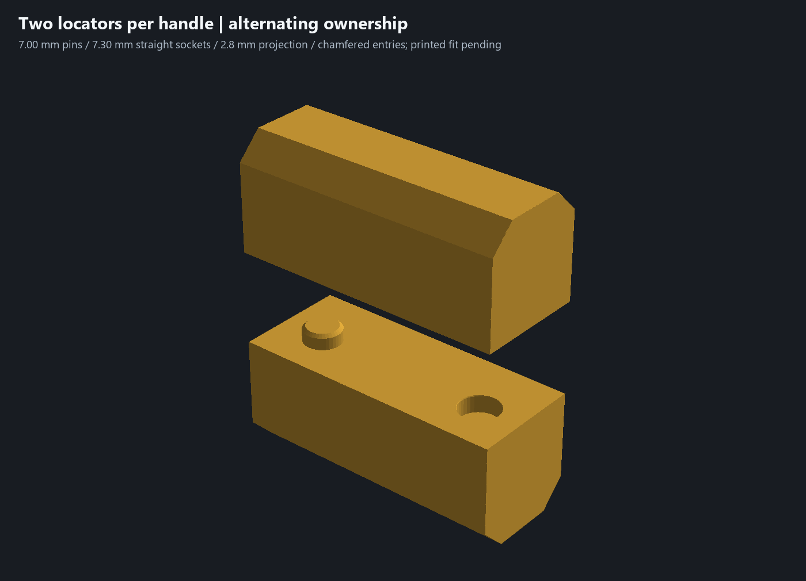
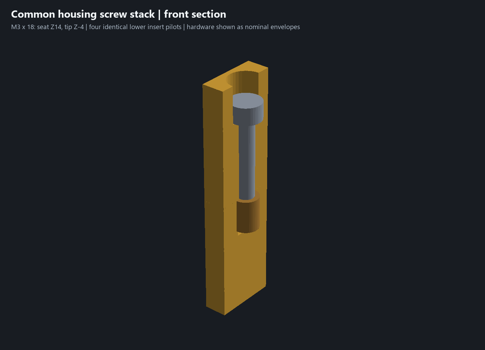
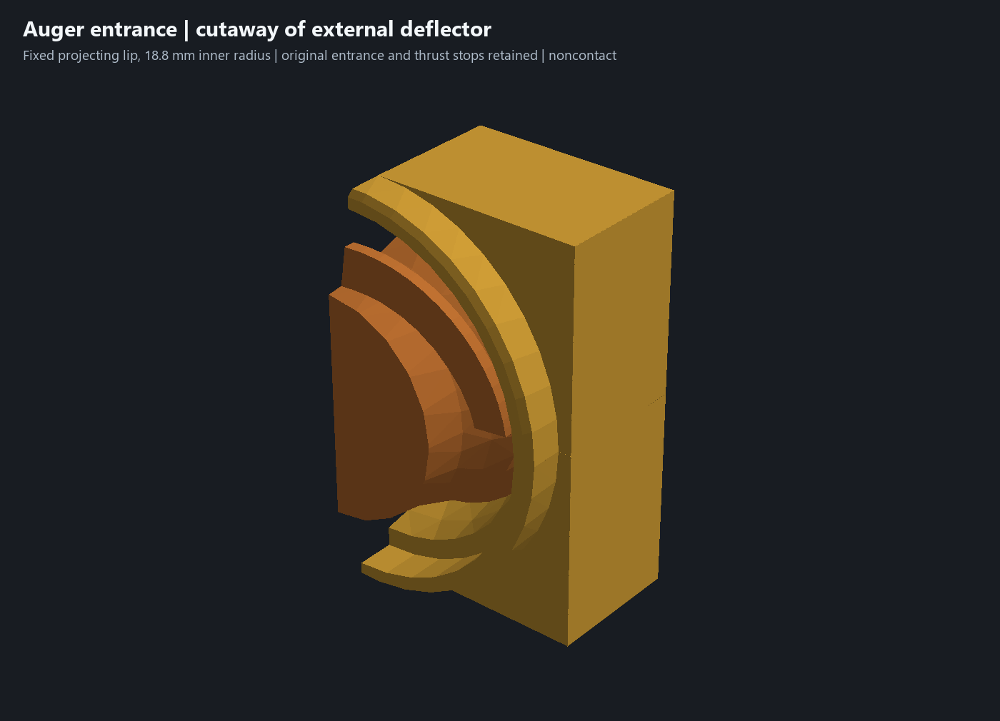
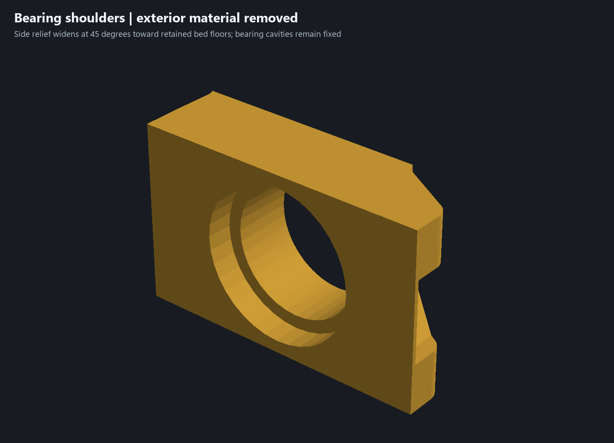
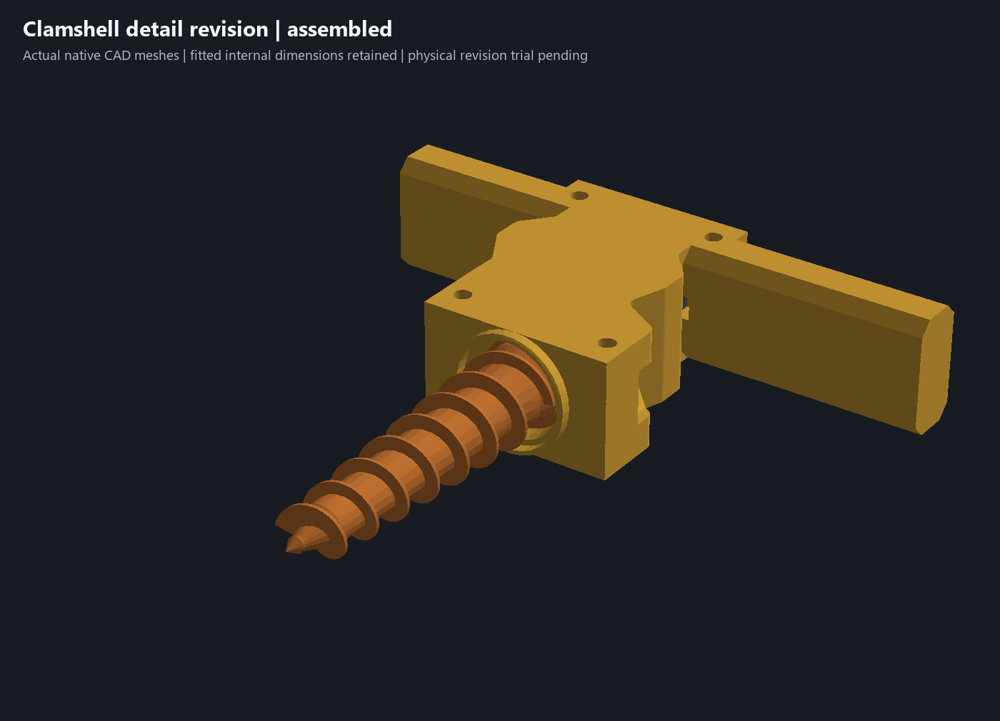
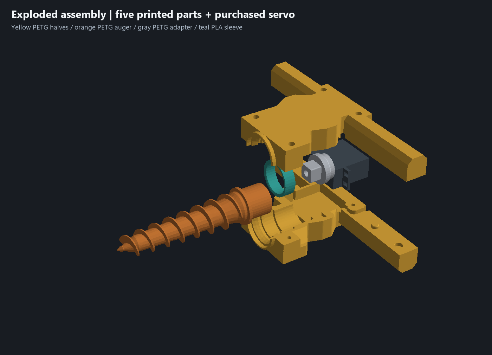
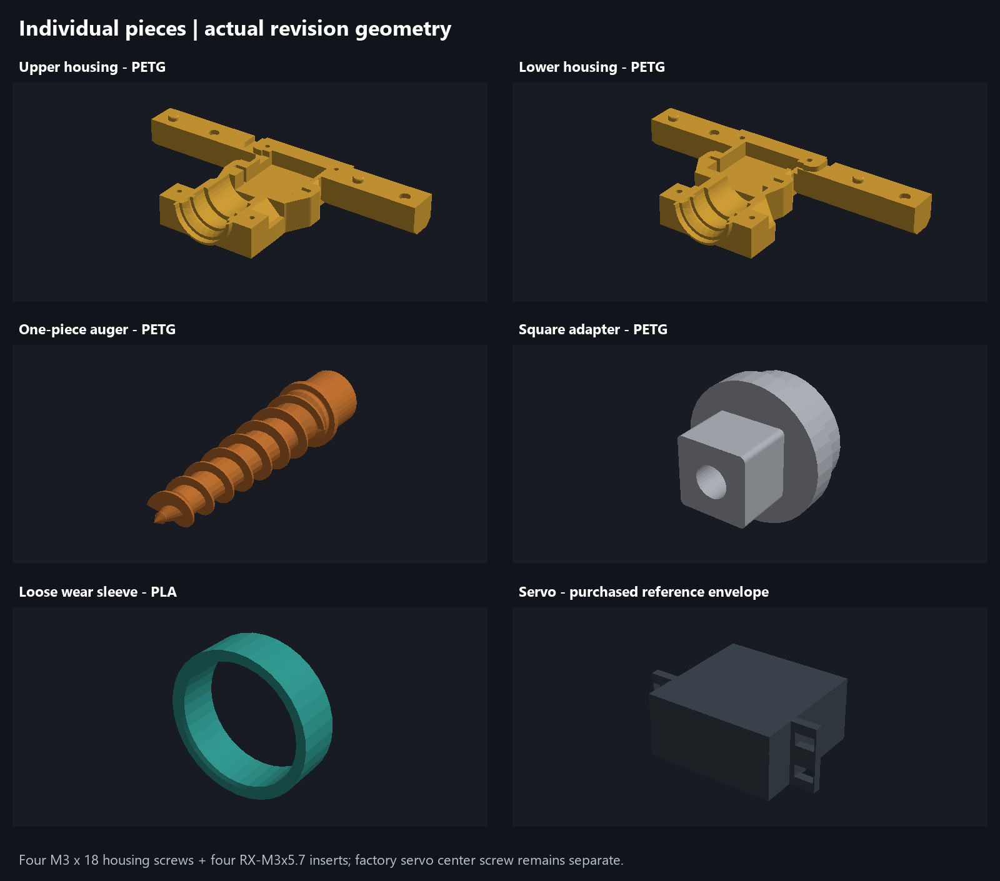

# Clamshell detail revision review ? 8 October 2026

The authorized detail revision is complete as an **editable CAD test candidate**. The physically successful snug-nest pair remains preserved. The owner observed movement while holding the halves together and flexing the handles; **the four screws were not tried**. This revision has not been printed or physically qualified. [Feedback and authorization](../source/references/clamshell-detail-feedback-20261008.json) distinguish observations from the requested changes.

Open [garden-auger-clamshell-detail-test.limo](../experiments/garden-auger-clamshell-detail-test.limo). Both revised halves are required together. Do not pair either with the previous snug-nest half.

## Registration and identical hardware

Four locating features replace the shallow dimples. Each handle has two features at X?55 and X?88, Y192. Upper owns X?55/+88; lower owns X?88/+55. **Alternating ownership gives each half one pin and one socket on each handle.** Pins are ?7.00, sockets ?7.30 along their straight locating surfaces: nominal total diametral freedom is 0.30 mm, versus approximately 0.90 mm at the old dimple mouths. Pin projection is 2.8 mm, socket depth 3.2 mm, with a 0.6 mm tip chamfer and a flared socket entrance. Flat seam lands close before pins bottom. These are provisional print dimensions, not a measured printer capability or a certified tight fit. Four round locators can bind if printed center spacing differs; verify simultaneous seating without using screws to force closure. A small mating-feature coupon can be used before reprinting both halves if clearance tuning is needed.

The four housing screws are now **identical M3 ?18 socket head cap screws** with four identical **ruthex RX-M3x5.7 inserts**. Screw centers and lower ?4.00 ?6.70 pilot geometry are unchanged. All upper ?6.20 head pockets end at Z14.00, with ?3.40 through passages. An 18 mm under-head length puts each tip at Z?4.00: **4.00 mm nominal insert penetration** and 2.70 mm to the pilot bottom. A nominal 3 mm tall cap head ends at Z17, **3.60 mm below the Z20.60 outer face**, with straight access for a hex key. The [W?rth manufacturer dimensional reference](https://marketplacemedia.witglobal.net/source/marketplace/stmedia/wuerth/documents/documents/std.lang.all/29212039.pdf) lists ?5.5 ?3 mm heads and a 2.5 mm drive for M3 ISO 4762 screws. Actual purchased hardware, insert installation height, usable threads, clamping and tightening behavior must be checked physically. The separate factory-compatible servo center screw is unchanged.

## Exterior shaping and auger entrance

Side relief removes stock through the housing depth near the bearing (Y126?143) and case shoulders (Y173?180). The relief widens at 45 degrees toward the retained outer bed floors. Nominal seam-side wall boundaries retain 3.0 mm outside the ?35.6 bearing cavity and 2.8 mm outside the servo case bay at the selected cuts. These selected distances are not a global minimum-wall certificate. The cuts stop before the handles; the first rendering review caught a longer trial cut encroaching on their grip section, which was corrected before this saved candidate. The grips have narrower seam-side shoulders, retain their 11.5 mm outer bed lands and retain the full depth and roots. Screw bosses, ear capture stock and the central floors remain.

The final pair removes **24.61 cm? net, or 8.01% of nominal solid housing volume**, including the added guard and new screw seats. Sparse slicer mass changes differ from solid volume because walls and skin dominate. This is a conservative printable sculpting pass; the continuous bed faces and locked internals still constrain the maximum depth and silhouette. Loaded grip strength and comfort need direct feedback.

The dirt concern is addressed at the **rotating auger opening** with a fixed annular deflector projecting about 4 mm forward of the original nose. It spans Y103.9?108.2, with **18.8 mm inner radius** and up to 20.6 mm outer radius, plus a bevel on its exposed edge. It recesses the existing entrance behind a projecting rim. The original ?33.6-to-?31.2 entrance taper, collar stops and rotating auger are unchanged. It remains **noncontact protection against direct dirt entry**, with an open rotating clearance: it does not establish a fine-dirt or slurry seal. Check whether the rim deflects soil or instead packs material in the dirty trial.

## Preserved fitted geometry and review evidence

[Native CAD review](../clamshell-detail-review.json) records engine and CAD hashes, exact nominal interference, native datum witnesses, equal screw seats, connected closed meshes and sampled checks. The purchased servo reference, auger bodies, adapter and PLA sleeve mesh arrays remain identical. Materials and CAD colors are identical: yellow PETG housing, orange PETG auger, gray PETG adapter and teal PLA sleeve. The following fitted construction records are identical: case bay, 3.00 mm ear slots /56.40 mm outer capture /20.40 mm capture width, rear Y194 wall, original bearing/collar/sleeve seats, insert pilots and rear cable route. The 27 mm rear-case measurement and 38 mm case-length measurement remain the only new caliper authority; no shaft offsets or measurement uncertainty were invented.

Validation passed:

- Exact nominal six-component assembly interference check; no overlap.
- Nine coupled servo/adapter/auger translation poses, using the same offset samples as the snug-nest review; no overlap.
- Twenty-four auger/housing motion samples at 30-degree increments, ?0.29 mm axial travel and +0.50 mm radial X displacement; no overlap. This radial displacement screens the housing/guard separately and is not a claim that the sleeve permits that displacement. A deliberately excessive ?0.50 mm axial move is blocked by existing thrust stops.
- Upper/lower registration controls: 0.10 mm translations in X and Y clear; 0.20 mm translations are blocked. These are discrete nominal geometry controls, not manufactured play measurements.
- Six native material-section probes match the fitted baseline: ear nest, central servo floor, rear wall, square socket, adapter seat and PLA sleeve. The servo-floor probe uses Y179.9 to avoid a section exactly coincident with the new shoulder termination at Y180, where native hatching returned an open-boundary error. The [finding is recorded on existing Limo-CAD issue #350](https://github.com/limo-cad/Limo-CAD/issues/350#issuecomment-6072498034); application implementation remains deferred until owner-confirmed Bevy finalization.
- Native cylindrical witnesses verify all four head seats at Z14?20.6 and all four unchanged insert pilots at Z?6.7?0.
- Each half exports as one watertight connected volume; native single-half print placement is on the outer bed face, pocket up. The original fitted CAD, both sparse fit projects and owner's saved historical template remain byte-identical.

These checks are sampled geometry evidence, not manufactured fit, complete GD&T, loaded strength, wear or ingress certification. Actual shaft engagement and usable servo-center-screw thread depth remain unconfirmed.

## Matching sparse print candidates

[Native Bambu evidence](../clamshell-detail-print-verification.json) records mesh and bed-transform identity, template preservation, final package hashes, fresh native previews and slice estimates:

- [garden-auger-upper-clamshell-detail-sparse-test.3mf](../garden-auger-upper-clamshell-detail-sparse-test.3mf): 74.4 minutes, 44.7 g PETG.
- [garden-auger-lower-clamshell-detail-sparse-test.3mf](../garden-auger-lower-clamshell-detail-sparse-test.3mf): 72.5 minutes, 44.2 g PETG.

Both retain the saved PETG/printer profile and Global **0.28 mm layers, 0.50 mm lines, two walls, 5% rectilinear infill, three top/bottom layers**, with no object strength overrides, supports or prime tower. Native slicing emitted no support toolpaths or filament changes. These are dimensional test settings; do not use their strength as evidence for loaded operation. Screw-pocket bridges and actual locator clearance still need printed inspection. No printer command was sent and these new projects were not opened in the occupied desktop.

## Assembly and individual renderings

All images are raster renderings of the saved native CAD geometry, not generated concept images. Detail images use display-only section crops. Screw and insert cylinders are labeled nominal envelopes; threads, knurls and hex sockets are omitted from those illustrative envelopes and are not print bodies.

## Physical acceptance

Check that all four locators seat together and seam lands close without screw force. Install four identical inserts and four identical screws, verify the tips do not bottom, then compare handle movement before and after clamping. Recheck servo seating, adapter alignment, free auger rotation throughout available end float, and the unchanged rear cable route. Inspect the projecting guard during the first dirty trial for rubbing, retained debris and dirt migration. Inspect housing roots, locator wear, insert movement and heat/creep after use. The successful previous assembly fit does not establish these new outcomes.

[Detail-revision physical acceptance is tracked in issue #5](https://github.com/jeffglousher/garden-auger-technic/issues/5). The first dirty trial remains tracked in [project issue #3](https://github.com/jeffglousher/garden-auger-technic/issues/3). No useful construction baseline or saved user template was deleted during this detail revision; the prior cleanup already removed redundant artifacts with recovery recorded in Git.

Rebuild with `uv run --no-project --python 3.14 --with numpy --with trimesh --with manifold3d --with pillow python scripts/revise_clamshell.py`, then run `scripts/check_clamshell_details.py`, `scripts/package_clamshell_detail.py` and `scripts/render_clamshell_detail.py` with the same dependency environment. Review and slicing use separate hidden headless processes; they do not control the occupied CAD/Bambu desktop or send printer commands.
