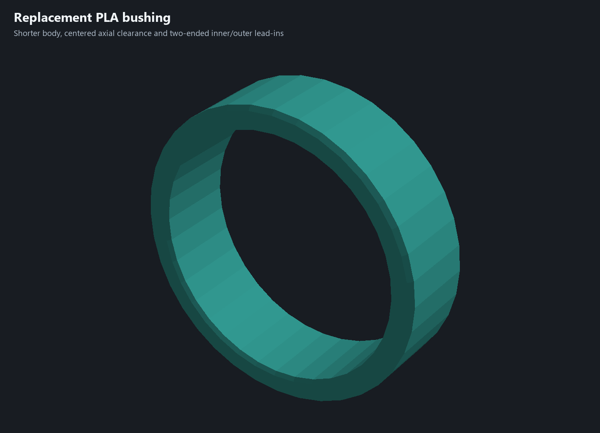
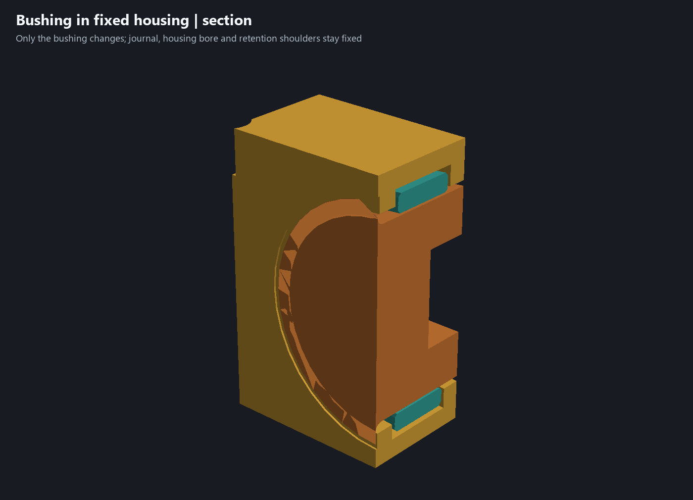

# Replacement PLA bushing derived from the assembly

The owner clarified that the teal part is a **bushing whose dimensions must serve the other parts**, rather than a fixed component to preserve. Its former10.40 mm length is therefore superseded. No new caliper reading is required to derive this nominal replacement from the established CAD constraints.

**Print only the [replacement bushing project](../garden-auger-pla-constraint-fit-bushing-test.3mf)** or use the [upright STL](../print-parts/pla-constraint-fit-bushing.stl). The complete [editable assembly candidate](../experiments/garden-auger-constraint-bushing-test.limo) shows it in the fixed rounded housing. Both housing meshes, auger, adapter and servo reference remain identical; no replacement housing is required for this change. The prior sleeve and reviewed candidates remain preserved as history.

## Fit construction

The fixed journal is diameter28.00. The fixed housing seat is diameter35.60, spanning Y120.30-131.20 (10.90 mm). The bushing retains its existing diameter28.60 bore and diameter34.00 outside because those already clear their mating surfaces:0.60 mm diametral bore room and1.60 mm diametral housing room.

Length is now **9.80 mm**, positioned at Y120.85-130.65. This centers the bushing in the fixed seat and leaves **0.55 mm at each end**, or1.10 mm total axial freedom rather than0.50 mm. These are chosen design clearances, not invented measurement uncertainty.

Both ends have **0.40 mm inner lead-ins and0.50 mm outer lead-ins**. Straight bearing-bore length remains9.00 mm; the full outside land remains8.80 mm. The minimum outside diameter at either chamfered end is33.00 mm, larger than both fixed adjacent throats (31.00 front,29.60 rear). The clamshell shoulders therefore still retain the bushing, without clips, extra hardware or changed housing dimensions. The bore and outside diameter retain the previous radial freedom; this is a loose captured wear bushing, not a press fit or a dirt seal.

The correction targets the narrower axial assembly constraint and eases entry at both ends. It is a replacement fit candidate, not a claim that the old physical obstruction has been conclusively diagnosed.

## Geometry and print checks

[Native CAD evidence](../constraint-bushing-review.json) records source/engine/candidate hashes, the derived profile, native bore/outside/end-face witnesses, unchanged component meshes and identical material/color records. The bushing remains one watertight connected volume.

- The nominal six-component assembly has no volume overlap.
- Five upper-half approach/closure samples clear the bushing and journal.
- Bushing translations of?0.50 mm axially clear;?0.56 mm collide with the fixed shoulders. These are positive/negative capture controls around the new?0.55 mm nominal window.
- Twenty-four auger rotation/end-float samples clear the housing and bushing.
- Nine coupled servo/adapter/auger poses clear the unchanged housing and new bushing.
- Native single-bushing bed placement passes. The STL stands on an annular end; the saved profile has no support or prime tower.

[Native Bambu evidence](../constraint-bushing-print-verification.json) reports **11.0 minutes /3.1 g PLA** for one bushing. The project retains the saved printer and PLA filament profile (slot4), with the active display color set to teal. It uses0.20 mm layers and four walls. The narrow annulus is filled by perimeters and gap fill: native slicing emits **zero sparse-infill paths, support paths or filament changes**. The global15% grid value is retained but produces no sparse paths in this part. An explicit100% rectilinear-process trial was rejected by native Bambu; the selected four-wall profile is the verified result. The historical Bambu file supplies profiles only; no historical housing is included in the new project. No printer command was sent.

Geometry sampling and slicing do not certify manufactured fit, PLA wear, creep or loaded strength. The next physical check is simply closing the housing with the replacement, confirming free auger rotation/end float and verifying the bushing stays captured. The existing [physical follow-up issue #5](https://github.com/jeffglousher/garden-auger-technic/issues/5) remains open; the first dirty trial remains in [issue #3](https://github.com/jeffglousher/garden-auger-technic/issues/3). Actual servo shaft engagement and usable center-screw thread depth remain unconfirmed and unchanged.

Rebuild with `uv run --no-project --python 3.14 --with numpy --with trimesh --with manifold3d --with pillow python scripts/build_constraint_bushing.py`, then the same environment for `scripts/package_constraint_bushing.py`. Native/slicer evidence reuses `.build/clamshell-detail`, owned by this garden-auger task with10 MB new-output budget. Retain native evidence and recovery models until review settles and no active/shared consumer needs them.
