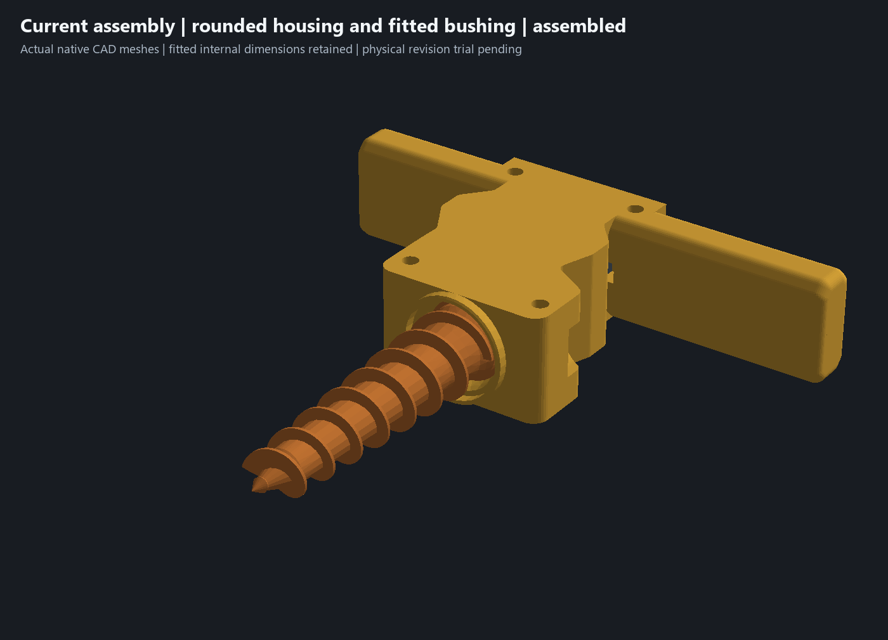
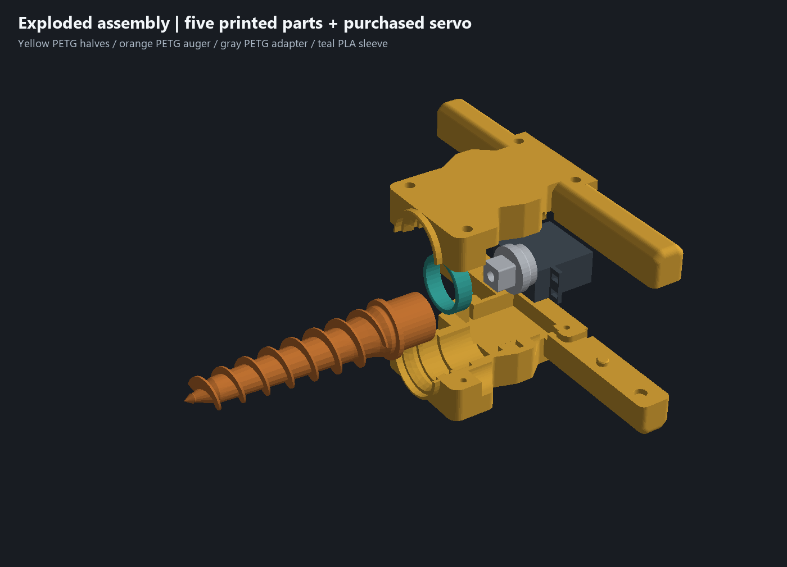
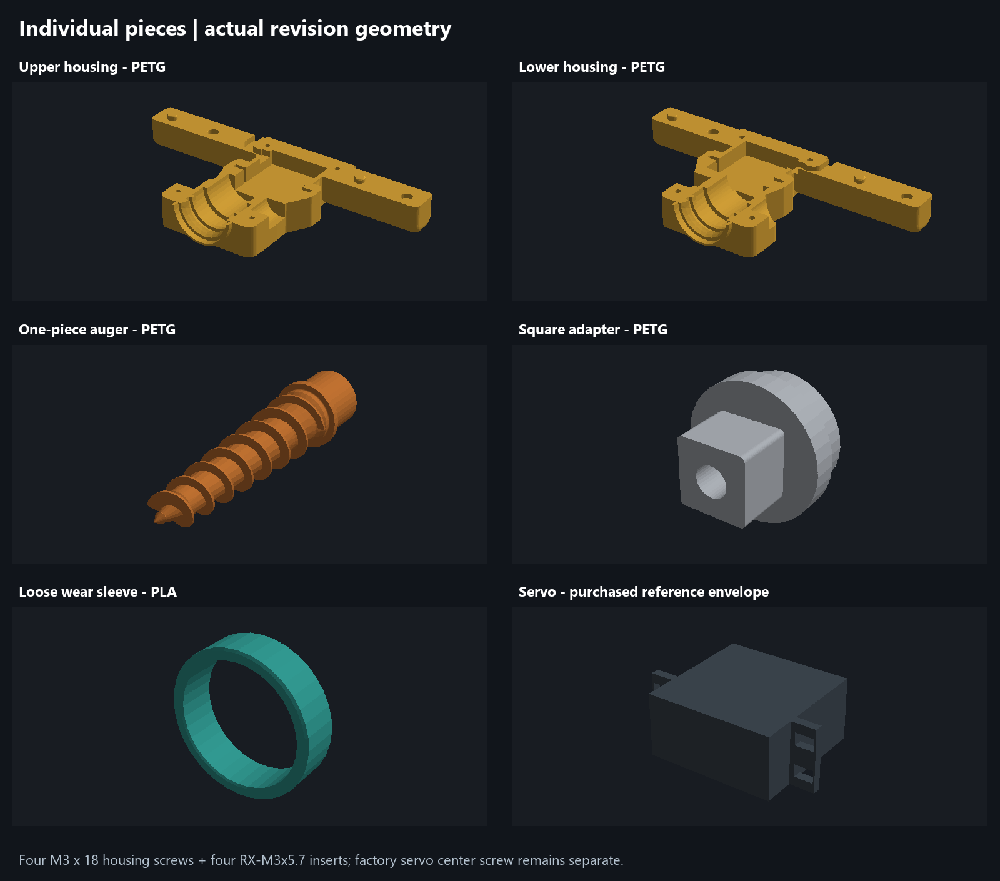

# Current assembly and complete print project — 15 October 2026

**Historical four-plate handoff:** the newer [two-plate candidate and geometry review](two-plate-geometry-review.md) is now preferred. This page preserves the preceding housing revision and its original checks.

Open **[garden-auger-current-assembly.3mf](../garden-auger-current-assembly.3mf)** in Bambu Studio. It contains all **five current printed parts on four plates**, sourced from [the constraint-fit-bushing assembly](../experiments/garden-auger-constraint-bushing-test.limo). The purchased servo and metal fasteners are excluded from the print. [Five individual STLs](../print-parts/current-assembly/) provide the same geometry and print orientations, without material/process metadata.

This handoff adds packaging, verification and current renderings; **it makes no further CAD geometry changes**. The historical `garden-auger-bambu-latest.3mf` supplied saved printer/filament profiles only. None of its old housing meshes were used. That file, the saved lower-half template and the owner's modified upper sparse project are unchanged.

What changed across the completed design revisions:

- **Registration:** two locators per handle, four total, with alternating pin/socket ownership. Pins are Ø7.00, straight sockets Ø7.30, projection 2.8 mm and depth 3.2 mm, with lead-ins. The 0.30 mm diametral clearance is provisional until printed; screws should not force the locators into place.
- **Housing hardware:** four identical M3 ×18 socket head cap screws and four identical ruthex RX-M3x5.7 inserts. All heads are recessed below the exterior; all stacks have 4.0 mm nominal insert penetration. Actual installed threads and clamping still need a physical check. The separate servo-center screw remains unchanged.
- **Exterior:** sculpted bearing/case shoulders, R4 grip blends, R6 front corners and curved R9.5 side relief remove material and soften the grips. The rounded pass removes another approximately 1.28% of housing volume after the earlier detail relief. Continuous bed floors, screw bosses and the rear cable route remain.
- **Auger entrance:** a fixed projecting annular dirt deflector addresses the rotating opening. It is a noncontact guard, with 18.8 mm inner radius, rather than a dirt-tight seal. The original entrance and thrust stops are unchanged.
- **Teal PLA bushing:** length decreases from 10.4 to **9.8 mm**, centered in the fixed 10.9 mm seat with **0.55 mm room at each end**. Both ends gain 0.4 mm inner and 0.5 mm outer lead-ins. The **Ø28.6 bore and Ø34 outside diameter stay unchanged**: nominal diameters already clear the fixed journal/seat. This reduces axial seating sensitivity without enlarging the fitted housing or assuming a measured physical fault.

The fitted servo nest remains locked: 3.00 mm ear slots, 56.40 mm outer-ear capture, 20.40 mm capture width and the conservative 41.30 mm case bay. Rear stop-to-wall distance remains 28.35 mm. The auger and square adapter are unchanged. Housing is yellow PETG, auger orange PETG, adapter gray PETG and bushing teal PLA.

The complete project uses the saved **Bambu Lab X2D 0.4 mm nozzle** printer/material profiles. Confirm the physical spool mapping before printing: project filaments 1–3 are PETG; filament 4 is PLA and also supplies support interfaces on the PETG plates. These project numbers do not establish physical AMS positions. The saved PLA profile is named Bambu PLA Glow; use the appropriate profile for the actual PLA loaded.

- **Plate 1 — matching housing halves:** 0.24 mm layers, six walls, 30% gyroid, six top/bottom layers; **6 h 54 min**, about **210.3 g PETG +2.0 g PLA**.
- **Plate 2 — one-piece auger:** 0.24 mm layers, six walls, 40% gyroid, six top/bottom layers; **2 h 55 min**, about **53.0 g PETG +5.2 g PLA**.
- **Plate 3 — square adapter:** 0.24 mm layers, six walls, 100% zig-zag infill; **36 min**, about **10.3 g PETG +0.1 g PLA**.
- **Plate 4 — replacement bushing:** 0.20 mm layers, four walls, four top/bottom layers; **11 min /3.1 g PLA**. The thin annulus fills with walls/gap fill; no sparse paths, supports or prime tower are emitted on this plate.

Combined native estimate is **10 h 36 min /284.1 g**, including supports, towers and purge. The PETG plates use automatic tree supports with the saved PLA interface and prime-tower setup. The housing support comparison cleared Bambu's cantilever warning at about **5.4 g /22 min** additional material/time. This full-print project intentionally has per-object strength settings; edit the relevant object when changing those settings. The earlier sparse test projects retain their support-free settings and are unchanged.

[Verification evidence](../current-assembly-verification.json) binds the CAD, prior fit evidence, engine, final package and standalone STLs by SHA-256. Fresh native recomputation has no timeline errors; all 15 nominal assembly body-pair checks have no interference. All five printed meshes are watertight, connected volumes; the auger core/flight are united into one printable solid. Every packaged mesh matches the fresh native export, with rigid unscaled placement, on-bed bounds and housing brim spacing checked. **Native Bambu slicing passes all four plates with no warnings**, the expected object counts and PETG/PLA assignments, and actual support roles on the PETG plates. The delivered editable 3MF has fresh previews and no embedded G-code. No printer command was sent.

The source CAD and native engine hashes also match the earlier detailed bushing review: five closure samples, clear/blocked axial capture controls, 24 auger rotation/end-float samples and nine coupled assembly poses remain applicable. These are sampled nominal geometry checks. The owner confirmed the preceding snug-nest physical assembly; **the rounded housing/locator/bushing combination still needs its printed and screwed trial**. Check seam closure, simultaneous locator seating, free rotation, adapter alignment and rear cable routing after support removal. Loaded strength, bushing wear, dirt exclusion, actual shaft engagement and usable servo-center-screw thread depth remain unconfirmed. Physical acceptance stays in [issue #5](https://github.com/jeffglousher/garden-auger-technic/issues/5); the dirty trial stays in [issue #3](https://github.com/jeffglousher/garden-auger-technic/issues/3).

Detail renderings: [locators](../renders/current-assembly/locators.png), [common screw stack](../renders/current-assembly/screw-stack.png), [auger entrance](../renders/current-assembly/auger-entry.png), [side relief](../renders/current-assembly/sculpted-shoulders.png), and [bushing in the fixed seat](../renders/constraint-bushing/seated-section.png). These are actual native mesh renderings; section caps and nominal hardware envelopes are display-only illustrations.

Rebuild with `uv run --no-project --python 3.14 --with numpy --with trimesh --with manifold3d --with pillow python scripts/package_current_assembly.py`. Native/slice evidence reuses `.build/clamshell-detail/current-assembly`, owned by this garden-auger task with a150 MiB additional-output budget. Retain until physical review, recovery coverage and active consumers settle; historical models/evidence and user edits are preserved.
