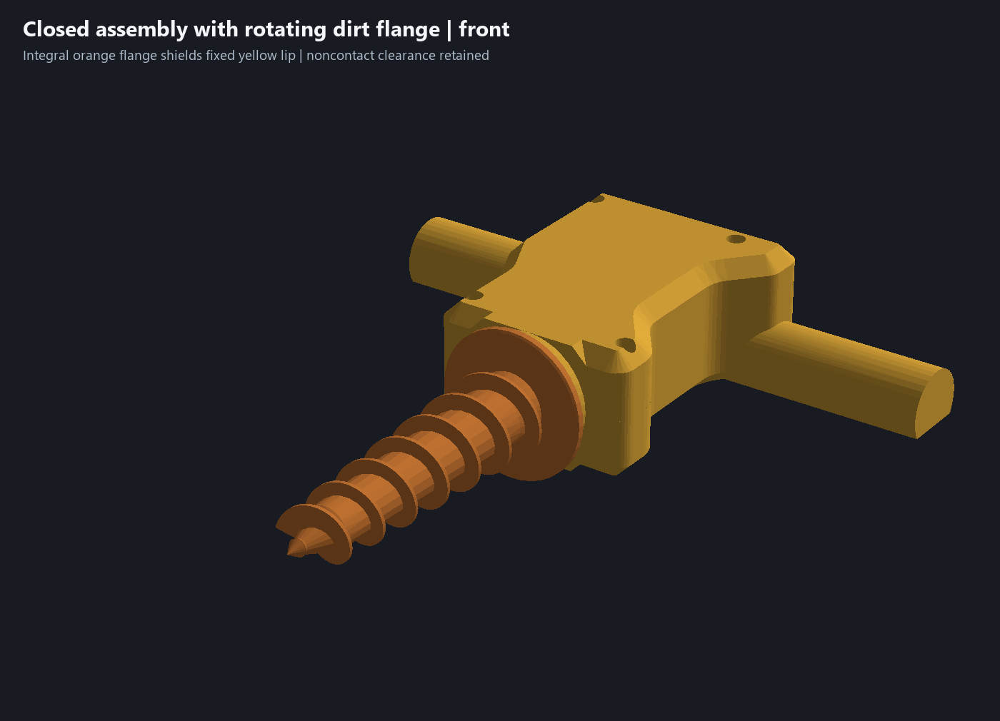
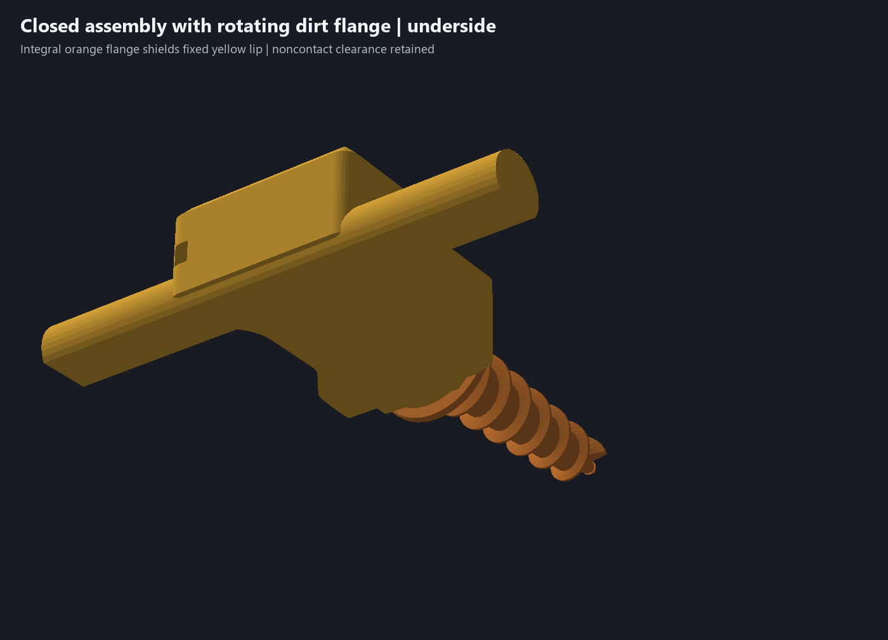
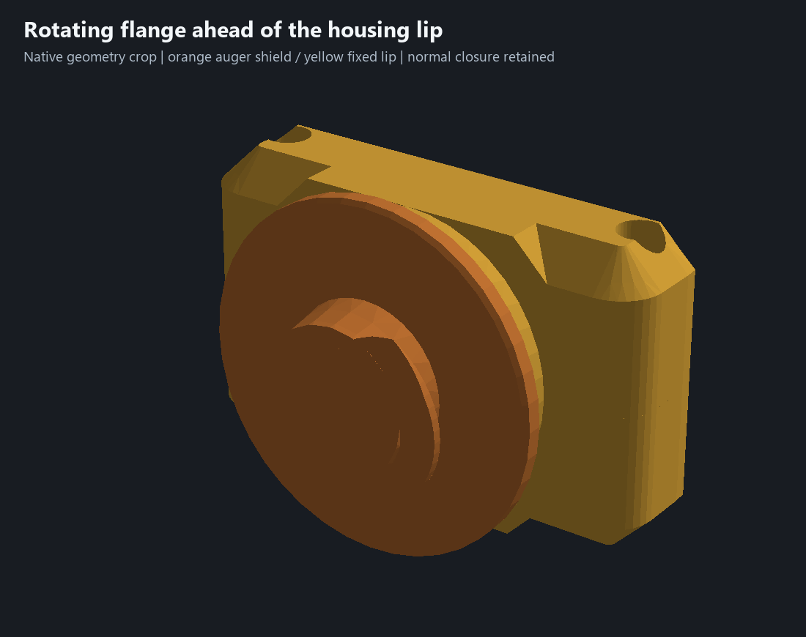
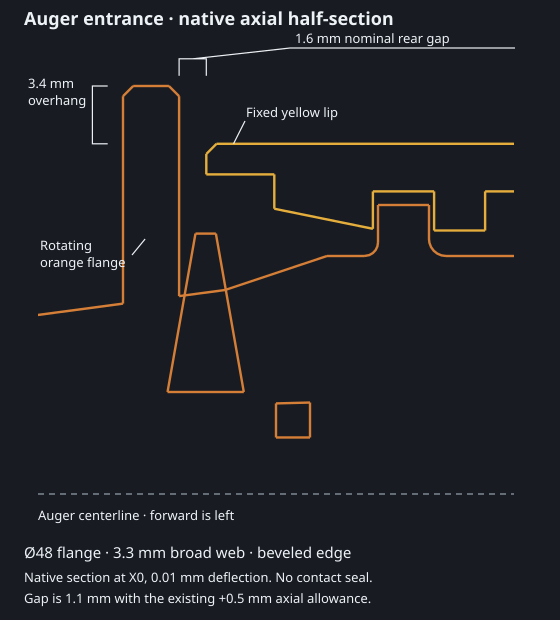

# Integral auger ingress flange — 29 October 2026

The owner asked for upper/underside views and a flange on the rotating orange auger to shield the opening behind the yellow housing ridge. The preceding fixed ridge remained open around the auger. This revision adds a forward flange integral to the auger; the chamfered housing halves, flight, adapter, bushing, servo reference and materials are unchanged.

## Shield geometry and assembly

The flange is **Ø48 mm**, ahead of the existing fixed lip. Its broad web is **3.3 mm thick**, with **0.6 mm, 45-degree edge chamfers** and a 2.1 mm thick outer edge. It spans Y99.0–102.3 on the existing auger axis. The housing lip starts at Y103.9 and has a maximum outer radius of 20.6 mm. The nominal flange-to-lip rear gap is therefore **1.6 mm**, with **3.4 mm radial overhang** at the flange's maximum radius. The broad flange obstructs direct axial approach to the entrance; material must pass around its edge to reach the gap.

With the existing conditional +0.5 mm axial allowance, the rear gap is **1.1 mm**. With a 0.5 mm radial axis offset, maximum-radius overhang is **2.9 mm** on the reduced side. These are nominal CAD dimensions and the existing conditional assembly allowances, not new measured hardware, printer capability or a full tolerance stack. Ten isolated-shield native poses at axial ±0.5 mm and centered/cardinal 0.5 mm radial offsets clear both housing halves; exact minimum distances are 1.1 or 2.1 mm. The real auger is checked separately within its nominal collar/end-float limits.

A rearward wraparound skirt was tested first. Its overlap trapped the upper housing lip during the normal vertical closure path: native checking at 2 mm upper lift found approximately **47.80 mm³** of overlap. That design was rejected. The final forward flange has open rear clearance and preserves the existing closure sequence. It adds no separate part, clip, gasket or screw. The original journal, collar/thrust geometry, square socket and flight remain; the flange is a new native revolve joined to the existing core.

This is a **noncontact dirt shield**. Fine grit or slurry can still reach the running gap, and soil can pack behind the flange. Reduced ingress is a design intent requiring a dirty trial, not a proven seal. Check free rotation and clean out packed material; clamped strength, flange durability and wear remain unqualified.

## Validation and printing

[Geometry and rejected-skirt evidence](../ingress-flange-geometry-review.json), [wall/angle checks](../ingress-flange-wall-review.json), [functional checks](../ingress-flange-validation.json) and [print evidence](../ingress-flange-print-verification.json) bind the final CAD and engine hashes. Native checks cover unchanged housing/flight/adapter/bushing/servo meshes, retained previous operation records, connected core/print exports, nominal interference, six fitted sections, four driver approaches, 20 locator controls, five closure positions, four bushing-capture controls, 24 auger rotation/end-float samples, nine coupled assembly poses and three continuous cable sweeps/controls. The original 44 housing bevel witnesses and selected 2.8 mm bearing-cover samples remain. These are sampled checks, not global GD&T or manufactured-fit certification.

Use [garden-auger-ingress-flange-assembly.3mf](../garden-auger-ingress-flange-assembly.3mf), [matching CAD](../experiments/garden-auger-ingress-flange.limo) and [five STLs](../print-parts/ingress-flange-assembly/). Existing matching chamfered housing halves, adapter and bushing do not change in this revision. The auger is the only changed printed part.

Native slicing passes without warnings at an estimated **9 h 01 min /235.2 g** total, plus any bed-cooling wait. Both plates retain print by object. Plate 1 holds the unchanged matching housing pieces. Plate 2 retains the PETG auger, PETG adapter, then PLA bushing order and the wait for a 55 C bed before PLA. The horizontal auger is now 48 mm tall because of the flange; saved supports remain enabled and native slicing rechecks the existing rear/front separation against the 33 mm rod clearance. Keep the supplied order and Textured PEI profile when reslicing. Physical execution of the thermal transition remains untested.

Saved printer/process/filament profiles, strength/support overrides, CAD colors and the user's sparse-upper edit are preserved. The delivered project contains no embedded G-code; no printer command was sent. [Physical acceptance #5](https://github.com/jeffglousher/garden-auger-technic/issues/5) and [dirty trial #3](https://github.com/jeffglousher/garden-auger-technic/issues/3) remain open. Actual shaft engagement and usable screw thread depth remain unconfirmed. The [preceding chamfer project](../garden-auger-chamfer-envelope-assembly.3mf) is retained.

Reproduce with `scripts/build_ingress_flange.py`, then `scripts/check_outer_walls.py --ingress-flange`, `scripts/check_d_grips.py --ingress-flange` and `scripts/package_refined_assembly.py --ingress-flange` in the existing numpy/trimesh/manifold3d/pillow Python environment. Native entrance curves are displayed without inferred closing edges; the closeup is a crop of the actual native meshes. [Render provenance](../renders/ingress-flange/provenance.json) binds the source and native section data. The owned `ingress-flange` evidence subdirectory on D is bounded to 90 MiB; retain source/scene and compressed native proof while current or needed to reproduce, and remove standalone G-code only after archive byte verification and settlement.
