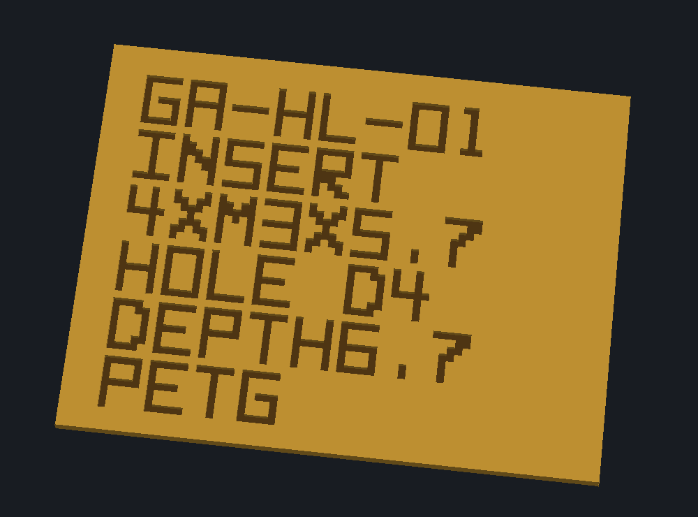
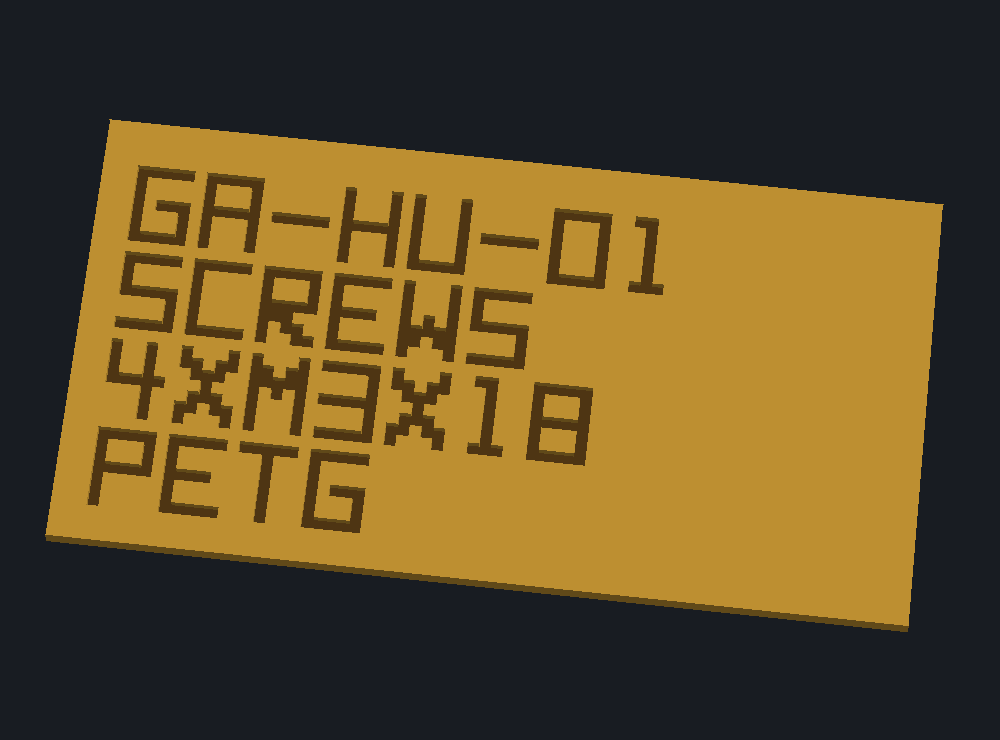

# Engraved housing labels

Current CAD: [garden-auger-labeled.limo](../experiments/garden-auger-labeled.limo). Complete print: [garden-auger-labeled-assembly.3mf](../garden-auger-labeled-assembly.3mf).

The labels are recessed 0.4 mm into the broad inner servo-pocket floors. The rim, zero-clearance locators, screw seats and insert holes retain their dimensions. Lettering cannot hold the halves apart because no material is added. There is 10.0 mm of remaining floor beneath the cuts. The housing stays one yellow PETG body per half; no extra colors, inlays, filament swaps or assembly parts are introduced.

Upper marking: `GA-HU-01 / SCREWS / 4XM3X18 / PETG`.

Lower marking: `GA-HL-01 / INSERT / 4XM3X5.7 / HOLE D4 / DEPTH6.7 / PETG`.

The IDs are project-assigned part identifiers, not a third-party standard. Hardware sizes are millimetres: four M3 x18 housing screws; four RX-M3x5.7 inserts; nominal insert pilots diameter4.0 x6.7 deep. Hole diameter is deliberately labeled separately from insert/thread size. No installation temperature is specified or inferred.

Letters use an original editable block font: 3.5 mm high with 0.5 mm strokes. Upper lettering is oriented to read correctly when the upper is turned pocket-up. Recessed same-color printing is the delivered option. A contrasting PETG option would need genuinely flush inlay volumes and separate color assignments; raised lettering on a mating face would prevent flat closure.

Validation is focused on the changes: both solids remain closed/connected; actual removed volume agrees with the lettering area times0.4 mm; the flat bed faces are preserved; all prior feature definitions are retained after the current engine adds default merge_profiles=false fields. Drive/servo native meshes are identical before and after labeling, and nominal assembled interference remains clear. Existing movement evidence applies to unchanged interfaces. Print legibility still needs a physical sample.

Reproduce using the existing Python environment plus Shapely2.1.2:

1. `python scripts/engrave_housing_labels.py`
2. `python scripts/package_refined_assembly.py --labeled --build-root .build/clamshell-detail/current-assembly/labeled`
3. `python scripts/render_label_details.py`

Owned native proof: existing D project lane, labeled directory, 90MiB ceiling. Retain compressed native source/slicing evidence while current or needed to reproduce; release exact duplicate standalone G-code after verified settlement. No printer command was sent.

Native Bambu slicing passes both print-by-object plates without warnings: approximately 8 h40 min /229.3 g total, plus bed cooling. The same saved process and material settings remain. No additional color changes are introduced. The new native engine budgeted out an unrelated whole-body entrance section after slicing completed; the labeled delivery uses the updated housing views and does not repeat that unchanged entrance view.

Closeups shade the recess bottoms darker for visibility. The actual print uses the same housing color throughout.

