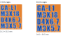
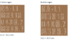
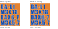

# Larger lettering trials

These coupons compare **7 mm and 8 mm capitals** in a heavy, condensed typeface with real curves. They replace the crowded 5.6 mm stencil for this print trial. Character gaps are 1.2 mm and row gaps are 1.6 mm. The 8 mm sample is the first choice for readability; print both to compare.

- [AMS coupons](../print/garden-auger-lettering-ams-coupons.3mf): two PETG colors, with flush contrasting lettering.
- [Single-color coupons](../print/garden-auger-lettering-single-color-coupons.3mf): one PETG filament, with concentric texture inside the letters.
- [Editable coupon model](../experiments/garden-auger-lettering-coupons.limo).

Each file holds two flat plaques: **31.3 × 35.5 mm** for 7 mm letters and **34.6 × 39.5 mm** for 8 mm letters. Both are 2.72 mm thick. Their layer phase matches the housing label floors. There are no raised letters or recessed grooves. Single-color texture keeps the letter paths in slicing, but its visible contrast depends on the printed finish and lighting.

The four rows are a proposed short part ID `GA-L1`, screw `M3X18`, pilot diameter/depth `D4X6.7`, and insert `M3X5.7`. These are lettering trials; final placement and complete housing annotations follow the printed choice. The production model and its accepted 4.70 mm locating pins are unchanged.

Both projects use the saved 0.4 mm nozzle, PETG, 0.24 mm layers, three walls, 15% grid, four top layers and three bottom layers. They print by layer with no support, brim, skirt, raft or prime tower. The AMS project uses logical filament1 for the base and filament3 for the text; map both to PETG. The single-color project uses filament1 only and needs no AMS.

Native local estimates for both plaques together: about **41 minutes /8.0 g** with AMS color and **18 minutes /6.4 g** in one color. Actual AMS mapping can change the estimate. Physical readability has not been confirmed.





These diagrams use the programmed bead widths from the native G-code, not photos of printed PETG. Earlier diagrams used 0.16 mm centre lines and exaggerated the empty space between beads. The blue paths are the second material. A full-width single-color projection cannot predict the reflected-light contrast of printed texture.

## Top finish trial

These new projects compare two **8 mm** samples of the same geometry:

- [AMS finish coupons](../print/garden-auger-lettering-finish-ams-coupons.3mf).
- [Single-color finish coupons](../print/garden-auger-lettering-finish-single-color-coupons.3mf).
- [Editable finish coupon model](../experiments/garden-auger-lettering-finish-coupons.limo).

Both use **1.05 top-surface flow** and **40 mm/s top-surface speed**. The left sample stops there. The right adds background-only ironing at **10% flow, 20 mm/s and 0.15 mm spacing**. Ironing is disabled in the letter masks so their concentric texture survives. Keep the samples in left/right order after lifting them from the bed; their geometry is identical.

The top-flow and speed settings apply to the exposed top-surface role across this coupon plate. They do not increase filament calibration flow, wall flow, bottom flow or internal infill flow. Ironing is an object/region override on the right sample. No extra modifier solid, brim or support geometry is added. The housing projects remain unchanged.

Native G-code was compared with a baseline using identical geometry and materials. On both plaques, the final top-surface raster at Z2.84 receives 5% more extrusion, within G-code rounding. All lower layers and wall extrusion match exactly. The single-color left sample has a 0.0009 mm filament difference in final-plane gap fill; other non-top roles match. The extra ironing paths occur only on the right plaque's final plane; their centre lines avoid letter ink in 0.1 mm samples. This checks the commands, not the physical finish.

Ironing is an extra low-flow pass over supported skin. It can smooth small gaps, but a larger missing region needs a toolpath or geometry fix. Small triangular gaps remain near some letter corners in the programmed bead projection; the flow change is not proof that these will close. Increasing ironing flow too far can leave ridges or drag PETG across the letters. These are print trials, not an accepted housing setting. Bambu's [configuration source](https://github.com/bambulab/BambuStudio/blob/master/src/libslic3r/PrintConfig.cpp) defines these surface and ironing controls.

Native estimates for the pair: **51 minutes /8.9 g** with AMS, or **24 minutes /7.1 g** in one color. Filament at $17.99/kg is approximately **$0.16** and **$0.13**, respectively; mapping colors can change the estimate.



Rebuild these trials with:

```powershell
cargo xtask lettering-coupons --finish-trials --evidence .build/lettering-finish --slicer "C:/Program Files/Bambu Studio/bambu-studio.exe"
```

The ignored evidence includes native baseline slices and an extrusion audit. No printer command is sent. Physical gap closure and text readability remain to be checked.

Rebuild with:

```powershell
cargo xtask lettering-coupons --slicer "C:/Program Files/Bambu Studio/bambu-studio.exe"
```

Windows uses the installed Impact font; `--font` can select another heavy sans-serif TrueType font. The saved model and 3MF contain the outlines and meshes, so opening or printing them needs no font installation. No font binary is distributed. Limo CAD supplies the native plaque bodies and stores imported outline sketches; font conversion and manufacturing masks are generated by the Rust xtask.

The rebuild preserves letter counters, repairs skipped collinear triangulation vertices and checks closed oriented masks, native plaque dimensions, both material assignments, surface-pattern readback and sliced support/adhesion features. It writes a local HTML path preview and evidence under `.build/lettering-readability`. It sends no printer command.
