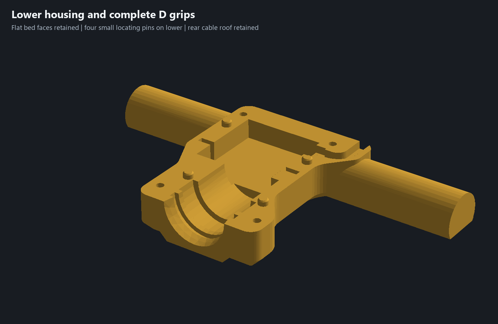
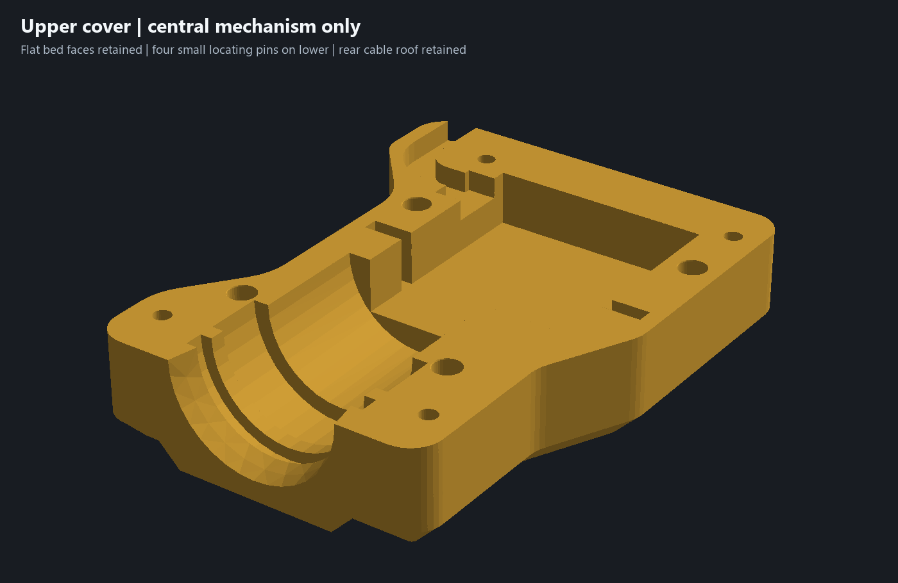

# Tighter, separated locators

Current candidate: `experiments/garden-auger-locator-fit.limo` and `garden-auger-locator-fit-assembly.3mf`. Use both new housing halves together. The previous simple-print assembly remains available as historical evidence.

Four lower-owned pins grow from 4.0 to 5.0 mm diameter; upper sockets grow from 4.3 to 5.2 mm. Nominal diametral clearance tightens from 0.30 to 0.20 mm (0.10 mm radial). Pin projection remains 2.8 mm, socket depth 3.2 mm, with chamfered entries. Pin cross-sectional area increases 56.25%; this is geometry, not a measured strength gain.

Locator centers move to (-21,132), (21,132), (-36,183), (16,175) mm. Minimum center spacing to the nearest insert/screw axis increases from 6.5 to 13.8 mm. The lower pin-root to insert-pilot edge separation is at least 9.3 mm; upper socket entry to screw-head recess separation is at least 7.9 mm. The insert pilot dimensions, thread hardware, screw seats and four M3 x18 screw stacks remain unchanged. More widely separated features do not certify insert pullout strength.

The first trial placed a front socket too close to the outer wall and a rear socket into the cable passage. Those positions were rejected. Revised native sections show at least 2.5 mm of side stock at Z1 across all four socket centers. These are selected sections, not a global minimum-wall certification.

The servo nest, bearing/bushing interfaces, adapter, auger, 38 mm shield, cable route, flat bed lands and D grips remain. Native mesh comparison confirms the servo and all three other printed parts are unchanged.

Reproduce from the repository root with the existing offline numpy/trimesh/manifold3d/pillow Python environment:

1. `python scripts/build_locator_fit.py`
2. `python scripts/check_locator_stock.py`
3. `python scripts/check_outer_walls.py --locator-fit`
4. `python scripts/check_d_grips.py --locator-fit --build-root .build/clamshell-detail/current-assembly/locator-fit`
5. `python scripts/package_refined_assembly.py --locator-fit --build-root .build/clamshell-detail/current-assembly/locator-fit`

Owned native proof uses the existing D project lane, with a 90 MiB ceiling. Retain compressed slicing/source/section evidence while current or needed to reproduce; release verified duplicate G-code after settlement. Physical tight-fit assembly and strength remain to be checked; no printer command is authorized or sent by these scripts.

Native Bambu slicing passed both print-by-object plates with no warnings: approximately 8 h 36 min /228.9 g total, excluding bed cooling. Both new halves are on plate 1; unchanged auger, adapter and bushing are on plate 2. The editable project contains no embedded G-code.

[Geometry evidence](../locator-fit-geometry-review.json), [functional checks](../locator-fit-validation.json), [wall checks](../locator-fit-wall-review.json), [native print verification](../locator-fit-verification.json).

