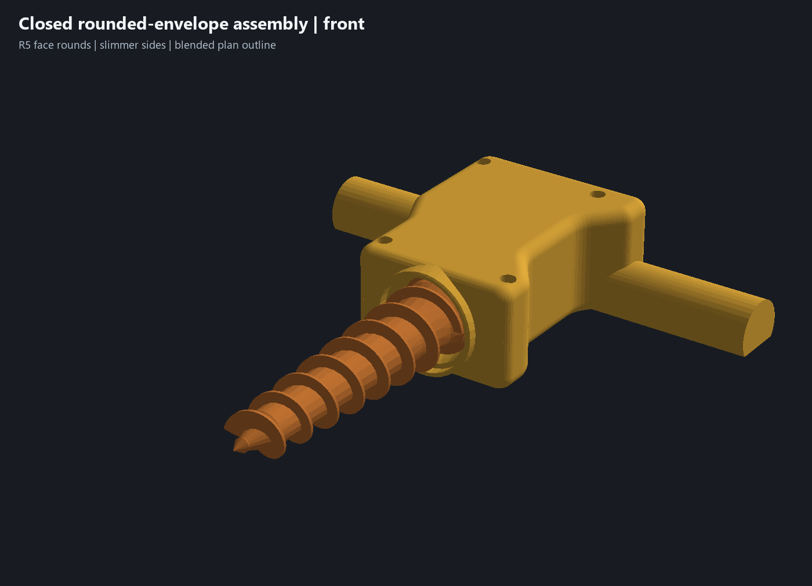
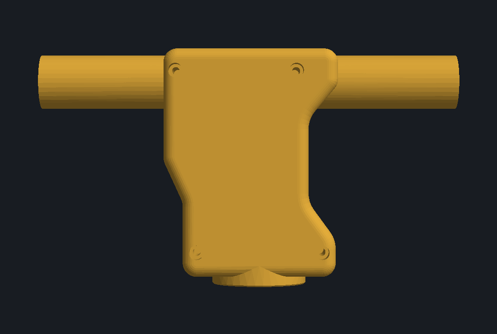

# Slimmer rounded housing envelope — 20 October 2026

The owner requested material removal from both **A: broad top/bottom outer faces** and **B: left/right side walls**, with the **C: stepped plan-view cheeks** blended into the body. This revision changes the exterior envelope while retaining the mechanism datums, complete lower D grips and continuous flat print bases.

## Shape and material changes

The broad outer-face perimeter rounds are **R5 on both sides of the original blank**, authored before the grip joins and functional cavity cuts. The side outline uses longer R8/R12 transitions and R6 end corners, replacing the short stepped waists. The redundant rear cheek/pad additions are suppressed because the new body supplies that stock continuously. No seam scallops are restored.

- Front bearing-block plan width reduces from **68 to 66 mm**; the ear-station outside width reduces from **64.6 to 62.6 mm**. The housing body X envelope reduces from **77 to 75.3 mm**, excluding the unchanged grips.
- Housing solid volume reduces from **231.79 to 226.99 cm³**: **4.80 cm³ / 2.07% net removal**, after filling/blending the former cheek steps and protecting the bearing roof. This is CAD volume; the native slice report supplies actual filament/time estimates.
- The central bearing still requires **41.2 mm overall depth** around its fixed Ø35.6 seat and retained 2.8 mm cover. The rounds remove the surrounding shoulders rather than moving the drive axis or lifting the print bases. The servo-zone central cover remains 10.4 mm at the sampled longitudinal locations.
- Both D grips retain their existing 24 mm width, 18.6 mm height, 20.04 mm flat land and 187 mm overall span. The existing comfort sample is preserved.

A first version without the bearing jacket left only **1.31 mm** at one native entry-roof sample and was rejected. A local **R20.6 bearing jacket from Y107.9 to Y113.9**, added before the original component cuts, restores that cover. The existing auger entrance, thrust stops, seat and dirt deflector dimensions remain. This is a geometry correction, not a claim of an application fix.

## Checks and practical limits

[Geometry evidence](../outer-envelope-geometry-review.json), [wall/contact checks](../outer-envelope-wall-review.json) and [functional validation](../outer-envelope-validation.json) bind this CAD hash and the installed native engine hash.

All preceding sketch/operation definitions are identical except for the exterior outline sketch; the intended stock features and superseded exterior fillets are suppressed in history. New rounds and the protective jacket are inserted before the original grip/cavity operations. Servo, auger, adapter and bushing meshes and all appearances remain identical. The caliper authority is still the owner's 27 mm rear case and 38 mm main case length; drawing references and missing shaft-relative measurements are unchanged.

The native checks cover closed connected housing exports, nominal assembly interference, six fitted-section probes, 20 clear/blocked case-locator controls, five closure positions, four driver approaches, four bushing-capture controls, 24 auger rotation/end-float samples, nine coupled assembly poses and continuous Ø4/Ø5 cable sweeps with a blocked Ø6.2 control. Exterior material intervals intentionally change; cavity boundaries and the drive-part sections remain.

Selected longitudinal samples retain at least **2.8 mm** of roof/cover stock. The native ear section retains **3.1 mm** outside each capture end. Five cable bend/outlet sections retain at least **2.97 mm** to the outer side. The counterbore land is thinner locally: approximately **2.2 mm** at the checked transverse station above the head seat. All four head seats remain at Z14 with unchanged screw/insert geometry. These are selected nominal stock checks, not a global minimum-wall, strength, complete GD&T or manufacturing certification.

The upper and lower retain approximately **4,679 and 7,392 mm²** of flat bed contact. Each exposed grip retains approximately **1,102 mm²**. No suspended floor is introduced. Native slicing checks supports and sequential clearance; adhesion, bridge quality, clamped root/fastener strength and wear still require physical testing. Actual shaft engagement, usable metal threads and dirty use remain unconfirmed in [physical acceptance #5](https://github.com/jeffglousher/garden-auger-technic/issues/5) and [dirty trial #3](https://github.com/jeffglousher/garden-auger-technic/issues/3).

## Complete printable project

Use [garden-auger-rounded-envelope-assembly.3mf](../garden-auger-rounded-envelope-assembly.3mf), [matching CAD](../experiments/garden-auger-rounded-envelope.limo) and [individual STLs](../print-parts/rounded-envelope-assembly/). Use both matching new housing pieces. The [native print report](../outer-envelope-print-verification.json) records final hashes, canonical mesh identity, actual object order, settings, temperature behavior and preservation of the earlier packages and user's sparse-upper edit.

The native estimate is **8 h 48 min / 229.7 g**, about3.7 g less material and4 minutes more time than the preceding project, plus any bed-cooling wait. Both plates retain print by object and the saved clearance limits. Plate 1 holds the matching housing pieces on their flat bases, separated by 62.4 mm in X. Plate 2 completes the PETG auger, PETG adapter and PLA bushing, with 126.0 mm separation from tall rear auger to short front objects and a wait for the saved 55 C bed temperature before the final bushing. Keep this order and the supplied Textured PEI profile when reslicing. Physical execution of that temperature transition remains untested. The editable project contains no embedded G-code; no printer command was sent.

Materials/colors stay yellow PETG housing, orange PETG auger, gray PETG adapter and teal PLA bushing. Per-object strength/support settings and saved filament profiles remain. The [preceding solid-frame package](../garden-auger-solid-frame-assembly.3mf) is retained as historical evidence.

Reproduce in the existing offline numpy/trimesh/manifold3d/pillow Python environment: `scripts/build_outer_envelope.py`, `scripts/check_outer_walls.py`, `scripts/check_d_grips.py --outer-envelope`, then `scripts/package_refined_assembly.py --outer-envelope`. Installed native CAD/Bambu provide the checks. The existing project-owned `outer-envelope` output sublane is bounded to 90 MiB; retain compressed native proof and source/scene witnesses while current or needed to reproduce, and remove byte-verified standalone G-code duplicates after archive validation.
