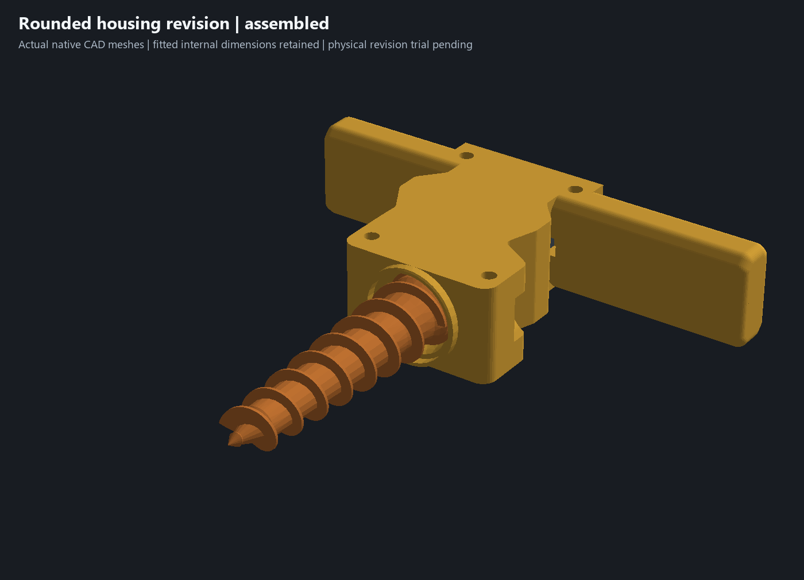
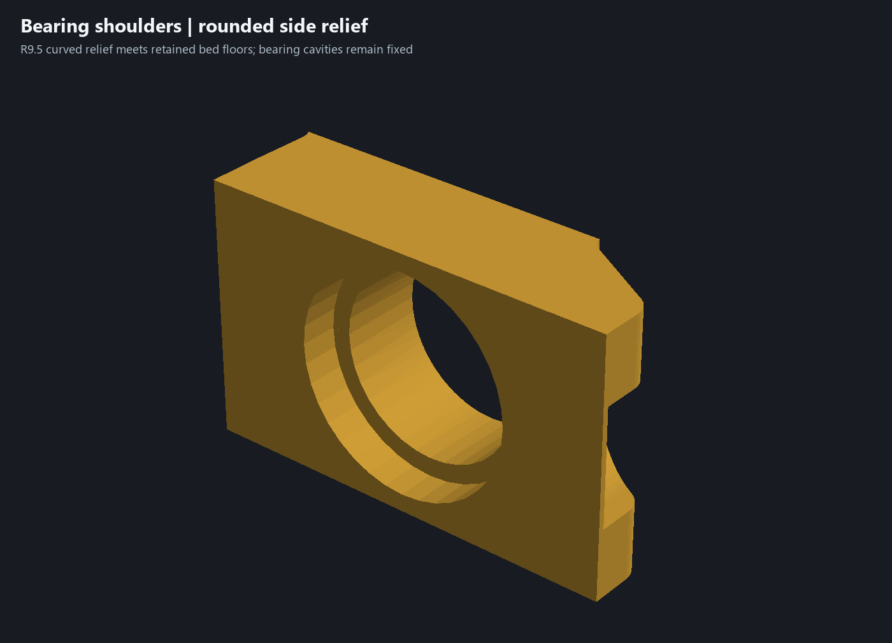
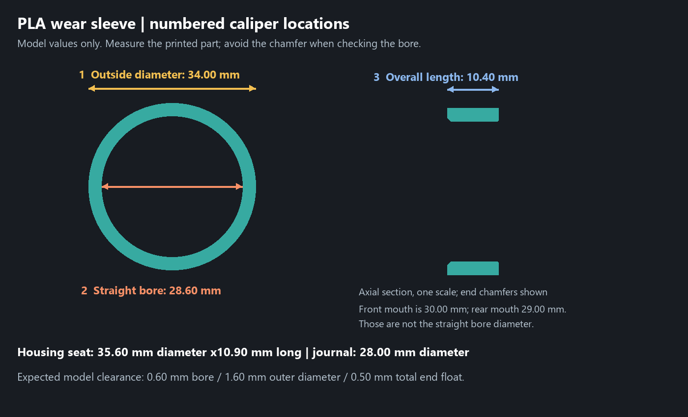
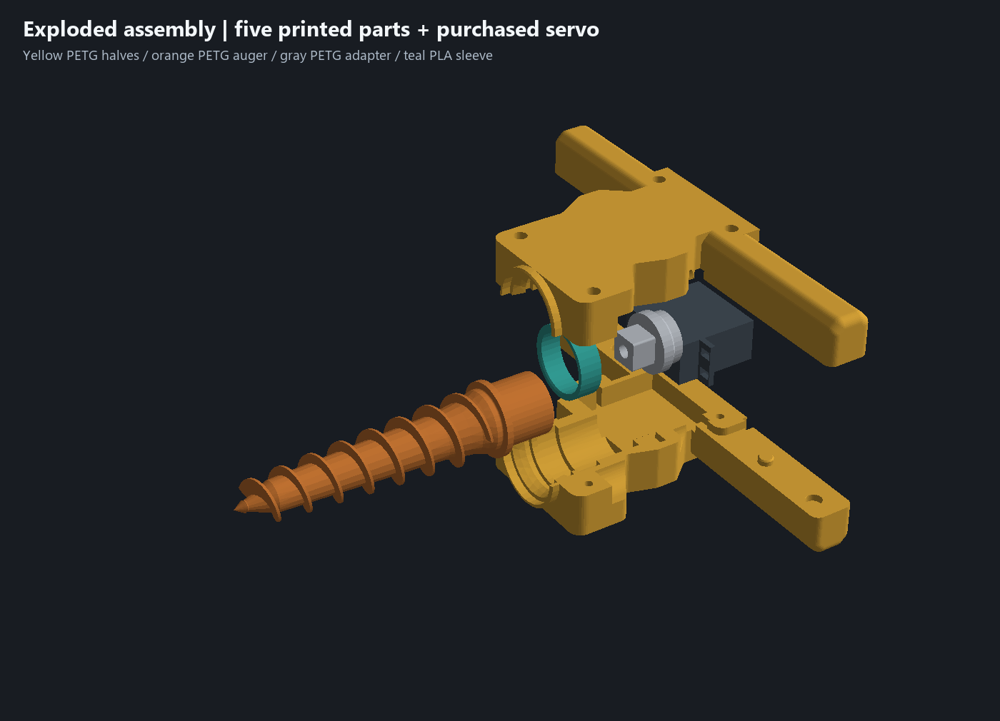
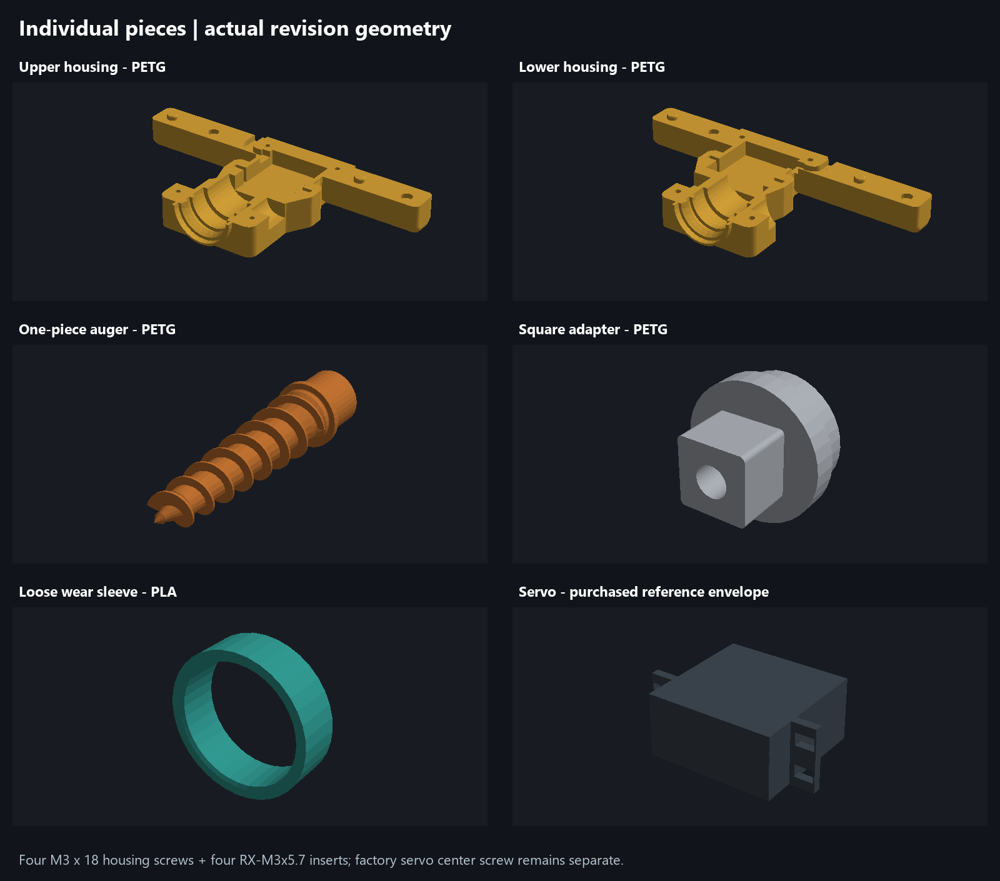

# Rounded housing and ring tolerance review ? 14 October 2026

The housing now has **R4 grip cross-section blends and tip corners, R6 front side corners and R9.5 curved side relief**. The side relief replaces the earlier flat bevels. Net solid volume falls another **3.62 cm? (1.28%)** relative to the clamshell detail revision. Continuous flat bed faces remain; the grip bed lands narrow where the cross-section corners are blended. Locator geometry, four identical M3 x18 screw stacks, fitted component cavities, rear cable route and auger-entry deflector are unchanged. Yellow PETG housing, orange PETG auger, gray PETG adapter and teal PLA sleeve are preserved.

Open the separate [rounded housing CAD](../experiments/garden-auger-rounded-housing-test.limo). Use two matching rounded halves. The previous physically fitted and detail candidates remain preserved, including the owner's locally modified upper Bambu project.

## Ring dimensions and print-file check

The owner now confirms that the **teal loose PLA wear sleeve seems to prevent housing closure** and requested dimensional diagnosis without speculative geometry edits. The actual printed housing filenames and printed sleeve dimensions remain unknown. A [separate closure audit](../sleeve-closure-review.json) confirms the fitted, detail and rounded CAD use identical sleeve-seat profiles and revolve definitions in both halves. Five upper-half approach/closure poses clear the nominal sleeve. No sleeve or housing geometry was changed during this diagnosis.

Native cylindrical and planar witnesses confirm:

- ?28.00 journal into ?28.60 straight sleeve bore: **0.60 mm diametral /0.30 mm radial clearance**.
- ?34.00 sleeve outside into ?35.60 housing seat: **1.60 mm diametral /0.80 mm radial clearance**.
- Sleeve Y120.60?131.00, length10.40; housing stops Y120.30?131.20, span10.90: **0.30 front gap +0.20 rear gap =0.50 mm nominal end float**.
- Straight sleeve wall thickness is2.70 mm. The front chamfer mouth is ?30.00 and rear mouth ?29.00; neither is the straight ?28.60 bearing bore.

The saved [sleeve STL](../print-parts/direct-drive/pla-full-wear-sleeve.stl) matches current native geometry after rotating it into its original bed orientation and translating its bounds to the origin. An initial coordinate comparison failed because the native definition lies along assembly Y while the STL stands along print Z. The normalized maximum vertex difference is **0.00000276 mm**, consistent with STL float32 serialization; this is a file comparison, not physical measurement uncertainty. The sleeve mesh is also identical to the preceding CAD. There is **no nominal outside-diameter interference or stale oversized sleeve file** in the reviewed geometry. There is deliberate radial and axial freedom; a loose feel can therefore be real even when the model is correct. These individual clearances do not establish simultaneous assembly play.

If this refers to the **yellow entrance rim**, that deflector is intentionally larger: ?37.60 inside, up to ?41.20 outside. It is separate from the ?34 sleeve, remains unchanged and is noncontact protection rather than a dirt-tight seal.

The follow-up also inspects the six matching sparse upper/lower projects. The detail and rounded meshes match their native CAD directly. The older servo meshes retain identical vertex/triangle counts and triangle order, with maximum coordinate differences of 0.00001453/0.00001512 mm from export precision; their Y125 sleeve-seat sections retain at least 0.77896 mm radial room around the nominal sleeve. All examined 3MF instance/component transforms are rigid, with no scaling. This is file/model evidence, not manufactured-dimension evidence.

**Axial seating is a narrower allowance than diameter.** A correctly located sleeve spans Y120.6-131.0 between stops Y120.3/131.2. Native sleeve translations of -0.29/+0.19 mm clear both halves; -0.31/+0.21 mm collide. Outside that short bay the adjacent openings reduce to diameter31.0 at the front and29.6 at the rear, so a displaced sleeve can prevent closure even with its correct diameter. These are isolated nominal controls, not proof that the physical sleeve is misplaced.

To diagnose the remaining physical problem, identify which upper/lower files were printed, check whether the halves close with the sleeve removed, and use the numbered printed-part measurements below. Do not use the chamfer mouth as the bore reading. No new caliper readings or shaft-relative offsets have been invented.

## Native review and matched print candidates

[Native review evidence](../rounded-housing-review.json) records the source/candidate/engine hashes, exact nominal no-overlap assembly, 24 rotation/end-float samples including the PLA sleeve, unchanged component meshes and colors, unchanged native section probes, nine coupled assembly poses, four equal screw stacks and locating translation controls. Each housing is one watertight connected volume. A mesh subtraction screens for added stock; the small positive residue is curved-boundary tessellation, not a dimensional-fit allowance. The operations are exterior convex rounds and enlarged relief cuts. Global minimum wall thickness, comfort and loaded strength remain physical review items.

The initial R2 all-perimeter and R3 long-bed-edge fillet trials were rejected by the native kernel and were discarded. The saved candidate uses the passing grip/front rounds and editable curved relief profiles; it has no failed or suppressed experimental fillet features.

[Native Bambu evidence](../rounded-housing-print-verification.json):

- [garden-auger-upper-rounded-housing-sparse-test.3mf](../garden-auger-upper-rounded-housing-sparse-test.3mf): 74.8 minutes, 44.2 g PETG.
- [garden-auger-lower-rounded-housing-sparse-test.3mf](../garden-auger-lower-rounded-housing-sparse-test.3mf): 72.9 minutes, 43.7 g PETG.

Both new sparse projects inherit the preceding detail templates: 0.28 mm layers, 0.50 mm lines, two walls, 5% rectilinear infill, three top/bottom layers, no support or prime tower, and no conflicting object strength overrides. Native placement and the packaged mesh/transform match. No support toolpaths or filament changes are generated. No printer command was sent. These remain dimensional-test profiles, not loaded-strength qualification.

Physical follow-up remains in [issue #5](https://github.com/jeffglousher/garden-auger-technic/issues/5), with the first dirty trial in [issue #3](https://github.com/jeffglousher/garden-auger-technic/issues/3). Verify simultaneous locator seating, matching-half closure, all four screws and inserts, handle comfort/stiffness, free rotation and rear cable routing. Printed sleeve dimensions and the specific oversize complaint remain unconfirmed; actual shaft engagement and usable servo-center-screw thread depth also remain unconfirmed.

Rebuild with the existing uv numpy/trimesh/manifold3d/pillow environment and `scripts/round_housing_review.py`; use the optional CAD/report parameters of `scripts/check_clamshell_details.py`, `scripts/package_clamshell_detail.py` and `scripts/render_clamshell_detail.py` for this separate candidate. Generated trial evidence reuses `.build/clamshell-detail` with a20 MB new-output budget, owned by this garden-auger task; retained models/evidence require recovery coverage and no active/shared consumers before cleanup.
