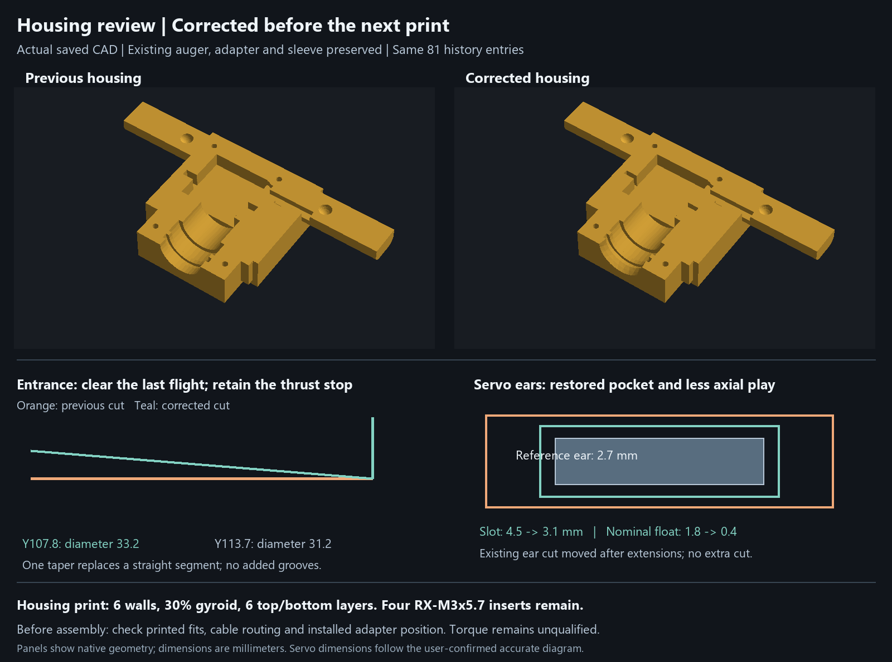

# Servo fit correction — 5 October 2026

The model was wrong. The 24.7 mm dimension in your diagram starts at the **underside/rear face of the mounting ear**. The servo reference and housing used its opposite face, moving the ears and pockets 2.7 mm rearward. The same error in both parts made the previous clearance check falsely pass.

Seating the real servo in those pockets placed its rear face 1.2 mm beyond the cavity. The corrected model restores the drawing datums, clears the larger catalog case length and accounts for the resulting adapter-position stack. **Reprint both housing halves. The auger, square adapter, PLA sleeve and four fit coupons are byte-identical to the previous release.**

## Dimensional authority and correction

The [original supplied image](../source/references/user-servo-fit-diagram.png) is retained unchanged with its SHA-256 in [source provenance](../source/references/provenance.json). It labels the 270° variant; the retained 360° supplier image has the same mechanical datums. The requested INJS035-360 drive remains the selected servo. The detailed mechanical drawing controls axial datums; the catalog's separate 40.5 ×20 ×40.5 summary does not override the explicitly drawn 37.5 mm case height and 41.5 mm tip-to-rear distance.

Every shown mechanical dimension was checked:

- Case plan: drawing 40 ×20 mm; the larger 40.5 mm catalog length is used conservatively. The cavity is **41.3 ×20.8 mm**, giving 0.4 mm clearance on each side of the larger case envelope.
- Shaft tip to rear case: **41.5 mm**; case axial height **37.5 mm**. Their difference is **4.0 mm nominal tip-to-case-front separation**. The reference contains no invented stationary nose.
- Ear underside to rear case: **24.7 mm**; ear thickness **2.7 mm**. With the shaft tip at world Y148.7, case faces are Y152.7/Y190.2 and ear faces are **Y162.8/Y165.5**.
- Corrected housing ear pockets: **Y162.6–165.7**, 3.1 mm wide axially, with 0.2 mm nominal clearance on each ear face. Previous pockets were Y165.3–168.4.
- Case cavity axial span: **Y151.7–191.7**, 40.0 mm. This already had sufficient total length at the correct datum: 1.0 mm nominal front room and **1.5 mm nominal rear room**, or 1.3 mm rear room at the nominal rearward ear-travel limit. Moving the ear seat restores the available length behind it from 23.5 to **26.2 mm**, exceeding the required 24.7 mm.
- Ear overall span: **56 mm**. Reference mounting-slot centers corrected from 52 to **49 mm** apart. The shaft is **10 mm from the right case edge**, centered across the 20 mm width. Slot widths/radii are not dimensioned; their conservative reference cut envelopes are retained. The fit inspection fills the ears solid, so those holes cannot hide a collision.

The two housing halves receive the same corrected case and ear cuts. The existing cut features are reused; no extra retaining hardware or grooves are added. The model still has **81 active history entries**, with **47 housing entries /25 solid operations**. Materials, colors and assembly poses are preserved.

## Mating surfaces and tolerance stack

The adapter, auger and sleeve are unchanged. The existing Ø29.6 rear chamber ends at **Y153.6**, 0.6 mm farther rearward, to accommodate the corrected installation allowance. Adapter rear clearance is **1.2 mm nominal /0.6 mm conditional minimum**. Boss radial clearance is 2.8/2.2 mm; flange radial clearance is 0.8/0.2 mm.

The installed adapter flange allowance is now **±0.40 mm**, derived from 0.20 mm ear-face clearance +0.10 mm printed stop-face extrema +0.10 mm shaft-seat-to-flange extrema. Require its auger-facing flange at **Y140.7–141.5**, or **27.0–27.8 mm behind the front chassis thrust stop**, and drive-axis radial offset no more than 0.50 mm.

Critical printed dimensions and functional-face extrema require ±0.10 mm acceptance; this includes surface form at the contact extrema. These are inspection requirements, not a measured printer capability or supplier tolerance. Each surface allowance is counted once. The independently derived conservative square stack gives **8.9–11.1 mm engagement**, **at least 0.9 mm peg-tip clearance**, and **at least 0.6 mm hub-to-flange clearance**. The 14 mm/R1 peg and 14.4 mm/R1.2 socket retain at least 0.10 mm flat clearance per side under the existing total profile controls.

The integral collar retains both thrust stops and 0.6 mm nominal total end float, conditional 0.4–0.8 mm. The loose PLA sleeve retains 0.5 mm nominal float, conditional 0.3–0.7 mm. The flight-entrance taper and open 8 mm cable channel remain. Cable-boot dimensions are not shown in the diagram.

## Hardware and materials

- Four **ruthex RX-M3×5.7** heat-set inserts, Ø4.6 ×5.7 mm, use unchanged **Ø4.00 ×6.70 mm** pilots. Checked surrounding wall after dimensional allowance is at least **4.45 mm**. Install flush with the split face.
- Housing screws remain **two M3×12 front and two M3×18 rear**. Nominal insert engagement is 4.0/5.3 mm. Passages and insert mouths remain open.
- The adapter retains its **Ø5.70 ×3.70 mm trial pilot**, Ø24 boss, Ø28 ×5 flange, 2.60 mm seating web, Ø3.4 center passage and Ø6.4 head access. The nominal trial center screw is **M3×6**, with 3.4 mm nominal insertion and 3.1–3.7 mm conditional insertion. A usable shaft-hole depth of at least 4.0 mm is required; internal thread depth and factory screw length are not shown in the diagram. Native printed-part screw clearance is verified; actual bottoming and thread engagement remain physical checks.
- CAD/portable export: housing **PETG yellow #E5AE3C**, auger **PETG orange #D57E37**, adapter **PETG gray #BEC3CA**, sleeve **PLA teal #37AAA1**.
- Bambu's saved spool palette remains **#034638, #FF671F, #FFFFFF, #DCF478** with PETG Basic /PLA Glow profiles. Housing: 6 walls, 30% gyroid, 6 top/bottom layers. Auger: 6 walls, 40% gyroid, 6 top/bottom layers. Adapter: 6 walls, 100% infill. Existing tree supports and PLA interfaces are retained.

## Evidence and delivery

The subsequent [direct CAD tool review](cad-tool-validation.md) distinguishes native tool results from separately derived tolerance bounds. Its [inspection project](../garden-auger-fit-inspection.limo) contains associative nominal measurements; its [raw results](../cad-tool-validation.json) retain the tool's warnings and limitations.

The [independent servo fit regression](../servo-fit-verification.json) recreates the old failure from literal drawing dimensions, rather than reusing production parameters. It confirms the old erroneous reference passed, while the correct envelope collided with both halves. The corrected native solids pass **23 fit/end-stop checks**, **6 lower-half insertion poses** and **5 upper-half closure poses**. The two beyond-limit poses correctly encounter the ear stops. The final document contains no inspection probe or temporary screw body.

The [component review](../preprint-review.json) passes **45 native motion poses** covering complete auger geometry, adapter motion, closure and hardware. The [adapter review](../adapter-housing-verification.json) passes nine installed-position checks. Canonical meshes, closed connected print solids, native schema-7 desktop round trips, material/pose preservation and the seven unchanged non-housing STLs are recorded in [release verification](../direct-drive-verification.json), [nesting verification](../housing-nesting-verification.json) and [Bambu layout verification](../bambu-latest-verification.json). [Native Bambu slice verification](../bambu-slice-verification.json) records the refreshed four-plate check.

Use the [corrected editable CAD](../garden-auger-direct-drive.nbcad), [complete Bambu project](../garden-auger-bambu-latest.3mf), [lower housing STL](../print-parts/direct-drive/petg-housing-lower.stl) and [upper housing STL](../print-parts/direct-drive/petg-housing-upper.stl). [All-part CAD views](../renders/direct-drive-all-parts.png) and [exploded assembly](../renders/direct-drive-exploded.png) show the current components.

The corrected geometry matches the shown mechanical dimensions. Physical verification still applies to unshown cable-boot and thread details, actual printed fits, and loaded torque/creep/wear. Those checks do not reopen the confirmed dimensions in your drawing.
