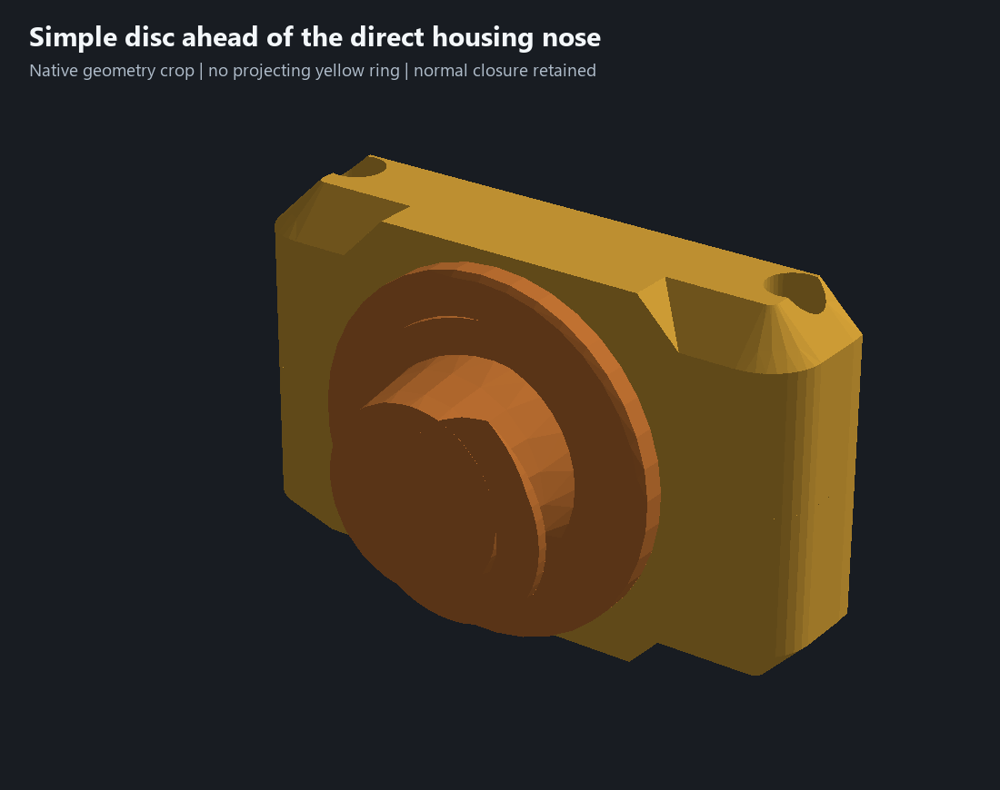
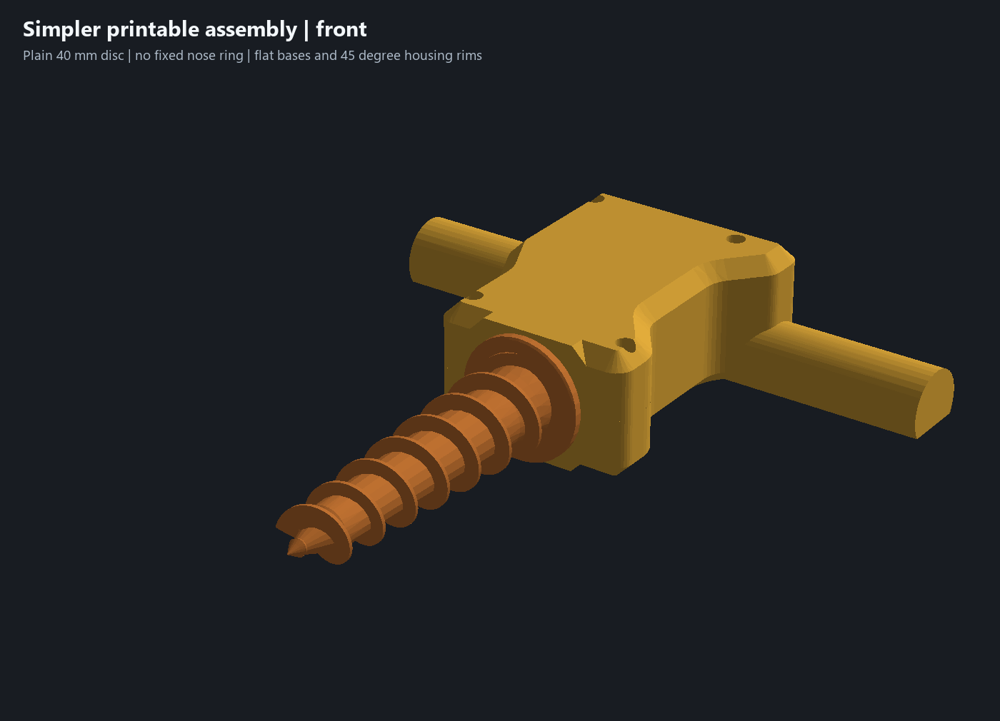
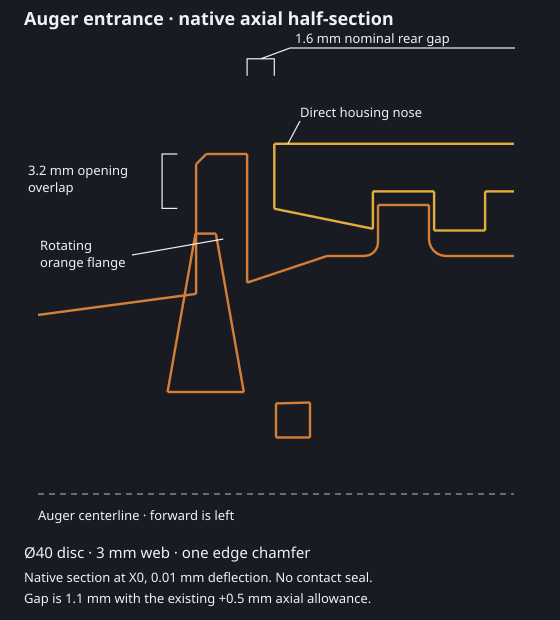

# Simpler printable nose and flange — 29 October 2026

The owner made simple, reliable printing a critical requirement. This revision removes a redundant feature rather than adding another seal stage: the projecting yellow nose ring is suppressed, and the orange auger uses a **plain Ø40 ×3 mm disc with one 0.6 mm, 45-degree front edge chamfer**. The housing retains its flat bases, broad 45-degree bevels and rounded plan corners. The D grips and fitted internal features remain.

## What becomes simpler

The fixed annular ring and its narrow space behind the larger rotating flange are gone. The direct housing nose is easier to inspect and clean. Moving the smaller disc closer to that nose retains the nominal **1.6 mm rear gap** without the old ring. The disc spans Y103.3–106.3; the housing starts at Y107.9. It overlaps the retained opening's conservative 16.8 mm radius reference by **3.2 mm**. With the existing conditional +0.5 mm axial allowance and 0.5 mm radial offset, the corresponding gap/overlap are **1.1 /2.7 mm**. These are CAD dimensions and existing allowances, not new physical readings or a complete tolerance certification.

The disc's broad web is 3 mm and its outer edge is 2.4 mm thick. There is one chamfer and no wraparound skirt, groove, nested seal, separate ring or added hardware. Nominal horizontal auger print height drops **48 to40 mm**. Five active construction operations are removed, **91 to86**, and the three changed solids lose **14 native faces** in total. Approximately **3.05 cm³** of solid material is removed across the core and both housing halves. Both housing bed-contact areas remain unchanged, approximately **4,835 /7,548 mm²**, including the unchanged grip lands.

This remains a noncontact shield. Soil, fines or slurry may still pass around its edge; effectiveness and packed-material behavior need the dirty trial. The smaller disc and direct nose simplify printing and cleanup, not establish a tested ingress seal.

## Matching parts and checks

**Use the matching simple-print auger and both simple-print housing halves. Do not mix the closer disc with the older projecting-ring housings.** A native mixed-version control reproduces approximately **351.05 mm³** of interference. The unchanged adapter and bushing can be retained. The original flight and servo-reference meshes remain unchanged, as do the journal/collar/socket geometry, all locating and screw/insert fits, cable route, D grips and appearances. Only the existing flange sketch/reference and the five suppressed ring history entries change; all other construction records remain.

[Geometry evidence](../simple-print-geometry-review.json), [wall/angle checks](../simple-print-wall-review.json), [functional checks](../simple-print-validation.json), [native print evidence](../simple-print-verification.json) and [before/after print comparison](../simple-print-comparison.json) bind this revision. The native checks include nominal interference, ten isolated flange allowance poses, six fitted sections, four driver approaches, 20 locator controls, five closure positions, four bushing-capture controls, 24 auger rotation/end-float samples, nine coupled poses and three cable sweep/controls. The 44 housing bevel witnesses, selected 2.8 mm bearing-cover samples and continuous flat bed lands remain. These are sampled digital checks; physical fit, clamped strength, wear and real shaft/thread details remain unconfirmed.

## Complete print

Use [garden-auger-simple-print-assembly.3mf](../garden-auger-simple-print-assembly.3mf), [matching CAD](../experiments/garden-auger-simple-print.limo) and [five STLs](../print-parts/simple-print-assembly/). Native slicing passes without warnings, estimating **8 h 39 min /229.4 g** total, plus any bed-cooling wait. With identical saved settings, this is **22 min /5.7 g less** than the preceding larger-flange project; native support-feature time reduces **14.0%**, from37 min42 sec to32 min24 sec.

Both plates retain print by object, saved object strengths/support settings and saved printer/process/filament profiles. Plate 1 holds both matching halves; plate 2 completes PETG auger, PETG adapter, then PLA bushing, with the saved wait for a 55 C bed before PLA. Keep that order and the Textured PEI profile when reslicing. The horizontal auger still needs support for its helical flights; this is not a support-free claim. The native comparison uses the same saved settings and reports support-feature time separately. It does not measure support removal effort, adhesion, bridge quality or physical print reliability.

Colors stay yellow PETG housing, orange PETG auger, gray PETG adapter and teal PLA bushing. No printer command was sent; the editable project contains no embedded G-code. Physical acceptance remains in [issue #5](https://github.com/jeffglousher/garden-auger-technic/issues/5), and ingress/loaded use in [dirty trial #3](https://github.com/jeffglousher/garden-auger-technic/issues/3). The user's sparse-upper edit and [preceding larger-flange package](../garden-auger-ingress-flange-assembly.3mf) are preserved.

Reproduce with `scripts/simplify_print_geometry.py`, `scripts/check_outer_walls.py --simple-print`, `scripts/check_d_grips.py --simple-print`, `scripts/package_refined_assembly.py --simple-print`, then `scripts/compare_simple_print.py`. Reuse the existing numpy/trimesh/manifold3d/pillow environment, private installed CAD and native Bambu slicer. Native section curves are displayed directly; the closeup is a crop of actual native meshes. The owned `simple-print` evidence subdirectory on D has a 90 MiB ceiling. Retain source/scene/section and compressed native proof while current or needed to reproduce; remove standalone G-code only after byte verification against the retained archive and settlement.
