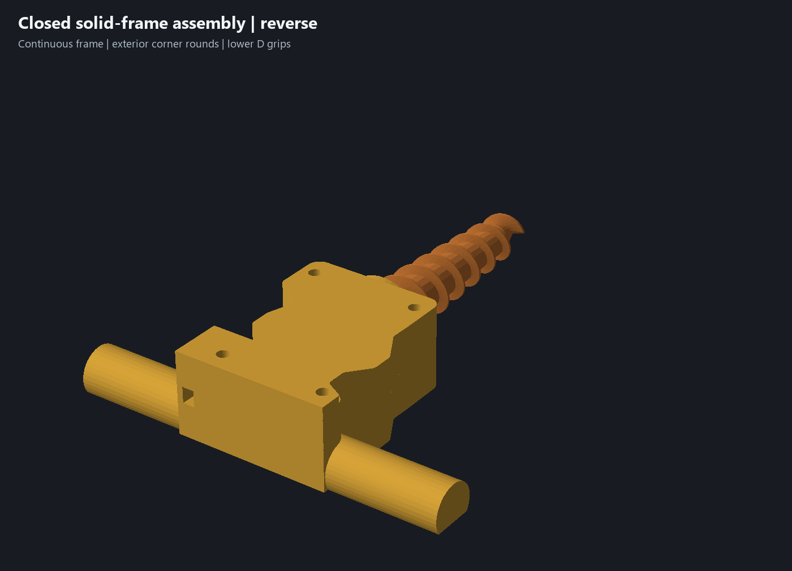
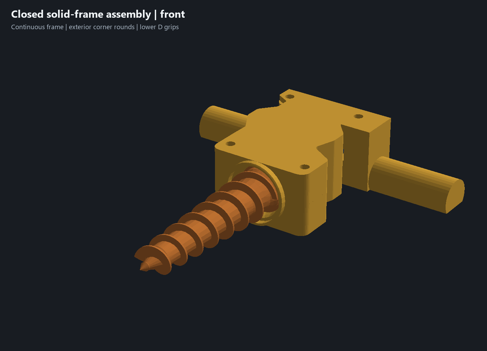

# Continuous frame, exterior rounds — 18 October 2026

The owner rejected the paired curved recesses visible when the housing closed. This revision removes all **eight cosmetic bearing/servo shoulder cuts**. Both housing sides now close into continuous walls. Rounding remains on the exterior front corners, the blended outside profile and the D grips.

The [preceding D-grip view](../renders/d-grip/closed-reverse.png) records the rejected recesses. They were material-removal cuts at the seam, not required component clearances. Removing them restores approximately **3,960 mm³ per half** without changing either part's overall bounds or flat bed contact. Exterior R6 front-corner fillets were rebuilt after suppressing the cuts so they reference the corrected geometry.

## Retained geometry and validation

Both complete D grips remain on the lower housing: **24 mm rounded width, 18.6 mm height, 20.04 mm flat land, 55 mm clear length each side and 187 mm overall span**. The upper remains a central cover. The [existing comfort sample](../print-parts/grip-comfort-sample.stl) is unchanged; 24 mm remains a starting size requiring an actual hand check.

The four Ø4/Ø4.3 case locators, four M3×18 screw stacks and insert pilots, rear cable route, servo locating nest, bushing seat and drive dimensions remain. All original feature definitions and appearances are retained; only the cosmetic-cut history entries and superseded front fillets are suppressed, followed by new exterior front fillets. Non-housing native meshes are identical to the preceding CAD. The cable outlet and necessary fastener/drive openings remain functional openings.

[Native geometry evidence](../solid-frame-geometry-review.json) verifies closed connected housing solids, unchanged bounds/bed contact, restored stock, identical preceding feature definitions, unchanged component meshes and no nominal assembly interference. [Functional validation](../solid-frame-validation.json) repeats six retained section probes, 20 clear/blocked locator controls, five closure positions, four driver approaches, four bushing-capture controls, 24 auger rotation/end-float samples, nine coupled assembly poses and three continuous cable sweeps. All pass. The caliper authority remains 27 mm rear case and 38 mm main case; no new hardware measurements or shaft offsets are inferred.

These are nominal sampled checks. Manufactured fit, hand comfort, clamped stiffness/root strength, loaded torque, actual shaft engagement, usable screw threads and dirty use remain physical acceptance items in [issue #5](https://github.com/jeffglousher/garden-auger-technic/issues/5) and [issue #3](https://github.com/jeffglousher/garden-auger-technic/issues/3).

## Complete printable project

Use [garden-auger-solid-frame-assembly.3mf](../garden-auger-solid-frame-assembly.3mf), [matching CAD](../experiments/garden-auger-solid-frame.limo) and [individual STLs](../print-parts/solid-frame-assembly/). Both revised housing pieces must be used together. The [print verification](../solid-frame-print-verification.json) records final hashes, native slicing, actual object order, temperature behavior, settings and preserved preceding/user files.

The native estimate is **8 h 44 min / 233.4 g**, plus any bed-cooling wait. Both plates retain the preceding **print by object** layout and saved clearance limits. Plate 1 contains the two housing pieces on their continuous flat bases, with 62.4 mm X separation. Plate 2 finishes PETG auger, PETG adapter, then PLA bushing, with 126.0 mm separation from the tall rear auger to short front objects and a wait for the saved 55 C bed temperature before the bushing. Keep this order and the supplied Textured PEI profile when reslicing. Physical execution of the temperature transition remains untested. The editable project contains no embedded G-code; no printer command was sent.

CAD design colors remain yellow PETG housing, orange PETG auger, gray PETG adapter and teal PLA bushing. Saved filament profiles, per-object strength/support settings and the owner's modified sparse upper project are preserved. Earlier complete projects remain historical evidence.

Reproduce with the existing offline Python environment containing numpy, trimesh, manifold3d and pillow: `scripts/build_solid_frame.py`, `scripts/check_d_grips.py --solid-frame`, then `scripts/package_refined_assembly.py --solid-frame`. The installed native CAD and Bambu Studio provide geometry/slicing checks. The existing project-owned build sublane has a 100 MiB additional-output budget; preserve compressed evidence while this revision is current or needed to reproduce the review.
