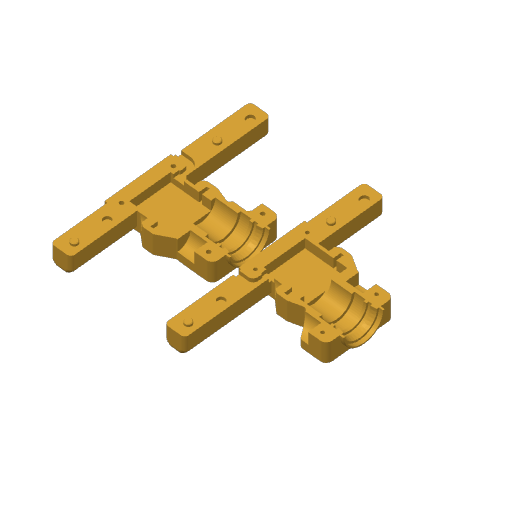
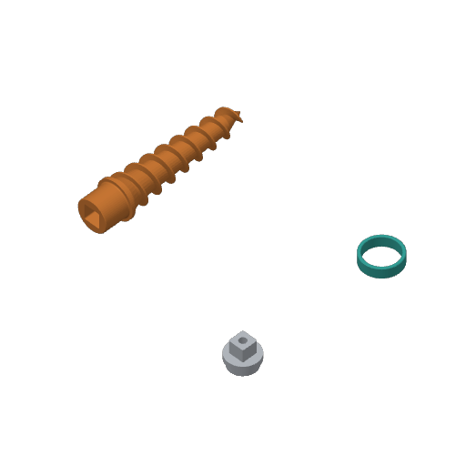
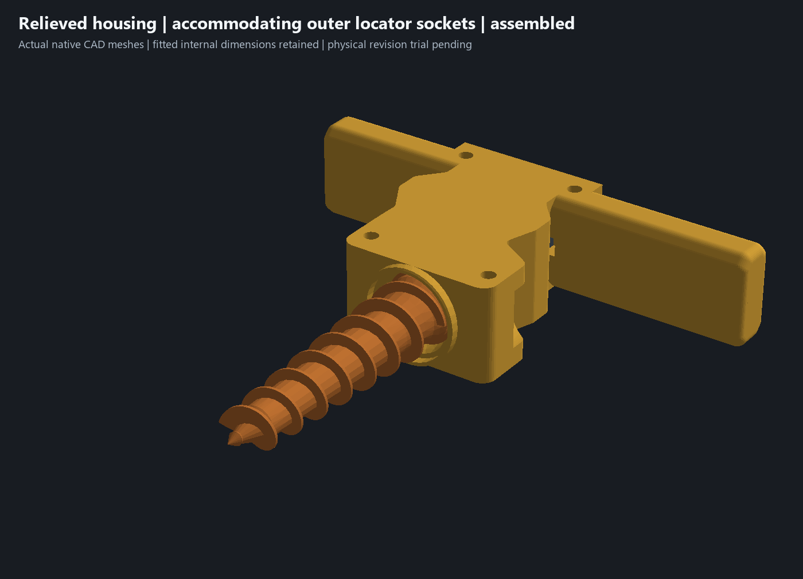
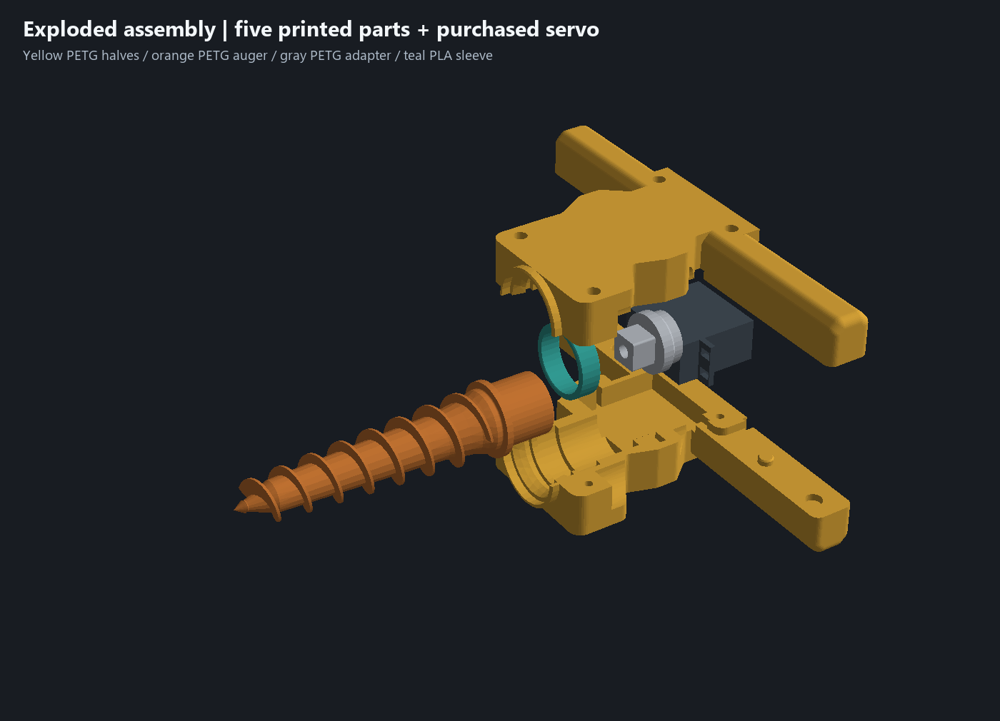

# Two plates and all three geometry reviews - 18 October 2026

**Historical iteration:** the [lower D-grip revision](child-d-grip-review.md) supersedes this housing and plate layout. The files below preserve the preceding geometry and its validation.

Use [garden-auger-two-plate-assembly.3mf](../garden-auger-two-plate-assembly.3mf) for the entire current printable candidate. It contains five parts from [the relieved-housing CAD](../experiments/garden-auger-relieved-housing.limo). Both native Bambu slices pass without warnings. The earlier [four-plate package](../garden-auger-current-assembly.3mf) remains an unchanged fallback for the preceding housing geometry.

## Plate layout and actual print order

- **Plate 1: matching housing halves, by layer.** Approximately 6 h 53 min / 212.1 g including PETG, PLA interfaces and purge. Parallel and staggered opposite-facing by-object trials both failed the native collision check. The delivered layout retains the previously qualified housing positions, supports and tower. Clearance limits were not reduced.
- **Plate 2: auger, adapter and bushing, by object.** Approximately 3 h 6 min / 60.0 g including supports and purge. The emitted G-code completes the orange PETG auger, then the gray PETG adapter, then the teal PLA bushing. The auger is flat, rotated within the bed plane, at the rear. Its approximately 34 mm height exceeds the saved 32.8 mm rod-clearance height, so the layout also gives it 126.0 mm of Y separation from the short front parts, exceeding the saved 33 mm rod distance. Actual toolpaths and their object order were checked; build-list order alone was insufficient.

The combined native estimate is **about 10 hours / 272.0 g**, approximately **36 minutes and 12.1 g less** than the prior four-plate package. Bed cooling before the final PLA part may add time beyond the slicer estimate. The PLA interface support paths remain on both PETG plates. Native by-object slicing emits no prime tower on plate 2; plate 1 retains its tower.

The saved PETG bed temperature is 70 C and the PLA profile uses 55 C. The new package uses Bambu's `by_first_filament` bed-temperature policy and a small, explicit **before-next-object** G-code block: on object index 2, `M190 S55` requests a wait for the saved PLA temperature before the final bushing. The emitted wait precedes all final-bushing toolpaths, with no later reheating to PETG temperature. Its physical execution is not yet tested. Existing printer startup/end G-code, filament profiles, colors and per-object strength/support overrides remain unchanged. The editable delivered project contains no embedded G-code; this transition is a process setting that is applied when slicing. Keep the supplied object order when reslicing; changing the order requires updating the final-object temperature block. Use the saved Textured PEI bed/profile assumptions and confirm the physical filament mapping before printing. Bambu's own [bed-temperature policy](https://github.com/bambulab/BambuStudio/blob/master/src/libslic3r/PrintConfig.cpp) distinguishes the first-filament and highest-temperature policies; the related mixed-material issue is already tracked upstream in [BambuStudio #9072](https://github.com/bambulab/BambuStudio/issues/9072).

## Housing shape and material reduction

Eight existing exterior shoulder-relief profiles change from R9.5 to R12.5. This removes approximately **1.52 cm3 / 0.545%** of the two housing solids. The stronger six-wall/30% gyroid slice saves only **about 0.23 g** on the housing plate; most total print savings come from combining plates. The geometry saving is modest and is not presented as a major weight improvement.

The servo nest, continuous outer bed faces, rear cable cut, thrust stops, auger entrance and deflector remain. Six native section probes through the ear nest, servo floor, rear wall, square socket, adapter seat and bushing have unchanged material spans. A mesh subtraction screens for added stock; less than 0.05 mm3 per half is curved-boundary tessellation residue. Both housings remain single closed connected solids. These checks do not establish a global minimum wall thickness or loaded stiffness.

## Bushing, shaft and adapter fit

The complete servo-reference, auger, adapter and bushing meshes remain identical to the preceding candidate. The verified interfaces remain:

- 28.00 mm journal in the 28.60 mm bushing bore: 0.60 mm diametral room.
- 34.00 mm bushing outside in the 35.60 mm seat: 1.60 mm diametral room.
- 9.80 mm bushing in the 10.90 mm seat, centered with 0.55 mm at each end; both end lead-ins retained.
- 14.00 mm square peg in the 14.40 mm square socket; existing corner geometry retained.
- Servo ears retain 3.00 mm axial slots, 56.40 mm outer capture, 20.40 mm capture width and 28.35 mm rear stop-to-wall spacing. The 27 mm rear reading and 38 mm case length remain the owner's caliper measurements; drawing dimensions remain drawing references.

Five closure samples, four clear/blocked bushing-capture controls, 24 auger rotation/end-float samples and nine coupled assembly poses pass again. These are sampled nominal checks, not a full tolerance/contact certification. Actual shaft engagement, usable servo-center-screw thread depth, loaded torque and bushing wear remain unconfirmed by physical measurement.

## Assembly, locators and screw access

The inner locators at X -55 and +55 keep their 7.00 mm pins and 7.30 mm round sockets. The outer sockets at X -88 and +88 gain **0.40 mm extra room at each X end**, making their straight sections **8.10 mm along X by 7.30 mm along Y**, with the existing 3.20 mm depth. All four pin centers, alternating ownership, 2.80 mm projection and pin lead-ins are retained. This gives the secondary locator on each handle room along the handle while retaining transverse guidance. It does not establish that the previous printed pattern was faulty.

Independent native 7.00 mm straight-pin controls clear at +/-0.50 mm along X and block at +0.56 mm. They clear at +0.14 mm across Y and block at +0.16 mm. Ten controls cover both relieved sockets. This is additional local accommodation; the complete housing pair is still located by the unchanged round locators and other assembly geometry.

All four identical M3 x 18 screw stacks retain 6.20 mm head pockets, head seats at Z14, exterior Z20.6 and lower insert pilots from Z -6.7 to 0. With the nominal 3 mm cap-head height, heads remain recessed 3.6 mm and nominal insert penetration remains 4.0 mm. Four native **4.50 mm diameter straight driver envelopes** from the nominal head tops to Z60 clear the housing. Actual purchased hardware, installed usable threads and tightened clamping still need the printed trial.

## Evidence and physical acceptance

[Geometry evidence](../geometry-refinement-review.json) and [two-plate package evidence](../two-plate-assembly-verification.json) bind the CAD, native engine, package, sliced archive and [five individual STLs](../print-parts/relieved-assembly/) by SHA-256. The final meshes match the native export, the object processes are retained, all 15 nominal assembly pairs clear, and the package has two warning-free native slices. The native slicer is Bambu Studio 02.08.02.61. Support/prime roles, actual object order, Y separation and the PLA-temperature wait are checked in the emitted toolpaths.

Use both new halves together. After support removal, check seam closure, all four locators, screw/insert seating, rear cable clearance and free auger rotation. Then test under load and in dirt. Physical acceptance remains in [issue #5](https://github.com/jeffglousher/garden-auger-technic/issues/5), and the dirty trial in [issue #3](https://github.com/jeffglousher/garden-auger-technic/issues/3). **No printer command was sent.**

Rebuild geometry with `scripts/refine_geometry.py`, then package with `scripts/package_refined_assembly.py`, using the existing uv Python 3.14 environment with numpy, trimesh, manifold3d and pillow. `scripts/combine_current_plates.py` also preserves the layout probes. Each native run uses a fresh named output directory to avoid stale results and overwrite prompts. Generated evidence reuses the garden-auger-owned `.build/clamshell-detail/current-assembly` lane (an existing junction into `D:/CodexTemp/garden-auger-technic/build`), with a 150 MiB additional-output budget for this revision. Retain compressed native evidence until physical review/recovery coverage and active consumers settle; remove only byte-verified standalone G-code duplicates. User Bambu edits and historical models are preserved.
