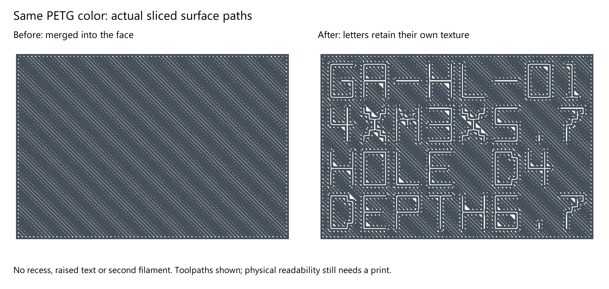

# Limo CAD to a locally reinforced print

## Demonstration

Open `garden-auger.limo` in [Limo CAD](https://github.com/limo-cad/Limo-CAD), then recall **Complete assembly**. Its 82 named features describe the servo reference, housing envelope, D grips, cavities, fasteners, drive, locators, rotating shield and flush lettering profiles. The two engraving cuts were removed after physical feedback. Repository images render the native geometry with the manufacturing color masks; they are not screenshots claiming a particular application UI state.

The `.limo` model owns fitted solid geometry and the two named lettering sketches. `print/garden-auger.3mf` contains the saved printer, materials, support settings, two-plate placement, nine reinforcement regions and two color-only lettering masks. STLs preserve only the five solid part meshes.

The model also saves **Exploded assembly**, **Inside the housing**, **Lower housing labels** and **Upper housing labels** views. Limo resolves their component offsets and cameras without changing the mechanical assembly. The gallery uses those native meshes and resolved poses; the turntable, rotating-drive explosion GIFs and part callouts are rendered and encoded externally. They illustrate the parts rather than defining an assembly motion constraint. Plate previews and time/material estimates come directly from the saved Bambu project. Asset hashes and source details are recorded in `validation.json`.

## Rebuild the tools and images

Install stable Rust (1.89 or newer), Limo CAD and Bambu Studio. No Python environment is needed. Run these commands from the repository root:

```powershell
cargo test --workspace --locked
cargo xtask verify-model
cargo xtask build-print --output .build/rebuilt.3mf
cargo xtask build-print --slicer "C:/Program Files/Bambu Studio/bambu-studio.exe" --output .build/sliced.3mf
cargo xtask build-print --single-color-lettering --slicer "C:/Program Files/Bambu Studio/bambu-studio.exe" --output print/garden-auger-single-color.3mf
cargo xtask gallery --output .build/gallery-preview
cargo xtask coupons --slicer "C:/Program Files/Bambu Studio/bambu-studio.exe"
cargo xtask lettering-coupons --slicer "C:/Program Files/Bambu Studio/bambu-studio.exe"
```

`build-print` defaults to replacing `print/garden-auger.3mf` only after a successful rebuild. Use `--output` to keep a separate candidate. Slicing is local and sends no printer commands. It preserves the five normal-part mesh files, replaces the nine reinforcement regions, rebuilds the two lettering masks from the current CAD sketches, and removes cached slice data. A failed native slice leaves the destination untouched and keeps the temporary evidence for inspection.

The model uses the current Limo CAD project identity. Validation checks that identity, and print rebuilds set the printer job title to **Garden auger**.

The rebuild preserves namespaced component paths and UUIDs, including files with multiple prefixes for the same namespace. Core model elements are written in Bambu's accepted default-namespace form. Both prefixed-core input and a production namespace declared as default plus prefix were rebuilt and sliced locally.

`verify-model` and `gallery` start a private headless CAD process. They accept `--executable`, or `LIMO_CAD_EXE`; Windows defaults to the installed Limo CAD path. The gallery reads the current model, saved poses and saved print previews; it does not depend on archived images or a live desktop session. It renders the two 48-frame loops, exploded callouts, native engraving closeups, both plate estimates and an annotated locator layout. That layout uses the native upper mating-face mesh and source sketch dimensions. Without `--output`, it refreshes the gallery images in `docs/images`. `--font` selects a TrueType font; the defaults are Segoe UI on Windows and DejaVu Sans on Linux. Check the generated `manifest.json` under `.build/gallery-rust` and update the published image hashes in `validation.json` when publishing new images.

All commands support `--help`. Evidence stays under ignored `.build` directories. The Cargo lockfile pins tool dependencies; `cargo xtask` uses `--locked` automatically.

For a small physical trial, use the [fit and lettering coupons](coupons.md). They copy the current locating profiles and compare single-color with contrasting PETG flush lettering on one plate.

The [larger lettering coupons](lettering-coupons.md) compare 7 and 8 mm heavy curved type with wider spacing. They have separate AMS and single-color projects and an actual native surface-path preview. Their text is a trial; production housing lettering stays unchanged pending the printed choice.

The full assembly and lettering coupons use five solid top layers (1.2 mm at 0.24 mm), normal top-surface flow and ironing off. This follows Bambu's recommended 4–6-layer range. Printed PETG gaps still require flow calibration and a physical check; no calibration value is inferred from a slice. See the [surface notes](lettering-coupons.md#surface-settings).

## Flush lettering

`print/lettering.json` selects the two native lettering sketches, a 0.72 mm material depth and PETG filament3 for contrast. The Rust rebuild follows the sketches' closed 0.8 mm stencil grid, preserving letter counters, and makes closed color masks ending exactly at the pocket floors. It checks that every mask vertex sits in its solid parent, with the exposed face on the floor. These regions set only `extruder`; they add no plastic outside the housing and carry no strength or adhesion overrides.

Use `--single-color-lettering` for the single-color version, or set `filament` to1 in `print/lettering.json`. A plain same-color assignment was merged away by Bambu on the first coupon. The revised mask also sets `top_surface_pattern` to `concentric`, so its letter boundaries survive as distinct surface paths. The surrounding face keeps its global pattern. There is no geometric recess or raised text; nominal surface height, layer count and wall settings stay unchanged. Texture has less contrast than a second color and still needs a physical readability check.



The saved model has flat floors and named sketch profiles; color and surface-texture assignment happen in the manufacturing project. The gallery overlays the contrasting manufacturing masks. This does not claim a Limo CAD face-painting feature. Bambu's [region configuration](https://github.com/bambulab/BambuStudio/blob/master/src/libslic3r/PrintConfig.hpp) supports the local top-surface pattern; the installed native slicer was used to check the actual resulting paths.

## Local reinforcement

`print/reinforcement.json` names nine annular regions and records their dimensions in CAD body-definition coordinates. Four lower rings surround the insert anchors; four upper rings follow the opposing screw load paths; one ring reinforces the adapter hub and screw seat. They request 100% zig-zag infill. All parts keep the global three walls, with 15% grid elsewhere. The rebuild rejects local wall, surface and adhesion overrides.

The housing rings are diameter9 mm outside /5.2 mm inside, with heights of 7.8 mm below the seam and 12.8 mm above it. The adapter ring is diameter18 mm outside /8 mm inside and 10.1 mm high. These regions occupy 73% less volume than the original cylinders. They clear the seam, screw bores, counterbores and outer chamfers; none protrudes. Every rebuild checks complete modifier/part mesh boundaries for at least 0.4 mm separation and rejects regions outside the part or enclosing a void.

Supports are off globally, with one named object exception for the horizontal auger. The housing screw-head recesses bridge without automatic support feet. Brims, skirts and rafts are disabled. The auger support exception changes no strength settings.

`cargo xtask build-print` rebuilds the named Bambu `modifier_part` volumes without altering the normal-part meshes. It translates each CAD-frame region into the centered manufacturing mesh frame. Existing component/plate transforms position each region with its parent. There are nine strength regions and two color-only masks; none adds a separate printed object.

Open the 3MF in Bambu Studio and expand the housings or adapter in the Objects list to inspect named modifier regions and their local infill settings. Global edits affect the baseline; explicit local regions retain their overrides. To change this scripted example reproducibly, edit `reinforcement.json`, run `cargo xtask build-print`, then slice again. Building without `--slicer` invalidates cached slice statistics/previews and makes no new print-time claim.

Use `build-print --no-reinforcement --output .build/baseline.3mf --slicer "C:/Program Files/Bambu Studio/bambu-studio.exe"` for an unreinforced comparison with the same parts, lettering, placement and global process. The original five-wall zones generated additional contours; reinforcement now changes infill only. Automatic tree supports had also created wide feet under the upper housing's screw recesses, including in the unreinforced baseline. Comparing ordinary brim paths alone missed those support bases. Inspect the first layer and the flush lettering in the sliced result before printing.

With `--slicer`, the command uses a temporary copy, verifies both plates, modifier readback and the named support exception, checks actual object order and the PLA bed-temperature wait, refreshes previews/statistics and retains evidence under ignored `.build/print`. Its complete G-code feature audit rejects every brim, skirt or raft, rejects support under any part except the auger, and requires the auger's supports to remain. It checks paths outside object blocks too. The published 3MF contains no G-code and the command never contacts a printer. Native toolpath inspection confirms increased infill extrusion inside all nine smaller rings against the unreinforced baseline. Physical strength and the housing recess bridges remain print checks.

## Existing Limo capabilities and remaining qualification

The installed engine's focused MCP operations include `print_intent_get`, `print_modifier_create`, `print_modifier_update`, `print_modifier_remove`, `print_modifier_copy`, `print_modifier_reset` and `print_modifier_effective`. They also appear in `cad_interface` under `document/print-intent`. Tool focus can hide them from the initial `tools/list`; that does not mean they are missing. Read operations were exercised in this session. Mutations require a current `expected_model_json` snapshot and stable body attachment.

Closed [modifier feature request #314](https://github.com/limo-cad/Limo-CAD/issues/314) covers primitive zones, shared engine/MCP behavior and Bevy controls. Open [handoff acceptance #316](https://github.com/limo-cad/Limo-CAD/issues/316) owns remaining visible/native qualification. This repository implements no CAD application feature and claims no completion of that application acceptance. The saved auger `.limo` intentionally has empty print intent, accurately demonstrating the verified external workflow.

The existing typed operations are callable through MCP/stdio, including from an external script. This repository's Rust xtask is the verified manufacturing path. Native Limo command-script parity and a UI create/edit/save/reopen/export walkthrough using this exact example are requested qualification; neither was exercised here.

Use this public case to qualify discoverable UI controls and named overlays, MCP/script parity, saved local intent and export of all nine zones through both print-by-object layouts. Compare actual Bambu toolpaths and distinguish CAD intent, exported metadata, native slicing and physical results. Preserve PETG-to-PLA thermal order; no built-in slicer or printer connection is required.
